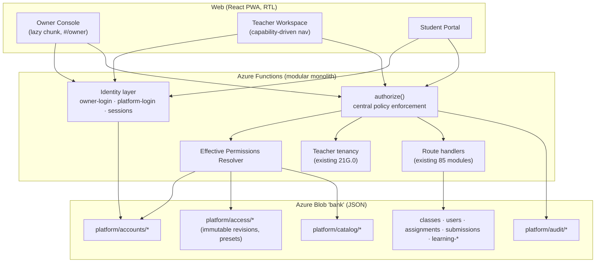
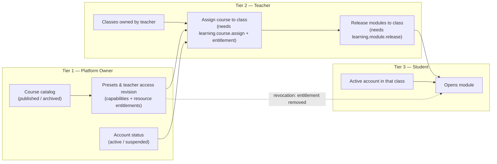
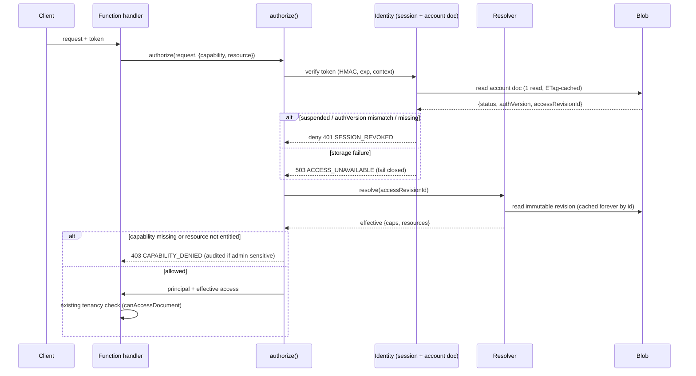
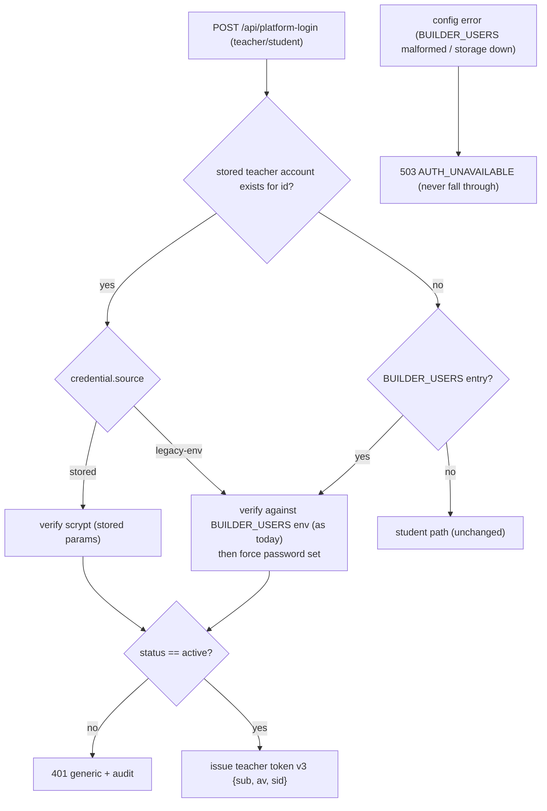
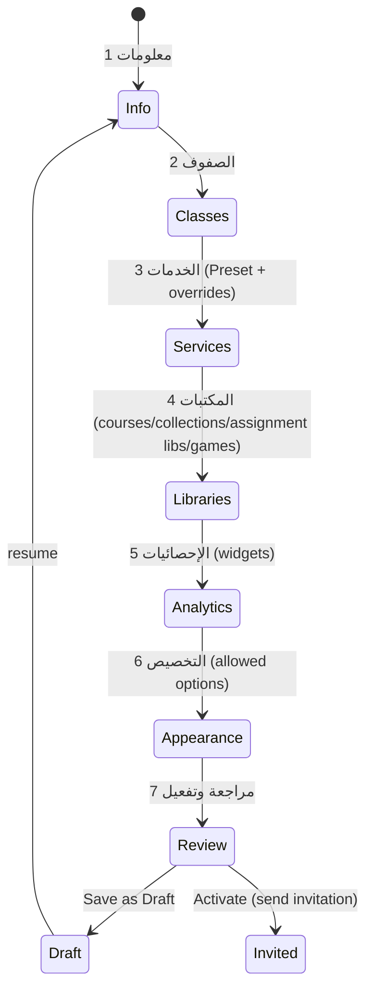
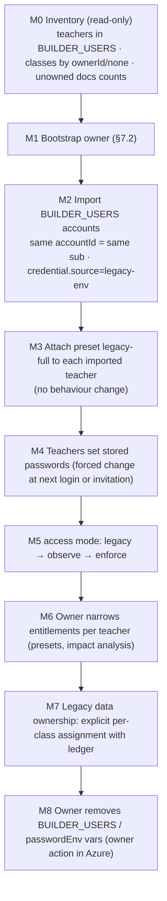
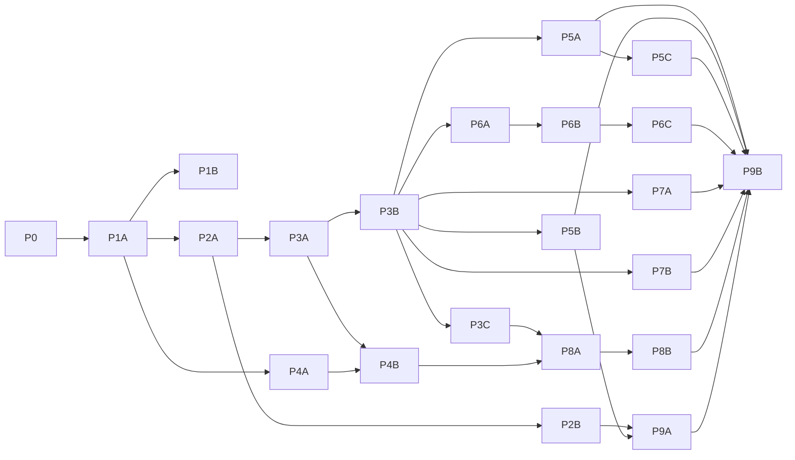

# Tadris+ Enterprise Transformation — P0: Architecture & Implementation Blueprint

**المنصة ثلاثية الطبقات: مالك المنصة (Platform Owner) / المعلم (Teacher) / الطالب (Student)**

| البند | القيمة |
|---|---|
| المرحلة | P0 — Architecture Audit + Enterprise Blueprint + Implementation Roadmap |
| نوع المرحلة | وثيقة تصميم فقط (docs-only). لا تغيير في الكود ولا في البيانات ولا في إعدادات Azure |
| Baseline | `origin/main` = `615d97ca87436a3930d03172c3462f5a8c41f8aa` (دمج PR #496) |
| الـ PRs المفتوحة وقت الفحص | لا يوجد (تم التحقق عبر GitHub API) |
| الحالة | **D1–D6 وD9 معتمدة من المالك (2026-11-01) كما أُوصي بها. بقية القرارات معلّقة حتى المرحلة التي تخصها (§19.1)** |
| الحَكَم النهائي | مالك المستودع. لا Merge تلقائي، ولا نشر، ولا تنفيذ لأي مرحلة P1+ قبل اعتماد القرارات |

> كل مرجع من نوع `file:line` في هذه الوثيقة مأخوذ من فحص فعلي للكود على الـ baseline أعلاه، وليس من الوثائق.
> عند تعارض الوثائق مع الكود اعتمدنا الكود، وأشرنا إلى الوثيقة القديمة (مثال: `README.md:152`).

---

## فهرس

1. Executive Summary
2. Current System Audit
3. Gap Analysis
4. Proposed Three-Tier Architecture
5. Role and Permission Matrix
6. Data Model
7. Authentication and Security Design
8. Owner Console UX Specification
9. Teacher Workspace UX Specification
10. Student Entitlement Rules
11. Migration and Compatibility Plan
12. Phased Roadmap
13. Risk Register
14. Testing Strategy
15. Azure Cost and Operational Impact
16. Creative Enterprise Recommendations
17. Acceptance Criteria
18. Final Architectural Recommendation
19. القرارات المعمارية المطلوب اعتمادها من المالك

---

## 1. Executive Summary

**الخلاصة في سطر:** Tadris+ اليوم منصة ناضجة وظيفيًا للمعلم والطالب، وفيها أساس جيد لعزل المعلمين (Teacher Tenancy 21G.0).
لكنها **لا تملك طبقة مالك، ولا حسابات معلمين ديناميكية، ولا نظام صلاحيات أو Entitlements**. لذلك كل معلم يستطيع اليوم:

- قراءة كل المواد التعليمية؛
- قراءة كل مكتبة الامتحانات، ومعها مفاتيح الإجابات؛
- قراءة كل بنك الأسئلة الرسمي؛
- استدعاء أدوات التشغيل الإدارية (Operator tools) التي تعيد كتابة بنك الأسئلة أو فهرس الواجبات.

**التوصية:** تطوير تدريجي فوق البنية الحالية، وليس إعادة بناء. البنية المقترحة:

1. **هوية مُدارة داخل المنصة (Managed Identity Store)** على Azure Blob JSON نفسه، بأنماط الكتابة الآمنة الموجودة اليوم:
   - CAS؛
   - Create-only reservations؛
   - Leases.
   تحل هذه الهوية محل `BUILDER_USERS` تدريجيًا، **مع الحفاظ على معرّف المعلم الحالي (`sub`) كما هو**، فلا تنقطع ملكية الصفوف والطلاب والامتحانات.
2. **مالك منصة مستقل** له:
   - سياق جلسة منفصل (HMAC context خاص)؛
   - تأسيس أول حساب برمز لمرة واحدة (One-time Bootstrap Token)، بلا كلمة مرور ثابتة؛
   - MFA إلزامي عبر TOTP.
3. **محرك صلاحيات مركزي (Effective Permissions Resolver)** يجمع ثلاث طبقات: **RBAC + Capabilities + Resource Entitlements**.
   - افتراضيًا يرفض كل شيء (Default Deny)، ويعمل على الخادم فقط.
   - تحميه "سجل قدرات" (Capability Registry) يُفحص في CI، يجبر كل مسار API على التصريح بالقدرة التي يحتاجها، على غرار سجل الـ Tenancy الموجود.
4. **إعدادات صلاحيات مُنسخة (Versioned Access Configuration)**:
   - كل تعديل من المالك ينتج Revision ثابتًا (immutable)؛
   - هذا يتيح Diff وRollback وسجل تدقيق كاملًا؛
   - ويتيح تخزينًا مؤقتًا آمنًا بلا صلاحيات قديمة (Stale permissions).
5. **Owner Console** كحزمة منفصلة (lazy chunk) تستخدم نظام التصميم نفسه، ومعها:
   - معالج إنشاء المعلم من 7 خطوات؛
   - قوالب الصلاحيات (Presets)؛
   - نسخ الإعدادات (Cloning)؛
   - معاينة الصلاحيات الفعلية قبل التفعيل.
6. **مساحة عمل معلم تتشكل من الصلاحيات** عبر `visibleNav(capabilities)`، مع حماية الروابط العميقة. الواجهة **ليست** مرجعًا أمنيًا؛ الخادم هو المرجع.
7. **لا قاعدة بيانات جديدة ولا Microservices الآن.** Azure Table/SQL أو خدمة هوية خارجية خيارات مستقبلية مدروسة التكلفة (§15).

**حجم العمل:** 10 مراحل رئيسية (P0–P9)، مقسمة إلى 19 مرحلة فرعية. كل مرحلة فرعية PR مستقل وفق `AGENTS.md`.
الترتيب يبدأ بالأمان والهوية (P1–P2)، ثم المحرك (P3)، ثم الواجهات والمحتوى.

---

## 2. Current System Audit

### 2.1 البنية العامة (كما هي فعليًا)

| الطبقة | التقنية | ملاحظات من الفحص |
|---|---|---|
| Web | React 19 + TS + Vite، PWA، RTL، Light/Dark | **لا يوجد Router**. `App.tsx:555` يختار الواجهة من دور الجلسة. المسار الوحيد بالرابط هو `#/learning…` (`src/learning/learningRoute.ts`) |
| API | Azure Functions v4، Node 22، CJS | 85 وحدة في `api/src/functions/` |
| التخزين | Azure Blob، حاوية `bank` (+ `assets`, `raw`) | JSON documents. CAS عبر `mutateJsonWithRetry` (`platform-storage.js:117`، 5 محاولات ثم 503) |
| Runner | `runner/` | خارج نطاق هذا التحول، ولا يُمس |

### 2.2 الهوية والجلسات

**المعلم**

- **مصدر الحسابات:** متغير البيئة `BUILDER_USERS` فقط، بالصيغة `{"users":{"<id>":{"passwordEnv":"ENV","displayName":"…"}}}` (`builder-users.js:3`)، بحد أقصى 200 حساب (`:19`).
- **كلمة المرور:** قيمة نصية صريحة (plaintext) في متغير بيئة. **لا يوجد Hashing** (`builder-users.js:77`، `builder-auth.js:256`).
- **المقارنة** Timing-safe، لكنها تعود مبكرًا عند اختلاف الطول (`builder-auth.js:44-51`).
- **الوضع القديم (Legacy):** عند غياب `BUILDER_USERS` تعمل المنصة بكلمة مرور واحدة. إذا لم يُضبط `BUILDER_USER_CODE` يُقبل **أي رمز مستخدم يكتبه الشخص** ويصبح `sub` (`builder-auth.js:131, 275-278`).
- **التوكن:** HMAC-SHA256، بالـ claims `{ver:2, role:"teacher", sub, am, iat, exp, sv}`، وصلاحيته 8 ساعات بلا Refresh (`builder-auth.js:5, 134-142`).
- **الإبطال (Revocation):** عام فقط، عبر `BUILDER_SESSION_VERSION` (يخرج كل المعلمين معًا)، أو بحذف الحساب من `BUILDER_USERS`. **لا إبطال لكل معلم وحده.**
- **تسجيل الخروج:** في المتصفح فقط (`App.tsx:1279-1298`). لا يوجد API للخروج.
- **إعدادات تالفة:** عند تلف `BUILDER_USERS` يعيد `/api/platform-login` خطأ 401 عامًا يشبه "كلمة مرور خاطئة"، بدل 503 (`builder-auth.js:254`، `platform-login.js:92-100`).

**الطالب** (أفضل حالًا وقابل لإعادة الاستخدام)

- **الحساب:** `platform/users/<uuid>.json`، ووثيقة اعتماد منفصلة `platform/auth/<sha256(code)>.json` تُكتب Create-only.
- **Hashing:** scrypt بملح 16 بايت ومفتاح 64 بايت (`student-auth.js:51-67`).
- **الإبطال:** عبر `authVersion`. الدالة `requireActiveStudentSession` تعيد قراءة وثيقة الطالب في كل طلب (`student-auth.js:209-222`).

**الحماية من التخمين** (`login-throttle.js`)

- 5 محاولات لكل (معرّف + IP)، و20 لكل معرّف عالميًا.
- عنوان IP يُقرأ من أول قيمة في `x-forwarded-for`، وهي قابلة للتزوير.
- الحد العالمي لكل معرّف يتيح **قفل حساب أي معلم أو مالك عمدًا (Lockout DoS)**.

**التدقيق** (`audit-log.js`)

- كل حدث في Blob مستقل.
- أحداث تسجيل الدخول **غير مُدققة**.
- القارئ `audit-history.js:20` محدود بآخر 100 حدث.
- في الوضع متعدد المعلمين يفلتر حسب `actor`.

### 2.3 الأدوار والصلاحيات

- **لا يوجد دور Owner أو Admin** في أي مكان، لا في الخادم ولا في الواجهة. دور توكن المعلم ثابت `"teacher"` (`builder-auth.js:136`).
- **الآلية الوحيدة للقدرات اليوم** هي `GOVERNANCE_CAPABILITIES`: author/review/approve/publish (`exam-governance-capabilities.js`).
  - المحلل (parser) جيد ويفشل بإغلاق (fail-closed).
  - لكنه مربوط بـ `sub`، وفي الوضع القديم يمكن انتحال `sub` بكتابته.
- **لا توجد أي Feature Flags أو Entitlements**، لا لكل معلم ولا لكل صف.

### 2.4 سطح الـ API

فحصنا 85 وحدة. أهم النتائج:

| الفئة | النتيجة | الدليل |
|---|---|---|
| مسارات الصفوف والطلاب والواجبات والتقارير والرسائل (classScoped) | معزولة بالمعلم عبر `tenantOf` و`canAccessDocument` **في الوضع متعدد المعلمين فقط** | `teacher-tenancy.js:14-35` |
| المواد التعليمية للمعلم | **أي معلم يقرأ كل المقررات وكل نصوص الوحدات** | `learning-content.js:32-34` (تجاوز كامل للبوابة عند وجود توكن معلم)، `learning-materials-catalog.js:15` |
| learning-study / training / exam-item للمعلم | الشيء نفسه | `learning-study.js:59`، `learning-exam-item.js:49`، `learning-training.js:92` |
| Exam Library | **أي معلم يقرأ كل العناصر مع مفاتيح الإجابة** | `exam-library.js:25-36`، `exam-library-store.js:65-73` |
| بنك الأسئلة الرسمي | مرئي لكل المعلمين | `bank-tenancy.js:8-17` |
| أدوات التشغيل (7 مسارات) | **أي معلم مسجل يستدعيها** | `assignment-index-control.js:26`، `build-bank-2025.js`، `classify-bank-batch.js`، `classify-question-preview.js`، `import-html-exam.js`، `inspect-html.js`، `storage-status.js:12` |
| إنشاء الواجب | يُنسخ `examSnapshot` من جسم الطلب كما أرسله العميل. الاستثناء الوحيد هو الامتحان الخاضع للحوكمة | `manage-assignments.js:85-91` |
| النسخ المنشورة من الامتحانات الخاضعة للحوكمة | تُحل بلا فحص ملكية | `exam-governance.js:685-691` |
| الصور التعليمية | 32 صورة PNG في `public/learning-assets/791381s/` و44 في `public/exam-library/assets/`، **عامة بلا مصادقة** | `public/staticwebapp.config.json:13-15` |
| لعبة تحويل الأعداد للطالب | لا فحص للصف | `game-number-conversion.js` |
| نصوص الوحدات في الحزمة | **محمية**: لا تُشحن في الـ bundle، والـ build يفشل لو شُحنت | `scripts/check-bundle-budget.mjs:174, 233-236` |
| فهرس العناوين (manifest) | عام: عناوين الوحدات والصفحات فقط | `check-bundle-budget.mjs:179-181` |

**سجل الـ Tenancy** `api/tests/tenancy-registry-21g0.test.js` يصنف كل مسار معلم إلى:

- classScoped
- teacherOwned
- sharedByDesign
- operator
- noData

ويفشل CI عند إضافة مسار بلا تصنيف. **هذا هو النمط الذي سنعمّمه للقدرات.**

### 2.5 الواجهة

**الملاحة**

- ملاحة المعلم مصفوفات ثابتة في `src/shell/teacherNav.ts`: `PRIMARY_NAV`, `EXAM_BANK_NAV`, `FOOTER_NAV`.
- ربط الصفحات يتم بسلاسل `if`:
  - التنقل في `App.tsx:750-767`؛
  - عرض الصفحة في `App.tsx:5884-5975`.
- البحث السريع يعرض **كل** الأيقونات (`TeacherAppShell.tsx:142`).

**بوابة الطالب**

- ترتيب الأقسام ثابت (`StudentPortal.tsx:453-482`).
- البيانات تأتي من الخادم.

**المظهر**

- Light/Dark فقط، ويُحفظ محليًا على الجهاز (`themePreference.ts`).
- لا كثافة عرض (density)، ولا تفضيلات مرتبطة بالحساب.

**مكونات مفقودة**

- Table: 54 ملفًا تكتب `<table>` يدويًا.
- Tabs.
- Switch.
- Stepper: موجود فقط داخل `src/studio`.

**قيود يجب احترامها**

- ميزانية الحزمة الأولية: 125 KB gzip.
- بوابة المقارنة البصرية (`ux-visual-gate`): أي تغيير بكسل يجب تصريحه في `docs/ux-r/visual-changes.json`. **إضافة أو حذف عنصر من الشريط الجانبي يغيّر كل لقطات المعلم.**
- حراس نظام التصميم (Design-system guards):
  - R18b/c: كل لون فاتح يحتاج قاعدة Dark من الـ tokens؛
  - R17c: كل `var()` معرّف ومستخدم؛
  - tokensV2: التباين بمستوى AA.

### 2.6 التخزين والتوسع

**الوثائق الرئيسية**

| الوثيقة | المسار | ملاحظة |
|---|---|---|
| الصف | `platform/classes/<id>.json` | فيه `ownerId` |
| الطالب | `platform/users/<uuid>.json` | فيه `ownerId` منسوخ من الصف |
| الواجب | `platform/assignments/<id>.json` | **بلا `ownerId`**، وفيه `createdBy`، والملكية تُستنتج من الصف |
| التسليم | `platform/submissions/<assignmentId>/<studentId>.json` | |
| تقدم التعلم | `platform/learning-*/<studentId>.json` | |
| ملف المعلم | `platform/teacher-profiles/<enc(sub)>.json` | |

**التوسع**

- **18 موضعًا يمسح بادئة كاملة** (كل الصفوف أو الطلاب أو الواجبات)، ثم يفلتر في الذاكرة. أمثلة:
  - `manage-classrooms.js:84-121`
  - `manage-students.js:163`
  - `reports.js:39`
- كلفة كل طلب تكبر مع **مجموع بيانات كل المعلمين**، لا مع بيانات المعلم وحده. هذا عائق أساسي أمام "مئات المعلمين".

**بيانات قديمة وقيود موثقة**

- البيانات السابقة لـ 21G.0 بلا `ownerId`، وتُنسب إلى `LEGACY_DATA_OWNER` إن ضُبط، وإلا تبقى مشتركة.
- `AGENTS.md:32`: "No database migrations exist; do not invent one".
- `README.md:152` قديم: ما زال يقول "Single-teacher model".

### 2.7 المراقبة

- `withObservability` يضيف X-Request-ID وسجلات JSON مُنقّحة.
- لا يوجد SDK لـ Application Insights؛ يجمع الـ host مخرجات stdout فقط.
- النسخ الاحتياطي يعتمد على soft delete وversioning وPITR في Azure (`docs/operations-backup-restore.md`).

---

## 3. Gap Analysis

### 3.1 موجود وقابل لإعادة الاستخدام (Existing & Reusable)

| المكوّن | الموضع | سيُستخدم في |
|---|---|---|
| مخطط توكن HMAC v2 مع اشتقاق مفتاح لكل دور | `builder-auth.js:54-65` | سياق جلسة المالك، وتوكن المعلم v3 |
| scrypt `hashPassword` / `verifyPassword` | `student-auth.js:51-67` | كلمات مرور المعلم والمالك (بمعاملات أقوى ومخزّنة) |
| نمط `authVersion` لإبطال الجلسات | الطالب | إبطال جلسات كل معلم وحده |
| `withCredentialLock` (Blob lease) | `student-credential-lock.js` | تغيير كلمة المرور وMFA |
| Create-only reservation | `platform/auth/<hash>.json` | حجز أسماء المستخدمين، و"تأسيس المالك مرة واحدة" |
| `mutateJsonWithRetry` / `uploadJsonConditional` | `platform-storage.js` | كل وثائق الحسابات والصلاحيات |
| `login-throttle` | | يُحسَّن (§7.7) ثم يُستخدم للمالك |
| `recordAuditEvent` + `audit-redact` | | تدقيق الإدارة والدخول |
| Tenancy helpers + سجل الـ Tenancy | `teacher-tenancy.js`، `tenancy-registry-21g0.test.js` | يبقى طبقة العزل، ويُضاف فوقه سجل القدرات |
| محلل قدرات يفشل بإغلاق | `exam-governance-capabilities.js` | نموذج لمحلل الـ Access document |
| Default-deny لنشر الوحدات للصف | `class-learning-materials.js:80-118` | الشرط الخامس في Access Formula |
| فلترة الرسمي/غير الرسمي في البنك | `bank-tenancy.js` | Bank collections |
| `etag-doc-cache` | | تخزين مؤقت آمن للـ Revisions الثابتة |
| مكونات `src/ui` | Dialog, ConfirmDialog, Toast, Field, SubNav, KpiStrip, StatusBadge, EmptyState… | Owner Console |
| بوابة الحزمة والبوابة البصرية | | تُطبَّق على Owner Console كـ chunk مستقل |

### 3.2 موجود لكن يحتاج إعادة هيكلة (Requires Refactoring)

| المكوّن | المطلوب |
|---|---|
| `builder-users.js` / `validateBuilder` | سلسلة مصادر: الحساب المخزّن أولًا، ثم `BUILDER_USERS` كمصدر انتقالي فقط |
| `platform-login.js` | فصل المالك في endpoint خاص به. إعادة 503 عند تلف الإعدادات بدل السقوط إلى مسار الطالب |
| `platform-session.js` | يعيد `capabilities` و`accessRevision` و`accountStatus` |
| `learning-content` / `study` / `training` / `exam-item` / `catalog` | إزالة تجاوز المعلم، وتطبيق Teacher Course Entitlement |
| `exam-library.js` | فلترة حسب Entitlement، والتمييز بين preview بلا مفاتيح وview كامل |
| `manage-assignments.js` create | حل `examSnapshot` على الخادم (من امتحان يملكه المعلم أو من نسخة مكتبة)، وختم `ownerId` و`libraryRef` |
| `exam-governance.js:685` | فحص ملكية/إتاحة الـ Revision المنشور |
| `teacherNav.ts` + سلاسل `if` في App | `visibleNav(caps)` + حارس للتنقل والرابط العميق |
| `themePreference.ts` | تفضيلات مرتبطة بالحساب ومقيدة بما يسمح به المالك |
| `audit-history.js` | عرض مالك شامل، وقراءة بنطاق تاريخ (بادئة ISO) بدل "آخر 100" |
| 18 موضع مسح كامل | فهرس لكل مالك `platform/owner-index/<sub>.json` (P5-B) |
| `GOVERNANCE_CAPABILITIES` (env) | تنتقل إلى قدرات `examGovernance.*` في محرك الصلاحيات، مع إبقاء المتغير كمصدر انتقالي |

### 3.3 وظائف مفقودة (Missing)

- دور المالك وهويته وتأسيسه وMFA.
- حسابات معلمين مخزنة: دورة الحياة (Draft / Invited / Active / Suspended / Archived)، الدعوة وإعادة التعيين، الإبطال الفردي، تسجيل الخروج من الخادم.
- محرك صلاحيات: سجل قدرات، Presets، Revisions، Resolver، فرض مركزي.
- Course Catalog lifecycle، وTeacher Course Entitlements.
- Bank Collections، وExam Library entitlements.
- Ready Assignment Library بنسخ ثابتة (Versions).
- نظام Widgets للوحة التحكم بصلاحيات.
- صلاحيات الرسائل والألعاب لكل معلم.
- Appearance presets مرتبطة بالحساب.
- Owner Console كاملة.
- مكونات Table/Tabs/Switch/Stepper مشتركة.

### 3.4 مخاطر أمنية (Security Risks)

مرتبة حسب الخطورة:

| # | الخطر | الخطورة |
|---|---|---|
| S1 | أدوات التشغيل متاحة لأي معلم (إعادة كتابة بنك الأسئلة، تبديل فهرس الواجبات، سرد حاوية `raw`) | **عالية** |
| S2 | مفاتيح إجابات Exam Library مقروءة لكل معلم | **عالية** (مع تعدد المعلمين) |
| S3 | كلمات مرور المعلمين plaintext في env، بلا إبطال فردي | **عالية** |
| S4 | انتحال `sub` في الوضع القديم عند غياب `BUILDER_USER_CODE`، ومعه قدرات الحوكمة | متوسطة–عالية |
| S5 | Snapshot الواجب من العميل يتيح تجاوز أي سياسة محتوى مستقبلية | عالية (مستقبليًا) |
| S6 | الـ Revision المنشور يُحل بلا فحص ملكية (IDOR) | متوسطة |
| S7 | الصور التعليمية عامة | منخفضة–متوسطة |
| S8 | Lockout DoS، وIP قابل للتزوير | متوسطة |
| S9 | تسجيل الخروج من المتصفح فقط، والتوكن صالح 8 ساعات | متوسطة |
| S10 | لا تدقيق للدخول ولا للأعمال الإدارية | متوسطة |
| S11 | تصادم معرّف الامتحان المحفوظ يعيد 403، فيكشف وجوده | منخفضة |
| S12 | الوضع القديم يعطل العزل كليًا | عالية (إن بقي فعالًا بعد تعدد المعلمين) |

### 3.5 متطلبات التوافق مع القديم (Legacy Compatibility)

- **هوية المعلم:** معرّف `BUILDER_USERS` (`sub`) هو مفتاح `ownerId` في كل الصفوف والطلاب والامتحانات والقوالب. **يجب أن يبقى المعرّف نفسه بعد الترحيل.**
- **هوية الطالب:** `userId` (UUID)، ورمز الدخول، ورقم الهوية الفريد عالميًا، تبقى كما هي.
- **البيانات القديمة:** الوثائق بلا `ownerId` تعمل كما اليوم (`LEGACY_DATA_OWNER` أو مشتركة)، إلى أن يقرر المالك صراحة.
- **التوكنات:** توكنات v2 الحالية تبقى صالحة حتى انتهائها خلال فترة انتقالية محددة، ثم تُرفض.
- **محتوى الواجبات:** `examSnapshot` في الواجبات القائمة لا يتغير. **قواعد التصحيح لا تُمس.**
- **التطبيق:** الـ PWA والـ Service Worker (بلا تخزين مؤقت) وRTL كما هي.

### 3.6 البنية الموصى بها (ملخص)

Modular monolith داخل الـ Functions الحالية:

- طبقة هوية: `api/src/lib/identity/*`
- طبقة صلاحيات: `api/src/lib/access/*`
- فرض مركزي: `authorize()`
- سجل قدرات يُفحص في CI
- إعدادات مُنسخة على Blob JSON

التفصيل في §4.

---

## 4. Proposed Three-Tier Architecture

### 4.1 الصورة الكلية



### 4.2 تدفق الصلاحية: المالك ← المعلم ← الطالب



**القاعدة الذهبية:** كل سهم في المخطط يُفحص **على الخادم في كل طلب**.

- السحب من أعلى (المالك يسحب مادة) يقطع ما تحته فورًا، حتى لو كانت الوحدة منشورة للصف.
- البيانات التاريخية (التقدم والعلامات) لا تُحذف.

### 4.3 مسار الطلب وفرض الصلاحية



### 4.4 مبادئ التصميم

1. **طبقتان لا تُدمجان:**
   - *Tenancy* (لمن هذا الصف؟) تبقى كما هي.
   - *Capability/Entitlement* (هل يحق لهذا المعلم هذه العملية على هذا المورد؟) طبقة جديدة **فوقها**.
   - الطلب يمر من الاثنتين.
2. **القدرات لا تُكتب في التوكن.**
   - التوكن يحمل الهوية فقط: `sub`, `role`, `av`, `sid`.
   - القدرات تُقرأ من الـ Revision المرتبط بالحساب.
   - النتيجة: أي تعديل يسري من الطلب التالي، بلا انتظار انتهاء التوكن، وبلا Stale permissions.
3. **Revision ثابت = تخزين مؤقت آمن.**
   - وثيقة الحساب (تُقرأ في كل طلب) تحمل `accessRevisionId`.
   - الـ Revision نفسه لا يتغير أبدًا، فيُخزَّن مؤقتًا في الذاكرة بلا انتهاء.
   - الكلفة: قراءة Blob واحدة لكل طلب، وهي ضرورية أصلًا لفحص الإيقاف.
4. **Fail closed:**
   - فشل تحميل الحساب أو الـ Revision، أو تلف الـ JSON، أو قدرة غير معروفة → 503 أو رفض.
   - **لا منح وصول افتراضي أبدًا** (اختبار القبول 14).
5. **سجل القدرات في CI:**
   - كل مسار، وكل `action` داخل المسارات متعددة الأفعال (مثل `manage-classrooms`)، يصرح بقدرته.
   - مسار بلا تصريح يُسقط CI.
6. **لا Microservices، لا Event Bus، لا قاعدة بيانات جديدة.** كل ذلك داخل التطبيق الحالي.

### 4.5 أوضاع التشغيل الانتقالية (Rollout modes)

وثيقة `platform/system/access-control.json` يكتبها المالك من الـ Console:

| الوضع | السلوك |
|---|---|
| `legacy` (الافتراضي قبل P3-B) | لا فرض للقدرات. السلوك الحالي تمامًا |
| `observe` | يحسب الـ Resolver القرار، ويسجل "كان سيُرفض" في السجلات والتدقيق، **دون منع**. فترة قصيرة للتحقق من أن Preset "الوصول الحالي" لا يكسر أحدًا |
| `enforce` | الفرض الكامل |

**قواعد أمان على الأوضاع:**

- مسارات المالك وأدوات التشغيل **لا تمر أبدًا بوضع `observe`**. تُفرض فور وجود حساب مالك.
- الرجوع من `enforce` إلى `observe` فعل إداري مُدقق.

---

## 5. Role and Permission Matrix

### 5.1 الأدوار (RBAC)

| الدور | المصدر | ملاحظات |
|---|---|---|
| `owner` | `platform/accounts/owners/<id>.json` | MFA إلزامي، وجلسة منفصلة. يملك كل قدرات `platform.*` |
| `teacher` | `platform/accounts/teachers/<id>.json` (أو `BUILDER_USERS` انتقاليًا) | قدراته = الـ Access revision فقط |
| `student` | `platform/users/<uuid>.json` (كما هو) | صلاحياته **مشتقة** من (معلم الصف + ما نشره)، ولا تُضبط يدويًا |

### 5.2 اصطلاح التسمية

`<module>.<resource>.<action>`، بأحرف صغيرة وcamelCase داخل المقطع. أمثلة:

- `learning.module.release`
- `examBank.question.select`

القدرة **فعل على نوع مورد**. الـ Entitlement **قائمة موارد بعينها**: مقررات، عناصر مكتبة، مجموعات، ألعاب، Widgets.

### 5.3 سجل القدرات المقترح (Capability Registry v1)

| Module | Capability | المعنى |
|---|---|---|
| Classes | `classes.class.view` | رؤية صفوفه |
| | `classes.class.create` | إنشاء صف بنفسه. إن لم تُمنح، ينشئ المالك صفوفه |
| | `classes.class.manage` | تعديل وأرشفة واستعادة صفوفه |
| Students | `students.student.view` / `.create` / `.edit` / `.archive` / `.restore` | ضمن صفوفه |
| | `students.student.import` | استيراد جماعي |
| | `students.credential.reset` | إعادة تعيين كلمة مرور الطالب |
| | `students.student.move` | نقل بين صفوفه |
| Learning | `learning.course.view` | رؤية ومعاينة المقررات المخولة له |
| | `learning.course.assign` | إسناد مقرر مخوَّل لصف |
| | `learning.module.release` | نشر وإخفاء الوحدات |
| | `learning.progress.view` | تقدم القراءة لطلابه |
| Exam Library | `examLibrary.item.view` | قائمة وبيانات وصفية |
| | `examLibrary.item.preview` | معاينة **بلا مفاتيح إجابة** |
| | `examLibrary.item.viewKeys` | رؤية المفاتيح |
| | `examLibrary.item.copy` | نسخ إلى امتحاناته (يتطلب أيضًا `examBuilder.exam.create`) |
| | `examLibrary.item.assign` | إسناده كواجب |
| Question Bank | `examBank.collection.view` | تصفح المجموعات المخولة |
| | `examBank.question.select` | اختيار أسئلة لامتحان |
| | `examBank.question.create` / `.edit` | أسئلته الخاصة |
| | `examBank.import.use` | الاستيراد (HTML / رفع / رابط) |
| Exam Builder | `examBuilder.exam.create` / `.edit` / `.save` / `.publish` | |
| | `examBuilder.ai.use` | مسارات التأليف بالذكاء الاصطناعي |
| | `examGovernance.exam.author` / `.review` / `.approve` / `.publish` | تخلف `GOVERNANCE_CAPABILITIES` |
| Assignments | `assignments.assignment.view` | |
| | `assignments.ready.assign` | إسناد واجب جاهز من المكتبة |
| | `assignments.assignment.create` | إنشاء من امتحاناته |
| | `assignments.content.edit` | تعديل العنوان والتعليمات (ضمن قاعدة D3 القائمة) |
| | `assignments.schedule.set` | تحديد البدء والنهاية |
| | `assignments.grading.grade` | |
| | `assignments.results.release` | |
| Games | `games.catalog.view` | |
| | `games.session.run` | تشغيل لعبة لصف |
| | `games.challenge.create` | |
| | `games.results.view` | (+ Entitlement: قائمة الألعاب) |
| Messages | `messages.inbox.read` | |
| | `messages.direct.send` | |
| | `messages.announcement.send` | |
| | `messages.history.view` | |
| Reports | `reports.widget.view` | (+ Entitlement: قائمة الـ Widgets) |
| | `reports.export.use` | |
| | `reports.ai.use` | |
| Projects | `projects.tracker.view` / `.manage` | |
| Appearance | `appearance.theme.choose` / `.palette.choose` / `.density.choose` / `.layout.choose` | (+ قائمة الخيارات المسموحة) |
| Audit | `audit.self.view` | سجل عملياته |
| Platform (owner) | `platform.teachers.manage` | |
| | `platform.access.manage` | |
| | `platform.catalog.manage` | |
| | `platform.assignmentLibrary.manage` | |
| | `platform.audit.viewAll` | |
| | `platform.operations.run` | أدوات التشغيل السبع |
| | `platform.system.view` | |
| | `platform.legacyData.assign` | |

**قواعد سجل القدرات:**

- **القدرات `platform.*` لا يمكن منحها لمعلم.** الـ Resolver يحذفها من أي Revision لمعلم، وفي ذلك اختبار.
- **التبعيات تُفرض في المحلل:**
  - `examLibrary.item.copy` ⇒ `examBuilder.exam.create`؛
  - `learning.module.release` ⇒ `learning.course.assign`.
  - Revision لا يحقق تبعياته يُرفض عند الحفظ (Configuration Validation)، **ولا يُصحح بصمت**.

### 5.4 مصفوفة الأمثلة الثلاثة من المواصفات

| القدرة | Teacher A — Learning Only | Teacher B — Learning + Ready | Teacher C — Full |
|---|:-:|:-:|:-:|
| classes / students (view, create, edit, archive, restore) | ✔ | ✔ | ✔ |
| learning.course.view / assign, learning.module.release | ✔ | ✔ | ✔ |
| learning.progress.view | ✔ | ✔ | ✔ |
| examLibrary.item.view / preview | ✗ | ✔ (عناصر محددة) | ✔ |
| examLibrary.item.viewKeys | ✗ | ✗ | ✔ |
| examBank.collection.view | ✗ | ✔ قراءة | ✔ |
| examBank.question.select / create | ✗ | ✗ | ✔ |
| examBuilder.* | ✗ | ✗ | ✔ |
| assignments.ready.assign + schedule.set | ✗ | ✔ | ✔ |
| assignments.assignment.create | ✗ | ✗ | ✔ |
| assignments.grading.grade / results.release | ✗ | ✔ (إن سمح المالك) | ✔ |
| messages.* | ✗ | ✔ | ✔ |
| games.* | ✗ | ✔ (ألعاب محددة) | ✔ |
| reports.widget.view | `learning.reading-progress` فقط | محددة | متقدمة |
| platform.* | ✗ | ✗ | ✗ |

**الطالب** لا يملك قدرات تُمنح له. يرى ما يحققه **تقاطع** ثلاثة شروط:

- قدرة المعلم؛
- Entitlement المعلم؛
- ما نشره المعلم لصفه.

التفصيل في §10.

### 5.5 Presets جاهزة مقترحة

| Preset | الغرض |
|---|---|
| `legacy-full` | **يساوي سلوك اليوم تمامًا**: كل المقررات، كل المكتبة، كل البنك الرسمي، كل الخدمات، عدا `platform.*`. يُطبَّق آليًا على المعلمين المُرحَّلين فقط، حتى لا يتغير شيء يوم الترحيل |
| `learning-only` | Teacher A |
| `learning-ready-assignments` | Teacher B |
| `full-teaching` | Teacher C |
| `read-only-observer` | مشرف أو زائر للقراءة. مقترح، تفعيله بقرار المالك |

**إصدارات الـ Presets:**

- كل Preset له إصدارات ثابتة.
- الـ Revision الخاص بمعلم يشير إلى `{presetId, presetVersion}` مع Overrides خاصة به (grants/denies).
- تحديث Preset **لا يسري تلقائيًا**. المالك "يطرح" الإصدار الجديد على معلمين مختارين بعد عرض الـ Diff، فلا تحدث مفاجآت جماعية.

---

## 6. Data Model

كل الوثائق في الحاوية `bank`، وكلها `schemaVersion` + `revision`/ETag.

**التصميم إضافي (additive):**

- حقول جديدة تُقرأ بكسل (lazy read)؛
- لا Backfill آلي؛
- لا إطار Migration (احترامًا لـ `AGENTS.md:32`).

### 6.1 خريطة المفاهيم ← الوثائق

| المفهوم (من المواصفات) | التمثيل الفعلي | السبب |
|---|---|---|
| PlatformOwner | `platform/accounts/owners/<enc(id)>.json` | عدد قليل، ومنفصل عن المعلمين |
| TeacherAccount | `platform/accounts/teachers/<enc(id)>.json` | `id` = معرّف `BUILDER_USERS` القديم عند الترحيل |
| TeacherProfile | `platform/teacher-profiles/<enc(sub)>.json` **(موجود)** | يكتبه المعلم: اسم العرض، الصورة، المظهر |
| TeacherPermissionSet + TeacherEntitlements + TeacherCourseAccess + TeacherBankAccess + TeacherAssignmentAccess + DashboardWidgetAccess | **وثيقة واحدة**: Access Revision ثابت `platform/access/revisions/<enc(id)>/<revId>.json` | منع التكرار. Diff وRollback على وحدة واحدة |
| Preset | `platform/access/presets/<presetId>/<version>.json` (ثابت) + `platform/access/presets/<presetId>.json` (رأس) | |
| TeacherClasses / ClassMembership | `platform/classes/<id>.json` (`ownerId`) و`platform/users/<uuid>.json` (`classId`) **(موجودة)** + `platform/owner-index/<enc(sub)>.json` (P5-B) | لا تكرار. الفهرس للأداء فقط ويُصلَح ذاتيًا |
| CourseCatalog | `platform/catalog/courses/<courseId>.json` (الحالة والإصدار) + المحتوى في `api/src/data/learning-content/` **(موجود)** | دورة الحياة في التخزين، والمحتوى يبقى في المستودع (D12) |
| ClassModuleRelease | `classroom.learningMaterials[]` **(موجود)** | |
| QuestionBankCollection | `platform/catalog/bank-collections/<id>.json` | Selector على `sourceId`/`examCode`/`topic` |
| Exam Library collections | `platform/catalog/exam-library-collections/<id>.json` | بالمعرّف أو الوسم أو الفئة |
| AssignmentTemplate | `platform/assignment-library/items/<id>.json` (رأس) + `…/versions/<id>/<n>.json` (ثابت، create-only) | |
| FeatureConfiguration | `platform/system/access-control.json` (وضع الفرض) + `platform/system/features.json` | |
| TeacherAppearanceSettings | حقل `appearance` في TeacherProfile، مقيد بـ `appearance.allowed` من الـ Revision | |
| AuditEvent | `platform/audit/<ISO>-<rand>.json` **(موجود)** + فهرس لكل فاعل `platform/audit-by-actor/<enc(actor)>/<ISO>-<rand>.json` | قراءة بنطاق تاريخ بلا مسح كامل |
| Username reservation | `platform/accounts/usernames/<sha256(nfkc lower)>.json` (create-only) | فرادة اسم المستخدم، على نمط `platform/auth` |
| Accounts index | `platform/accounts/index.json` (CAS) | قائمة المعلمين للـ Console بلا مسح |
| Sessions (owner) | `platform/sessions/owners/<sid>.json` | إبطال وخروج لكل جهاز |

### 6.2 TeacherAccount (مقترح)

```json
{
  "schemaVersion": 1,
  "accountId": "teacher-author",
  "role": "teacher",
  "organizationId": "default",
  "username": "t.author",
  "fullName": "…",
  "displayName": "…",
  "email": "…",
  "phone": null,
  "subjects": ["791381"],
  "adminNotes": "…",
  "status": "draft | invited | active | suspended | archived",
  "credential": {
    "source": "stored | legacy-env",
    "algo": "scrypt",
    "params": { "N": 131072, "r": 8, "p": 1, "keyLen": 64 },
    "salt": "<b64>",
    "hash": "<b64>",
    "setAt": "…",
    "mustChange": false
  },
  "invitation": { "tokenHash": "<sha256>", "expiresAt": "…", "purpose": "invite | reset" },
  "authVersion": 3,
  "accessRevisionId": "01J…",
  "createdAt": "…",
  "createdBy": "owner:…",
  "updatedAt": "…",
  "updatedBy": "…",
  "suspendedAt": null,
  "suspendedReason": null
}
```

**قواعد الحساب:**

- `accountId` ثابت لا يتغير، ولا يساوي أبدًا رقم الهوية الشخصية. يُحقق بالقاعدة الحالية `/^[A-Za-z0-9][A-Za-z0-9._@-]{0,127}$/`.
- `adminNotes`، و`credential`، و`invitation` **لا تخرج أبدًا** من أي استجابة للمعلم.
- `organizationId` حقل محجوز بقيمة ثابتة `"default"`، تمهيدًا لتعدد المدارس مستقبلًا بلا سلوك اليوم (يحتاج موافقة، D13).

### 6.3 Access Revision (ثابت)

```json
{
  "schemaVersion": 1,
  "revisionId": "01J…",
  "accountId": "teacher-author",
  "parentRevisionId": "01H…",
  "preset": { "id": "learning-ready-assignments", "version": 3 },
  "grants": ["messages.announcement.send"],
  "denies": ["games.challenge.create"],
  "resources": {
    "courses": [{ "courseId": "791381s", "modules": "all" }],
    "examLibrary": { "collections": ["networks-ready"], "items": [] },
    "bankCollections": ["official-791381"],
    "assignmentLibrary": ["networks-unit-1"],
    "games": ["number-conversion"],
    "widgets": ["students.count", "learning.reading-progress"],
    "appearance": { "themes": ["light", "dark"], "palettes": ["default", "ocean"], "density": ["comfortable", "compact"] }
  },
  "reason": "…",
  "createdAt": "…",
  "createdBy": "owner:…"
}
```

**الكتابة:**

1. إنشاء Revision جديد (create-only بمعرّف ULID).
2. CAS على وثيقة الحساب لتغيير `accessRevisionId`.

إذا انقطعت العملية بين الخطوتين يبقى Revision يتيم بلا أثر، لأنه غير مُشار إليه. **لا حالة نصف مكتملة.**

**Rollback** = إنشاء Revision جديد بمحتوى Revision قديم، فيبقى السجل خطيًا وقابلًا للتدقيق.

### 6.4 مخطط العلاقات

```mermaid
erDiagram
  OWNER ||--o{ TEACHER_ACCOUNT : provisions
  TEACHER_ACCOUNT ||--|| ACCESS_REVISION : "points to current"
  ACCESS_REVISION }o--|| PRESET_VERSION : "based on"
  ACCESS_REVISION }o--o{ COURSE : "entitles"
  ACCESS_REVISION }o--o{ BANK_COLLECTION : "entitles"
  ACCESS_REVISION }o--o{ ASSIGNMENT_TEMPLATE : "entitles"
  TEACHER_ACCOUNT ||--o{ CLASS : "ownerId"
  CLASS ||--o{ STUDENT : "classId"
  CLASS ||--o{ CLASS_MODULE_RELEASE : "learningMaterials[]"
  CLASS ||--o{ ASSIGNMENT : "classId"
  ASSIGNMENT }o--o| ASSIGNMENT_TEMPLATE_VERSION : "libraryRef"
  ASSIGNMENT ||--o{ SUBMISSION : "has"
  STUDENT ||--o{ LEARNING_PROGRESS : "has"
  TEACHER_ACCOUNT ||--|| TEACHER_PROFILE : "appearance prefs"
```

### 6.5 الواجبات ومكتبة الواجبات الجاهزة

**حقول جديدة اختيارية على الواجب** (إضافية، لا تمس القديم):

- `ownerId`؛
- `origin: "teacher" | "library"`؛
- `libraryRef: {itemId, version}`؛
- `sourceExamOwnerId`.

**الإنشاء:**

- إن كان `origin = library`: الخادم يقرأ `versions/<itemId>/<version>.json` وينسخ الـ Snapshot. **العميل لا يرسل المحتوى.**
- إن كان `origin = teacher`: الخادم يقرأ الامتحان المحفوظ ويتحقق أن `ownerId` = المعلم، **ولا يقبل Snapshot من العميل**. هذا يتطلب توافقًا مع الواجهة في المرحلة نفسها.
- **الواجبات القائمة لا تتغير.** قواعد التصحيح وتطبيق الدرجات Idempotent كما هي.

### 6.6 الفهرس لكل مالك (P5-B)

- الوثيقة: `platform/owner-index/<enc(sub)>.json = {classIds[], epoch}`.
- تُحدَّث بـ CAS عند إنشاء الصف أو نقله أو أرشفته.
- تُستخدم لاستبدال مسح كل الصفوف في المسارات الـ 18.
- **عند الشك** (فهرس مفقود أو epoch قديم) يعود النظام إلى المسح الكامل الحالي ويُصلح الفهرس. نفس نمط `class-assignment-index` المجرَّب.

---

## 7. Authentication and Security Design

### 7.1 سلسلة مصادر الهوية الانتقالية



### 7.2 هوية المالك وتأسيس أول حساب (Bootstrap)

لا يوجد مالك افتراضي، ولا كلمة مرور ثابتة، ولا بيانات دخول في المستودع.

**الخطوات المقترحة (D3):**

1. **على جهاز المالك:** يولّد رمزًا عشوائيًا (32 بايت)، ويحسب SHA-256 له. نوفر سكربتًا محليًا `scripts/owner-bootstrap-token.mjs` يطبع الرمز والـ Hash ولا يرسل شيئًا.
2. **المالك بنفسه** يضع في إعدادات التطبيق:
   - `OWNER_BOOTSTRAP_TOKEN_SHA256` = الـ Hash فقط؛
   - `OWNER_BOOTSTRAP_EXPIRES_AT`، ومدته القصوى 24 ساعة.
   الوكيل لا يلمس إعدادات Azure.
3. **يفتح `#/owner/setup`** ويدخل:
   - الرمز؛
   - اسم المستخدم؛
   - كلمة مرور قوية؛
   - ثم يمسح QR لتفعيل TOTP، ويؤكد برمز صحيح.
4. **الخادم:**
   1. يتحقق من الـ Hash (timing-safe) ومن الصلاحية الزمنية.
   2. ينشئ `platform/owner/bootstrap.json` **create-only**. وجود هذه الوثيقة يغلق المسار نهائيًا، حتى لو بقي المتغير مضبوطًا.
   3. ينشئ حساب المالك.
   4. يسجل حدث تدقيق.
5. **بعد التأسيس:**
   - يُظهر `/api/health` وOwner Console تحذيرًا: "احذف متغير التأسيس".
   - المسار يعيد 410 دائمًا.

**البديل B** (أبسط لكنه أضعف): ترقية حساب `BUILDER_USERS` موجود إلى مالك عبر متغير `PLATFORM_OWNER_ID`.

- عيبه: يربط هوية المالك بكلمة مرور plaintext في env حتى تُغيَّر.
- **لا نوصي به.**

### 7.3 جلسات المالك

| البند | القرار المقترح |
|---|---|
| Endpoint | `/api/owner-login` منفصل. **لا يمر أبدًا بـ** `platform-login` |
| سياق HMAC | `"ExamBank791381:owner-session:v1"`. السر `OWNER_SESSION_SECRET` إن وُجد، وإلا اشتقاق من `BUILDER_SESSION_SECRET` بسياق مختلف (domain separation) |
| الصلاحية | ساعتان مطلقتان، بلا Refresh صامت، مع إعادة طلب TOTP للعمليات الحساسة (Step-up): إعادة تعيين، إيقاف، تغيير الوضع، أدوات التشغيل |
| الحالة | جلسة مخزنة `platform/sessions/owners/<sid>.json`. الخروج يحذفها، و"الخروج من كل الأجهزة" يرفع `authVersion` |
| MFA | TOTP (RFC 6238) بتنفيذ `node:crypto` بلا تبعية جديدة. السر مشفر AES-256-GCM بمفتاح مشتق من سر الجلسة. 10 رموز استرداد Hash. **WebAuthn مستقبلي** |
| الاسترداد الطارئ | إعادة تشغيل Bootstrap برمز جديد يتطلب **حذف المالك يدويًا لوثيقة** `platform/owner/bootstrap.json` من Azure. هذا يعني أن جذر الثقة النهائي هو صلاحية المالك على Azure. موثّق في Runbook |

### 7.4 جلسات المعلم (Token v3)

**الـ claims:** `{ver:3, role:"teacher", sub, am:"managed"|"multi-user"|"legacy", av, sid, iat, exp, sv}`.

**في كل طلب** يُقرأ حساب المعلم المخزن. الطلب يُرفض إذا:

- `status !== "active"`؛
- أو `av !== authVersion`؛
- أو `sid` في قائمة الجلسات الملغاة.

قائمة الجلسات الملغاة محدودة وتُقلّم بعد انتهاء صلاحيتها.

**الأفعال:**

- **إيقاف الحساب** يسري **فورًا**، من الطلب التالي (اختبار القبول 11).
- **إعادة تعيين كلمة المرور** و"إبطال كل الجلسات" ترفع `authVersion`.
- **تسجيل الخروج** API حقيقي `/api/session/logout` يلغي `sid`.

**التوافق مع v2:**

- توكنات v2 مقبولة حتى انتهائها الطبيعي (8 ساعات) **فقط** للحسابات غير المُرحَّلة.
- بعد الترحيل تُرفض v2 لذلك الحساب، لأنها لا تحمل `av`.

### 7.5 كلمات المرور (D2)

- **Node 22 لا يوفر `crypto.argon2`.** تحققنا: `typeof crypto.argon2 === "undefined"` على v22.23.
- **التوصية:** scrypt المدمج بمعاملات قوية **مخزنة مع كل Hash**:
  - N=2¹⁷، r=8، p=1، أي قرابة 128 MiB، وفق توصية OWASP لـ scrypt؛
  - مع `maxmem` مضبوط؛
  - مع قياس زمن الاستجابة على الـ preview.
- **سبب تخزين المعاملات:** يتيح Rehash-on-login مستقبلًا إلى Argon2id عند الترقية إلى Node 24 الذي يوفر `crypto.argon2`، **بلا تبعية Native**.
- **البدائل:**
  - حزمة `argon2` (Native binary): خطر بناء على Azure Functions.
  - `hash-wasm`: تبعية خارجية لمسار الهوية الأكثر حساسية.
  - لا نوصي بأي منهما الآن.
- **سياسة كلمة المرور:**
  - 12 حرفًا على الأقل للمعلم و14 للمالك؛
  - قائمة كلمات شائعة محلية صغيرة؛
  - **لا كلمة مرور مؤقتة يعرضها الخادم للمعلمين**؛ الدعوة برابط.
- **كلمات مرور الطلاب** تبقى كما هي (قرار منتج قائم).

### 7.6 الدعوة وإعادة التعيين (Invitation / Reset)

1. المالك ينشئ الحساب → الخادم يولد رمزًا عشوائيًا 32 بايت، **ويخزن الـ SHA-256 فقط** مع صلاحية 72 ساعة.
2. يعرض الرابط **مرة واحدة** للمالك (نسخ أو QR)، والمالك يرسله بقناته. لا توجد خدمة بريد اليوم؛ Azure Communication Services مستقبلي.
3. المعلم يفتح الرابط ويضع كلمة المرور. يُستهلك الرمز (CAS) ويُحذف الـ Hash.
4. إعادة التعيين بالآلية نفسها، وترفع `authVersion`.

### 7.7 الحد من المعدل (Rate limiting)

- **IP:** لا يُوثق بـ `x-forwarded-for` كما هو.
  - في P1-B نتحقق على بيئة الـ preview من الترويسة التي يضيفها Static Web Apps فعليًا، ونعتمدها.
  - إلى ذلك الحين يبقى الـ IP عاملًا ثانويًا.
- **منع الـ Lockout DoS:**
  - الحد العالمي لكل حساب يتحول من **منع** إلى **تأخير متصاعد محدود** (حد أقصى 30 ثانية).
  - المنع الكامل يبقى لكل (حساب + IP).
  - يُسجَّل حدث تدقيق "محاولات مرتفعة" يراه المالك.
- **للمالك:** الحد نفسه + TOTP، فلا تكفي كلمة المرور وحدها.

### 7.8 التدقيق (Audit)

**أحداث جديدة:**

- `auth.login.success` / `auth.login.failure` (بلا كلمة المرور، والمعرّف مُموَّه في السجلات العامة)؛
- `auth.logout`، `auth.session.revoked`؛
- `account.created` / `invited` / `activated` / `suspended` / `archived` / `reset`؛
- `access.revision.applied` (مع ملخص Diff)، `access.mode.changed`؛
- `catalog.*`، `assignmentLibrary.*`، `operations.*`، `legacyData.assigned`.

**القراءة:**

- المالك يقرأ كل الأحداث بنطاق تاريخ، اعتمادًا على البادئة ISO التي تجعل `listBlobsFlat({prefix:"platform/audit/2026-11-"})` محدودًا.
- المعلم يقرأ أحداثه فقط عبر `audit-by-actor`.
- **الاحتفاظ (Retention):** قرار المالك. الافتراضي المقترح 400 يوم، ثم تقليم بخطة موافَق عليها، **لا حذف آلي في هذه المرحلة**.

### 7.9 IDOR والفشل الآمن

- كل مسار يأخذ معرّف مورد يمر بثلاثة فحوص:
  - `authorize()` بالقدرة والمورد؛
  - ثم فحص الـ Tenancy الحالي؛
  - ثم رد موحد `404 NOT_FOUND` بدل 403 حيث يكشف 403 وجود المورد (يعالج S11).
- **انقطاع التخزين** = 503 مع `Retry-After`. **لا يُمنح وصول ولا تُصنع نتيجة.**
- هذا يتسق مع قواعد Grading Safety في `AGENTS.md` §10.

---

## 8. Owner Console UX Specification

### 8.1 المبادئ

1. **حزمة منفصلة (lazy chunk) `OwnerConsole`:**
   - لها توقيع محتوى (content-signature) خاص في `check-bundle-budget.mjs`؛
   - ولها فحص "own chunk"؛
   - لا تمس ميزانية الحزمة الأولية (125 KB).
   - المعلم والطالب لا يحمّلانها أبدًا.
2. **الدخول:** `#/owner` بشاشة دخول خاصة (اسم المستخدم + كلمة المرور + TOTP)، مستقلة عن شاشة دخول المنصة.
3. **التصميم:** نفس نظام التصميم والـ tokens وRTL وDark. المكونات الجديدة المشتركة تُبنى أولًا في P4-A:
   - Table: فرز، تحديد متعدد، كثافة، تحويل إلى بطاقات على الموبايل؛
   - Tabs: نمط ARIA tablist؛
   - Switch: `role="switch"`؛
   - Stepper؛
   - DiffView.
4. **كل شيء من الواجهة:** يُعد المعلم كاملًا دون لمس Azure أو JSON أو إعدادات الخادم. الاستثناء الوحيد: تأسيس أول مالك (§7.2).

### 8.2 الشريط الجانبي للمالك

| القسم | المحتوى |
|---|---|
| نظرة عامة | عدد المعلمين النشطين والمعلقين، دعوات تنتهي قريبًا، تحذيرات التشغيل (متغير التأسيس، وضع الفرض)، آخر العمليات |
| إدارة المعلمين | القائمة + المعالج + تفاصيل المعلم |
| الصفوف والطلاب | عرض شامل للقراءة + إنشاء صفوف لمعلم + نقل صف بين معلمين (بخطة نقل §11.6) |
| المواد التعليمية | الكتالوج: Draft / Published / Archived، الإصدارات، المعلمون المخوَّلون |
| بنك الامتحانات | المجموعات (Collections) ومكتبة الامتحانات |
| مكتبة الواجبات | القوالب، الإصدارات، الاستخدام |
| الألعاب التعليمية | الكتالوج والإتاحة |
| الرسائل | سياسات الخدمة فقط. **لا قراءة لمحادثات المعلمين** إلا بإجراء تدقيقي صريح (قرار D14) |
| الصلاحيات والقوالب | الـ Presets، الإصدارات، الطرح الجماعي |
| الإحصائيات | مؤشرات المنصة، تجميعية بلا بيانات طلاب فردية افتراضيًا |
| سجل العمليات | Audit Timeline بفلاتر |
| إعدادات المنصة | وضع الفرض، الميزات، سياسات كلمات المرور، الاحتفاظ |
| مراقبة النظام | `health`، حالة الإعدادات، أدوات التشغيل السبع (بـ Step-up MFA) |

### 8.3 قائمة المعلمين

- **جدول:** الاسم، اسم المستخدم، الحالة، الـ Preset، عدد الصفوف والطلاب، آخر دخول، التنبيهات.
- **بحث وفلترة:** الحالة، الـ Preset، المادة.
- **تحديد متعدد للعمليات الجماعية:** تطبيق Preset، إيقاف، إعادة إرسال دعوة.
- **على الموبايل:** بطاقات.

### 8.4 معالج إنشاء المعلم (7 خطوات)



**الخطوة 3 (الخدمات):**

- اختيار Preset أولًا، ثم Overrides لكل خدمة مع صلاحياتها الفرعية، وليس مجرد ON/OFF.
- القدرات التابعة تُفعَّل أو تُعطَّل مع شرح: "يتطلب …".

**الخطوة 7 (المراجعة):**

- **Readiness Checklist:**
  - اسم المستخدم فريد؛
  - صف واحد على الأقل، أو قدرة إنشاء صف؛
  - كل قدرة لها موردها، فلا تُمنح `learning.course.assign` بلا مقرر؛
  - لا تبعيات ناقصة.
- **Effective Access Preview:**
  - الشريط الجانبي كما سيراه المعلم؛
  - بطاقات لوحة التحكم؛
  - قائمة "ما يستطيع وما لا يستطيع" بلغة عربية واضحة.
- **Diff** مقابل الـ Preset الأصلي.

**عناصر عامة في المعالج:**

- حماية التغييرات غير المحفوظة: مطالبة عند المغادرة، ومسودة محفوظة على الخادم.
- **Duplicate Configuration:** "إنشاء معلم على غرار…" ينسخ الـ Revision، أي الصلاحيات والمكتبات والإحصائيات والمظهر. **لا ينسخ** الهوية ولا الصفوف ولا الطلاب ولا العلامات ولا الملاحظات.

### 8.5 مساحة تفاصيل المعلم (Teacher Details Workspace)

تبويبات:

- Profile
- Classes
- Subjects
- Permissions
- Learning Access
- Exam Access
- Assignment Access
- Analytics
- Appearance
- Activity

**ما تعرضه:**

- **رأس ثابت:** الحالة، الـ Preset، الـ Revision الحالي، أزرار (إيقاف، إعادة تعيين، إبطال الجلسات، تطبيق Preset).
- **Permissions:** مصفوفة الوحدات × الأفعال، بألوان: ممنوح من الـ Preset / ممنوح كـ Override / ممنوع كـ Override / غير ممنوح.
- **Activity:**
  - Audit Timeline للمعلم؛
  - لكل Revision زر "عرض الفرق" و"استعادة هذا الإعداد" (Controlled Rollback، مع تأكيد وسبب).
- **Impact Analysis قبل التقليص:** "سحب مقرر 791381s سيخفي 14 وحدة منشورة لـ 3 صفوف (86 طالبًا). التقدم التاريخي محفوظ."

### 8.6 Preview as Teacher

**التوصية (Essential):** معاينة **بنية** فقط.

- الخادم يحسب الـ Effective Access للمعلم ويعيده.
- الواجهة تعرض الشريط والبطاقات والصفحات بحالة "معاينة" ببيانات تجريبية مولّدة.
- **لا توكن انتحال ولا وصول لبيانات طلاب المعلم.**

**الانتحال الكامل (Impersonation):** مؤجل (Future)، ويحتاج تصميمًا أمنيًا مستقلًا وموافقة.

---

## 9. Teacher Workspace UX Specification

### 9.1 ملاحة تتشكل من الصلاحيات

1. **مصدر الحقيقة:** `/api/platform-session` يعيد `capabilities[]`، و`resources` الموجزة (معرّفات فقط)، و`accessRevisionId`.
2. **الفلترة:** الدالة النقية `visibleNav(caps)` في `teacherNav.ts` تفلتر المصفوفات الحالية، التي تبقى مرجع الترتيب. تُطبَّق على:
   - الشريط الجانبي؛
   - الدرج (Drawer) على الموبايل؛
   - البحث السريع؛
   - الشارات.
3. **حماية التنقل:** `navigateTeacherNow` والعرض الأولي (`App.tsx:622`) يرفضان المعرّف المخفي ويعودان إلى لوحة التحكم مع رسالة "هذه الخدمة غير مفعلة لحسابك".
4. **الرابط العميق `#/learning/<course>`** لمقرر غير مخوَّل يعرض "غير متاح".
5. **الحماية الحقيقية على الخادم:**
   - الـ API يرد 403 `CAPABILITY_DENIED`؛
   - الواجهة تعرض حالة "غير مفعّل" موحدة بدل رسالة خطأ تقنية.
6. **عند فشل تحميل الصلاحيات:** شاشة "تعذر تحميل صلاحياتك — إعادة المحاولة". **لا عرض كامل افتراضي** (اختبار 14).
7. **تحديث الصلاحيات دون إعادة دخول:**
   - إذا تغير `accessRevisionId` يعيد التطبيق تحميل الـ capabilities عند:
     - التركيز على النافذة (focus)؛
     - كل 5 دقائق؛
     - أي رد 403.
   - هذا يكفي لأن الخادم هو المرجع.

### 9.2 لوحة التحكم القابلة للتهيئة (Widget System)

**سجل الـ Widgets:** `api/src/lib/dashboard-widgets.js` + نسخة أنواع في الواجهة. لكل Widget:

- `widgetId`؛
- `capability` (`reports.widget.view` + Entitlement بمعرّفه)؛
- `dataSource` (القسم في استجابة `teacher-today`/`teacher-analytics`)؛
- `sizes`.

**قواعد العزل:**

- الخادم **لا يحسب ولا يرسل** قسم Widget غير مخوَّل.
- المعلم يعيد ترتيب ما سُمح له فقط. الترتيب يُحفظ في `teacher-profile.appearance.dashboardLayout`، والخادم يتحقق أن كل معرّف مخوَّل.
- التقارير الأخرى (`reports`, `assignment-item-analysis`…) تمر بالقدرة نفسها. **لا تسريب لبيانات Widget عبر تقرير آخر** (§9 من المواصفات).

### 9.3 المظهر (Controlled Theme Presets)

**ما يختاره المعلم:**

| الخيار | القيم |
|---|---|
| الوضع | Light / Dark |
| لوحات ألوان معتمدة | مثل `default`, `ocean`, `forest`, `sand`. كل لوحة مجموعة tokens فقط، تمر باختبار AA في الوضعين |
| الكثافة | Comfortable / Compact، عبر `--eb-*` spacing tokens |
| تخطيط اللوحة | عمود / شبكة |
| شكل البطاقات | |
| كثافة الجداول | |
| ترتيب الملاحة | ضمن المسموح |

**آلية التطبيق:**

- عبر `data-palette` و`data-density` على `<html>` بجانب `data-theme`.
- تخضع لحراس R18b/c وR17c.
- لكل لوحة اختبار token-values على نمط tokensV2.

**القيود:**

- الخادم يقبل فقط قيمًا ضمن `resources.appearance` في الـ Revision، **وضمن السجل المعتمد**.
- زر "استعادة الافتراضي" متاح.
- **المظهر لا يمنح أي صلاحية.** حقل المظهر لا يُقرأ في أي فحص أمني، وفي ذلك اختبار (اختبار القبول 12).

**البوابة البصرية:** كل لوحة جديدة تُصرَّح في `docs/ux-r/visual-changes.json`، ويُضاف مشهد التقاط لكل لوحة.

### 9.4 أثر ذلك على البوابة البصرية

- **تقنيًا:** إضافة `capabilities` إلى mock `platform-session` في harness الالتقاط تضمن أن لقطات المعلم الحالية (`legacy-full`) **لا تتغير بكسل**.
- **العرض الجديد** لمعلم بصلاحيات أقل يضاف كمشاهد جديدة مصرَّح بها.

---

## 10. Student Entitlement Rules

### 10.1 Access Formula (يُطبَّق على الخادم في كل مسار تعلم)

يفتح الطالب وحدة تعليمية **فقط** إذا تحققت كل الشروط:

1. `course.status === "published"` في الكتالوج.
2. `teacher(class.ownerId)` حسابه `active`.
3. الـ Revision الحالي للمعلم يخوّله المقرر، والوحدة ضمن `modules`، **ومعه القدرة `learning.course.assign`**.
4. الصف ملك المعلم (`class.ownerId`) وغير مؤرشف.
5. المقرر مُسند للصف: `classroom.learningMaterials[courseId]`.
6. الوحدة في `visibleModuleIds`.
7. الطالب عضو في الصف (`user.classId`).
8. حساب الطالب `active`، وغير `archived`، و`authVersion` مطابق.

**المسارات المشمولة:**

- `learning-content`
- `learning-study`
- `learning-training`
- `learning-exam-item`
- `learning-progress`
- `learning-annotations`
- `student-learning-materials`
- `learning-class-progress` (للمعلم)

**التنفيذ:** دالة واحدة `resolveStudentCourseAccess(student, courseId, moduleId?)` في `api/src/lib/access/`، تستخدمها كل هذه المسارات. لا تكرار.

### 10.2 سياسة السحب (Revocation)

| الحدث | الأثر |
|---|---|
| سحب المقرر من المعلم | قراءات المحتوى والتدريب الجديدة تُرفض فورًا (403 `COURSE_NOT_AVAILABLE`). التقدم التاريخي (`platform/learning-*`) **لا يُحذف**، ويبقى ظاهرًا في "إنجازاتي" كأرشيف للقراءة. `classroom.learningMaterials` **لا تُمسح**، فتُستعاد عند إعادة المنح |
| أرشفة المقرر في الكتالوج | كما سبق لكل المعلمين |
| إيقاف المعلم | الطلاب **يحتفظون** بالدخول ورؤية نتائجهم المنشورة. المحتوى التعليمي والواجبات الجديدة يتبعان D15 (التوصية: يبقى ما نُشر قبل الإيقاف متاحًا للقراءة حتى يقرر المالك؛ البديل تجميد كامل) |
| أرشفة الطالب | كما اليوم: لا دخول، والنتائج محفوظة |

### 10.3 الواجبات والامتحانات والألعاب والرسائل

| الخدمة | قاعدة ما يراه الطالب |
|---|---|
| الواجبات | المنشورة لصفه (كما اليوم). إضافة: إذا كان `origin=library` وسُحب القالب من المعلم، **يبقى الواجب المنشور قائمًا** لأن له Snapshot ثابتًا. السحب يمنع النشر الجديد فقط، **ولا يمس محاولات الطلاب أو علاماتهم** (Grading safety) |
| الألعاب | تظهر اللعبة فقط إذا كانت في `resources.games` لمعلم صفه ومعها القدرة. يعالج هذا فجوة `game-number-conversion` (لا فحص صف حاليًا) |
| الرسائل | تظهر خدمة الرسائل للطالب فقط إذا كان معلم صفه يملك `messages.inbox.read`. الرسائل التاريخية تبقى للقراءة |
| النتائج | وفق قواعد نشر العلامات الحالية (`resultsRelease`). **لا تغيير** |

### 10.4 الأصول الثابتة (Static assets)

- **اليوم:** صور `public/learning-assets` و`public/exam-library/assets` عامة (S7).
- **التوصية (D10):** نقلها إلى حاوية Blob `assets` خاصة، وتقديمها عبر Endpoint بروابط موقعة قصيرة العمر. الآلية موجودة لصور الأسئلة: `question-image.js` و`builder-auth.js:67-93`.
- **التحقق:** يُضاف فحص build يمنع ظهور أي ملف تحت `public/learning-assets` أو `public/exam-library/assets`.
- **الـ PWA:** لا أثر، لأن الـ SW لا يخزن مؤقتًا.
- **نطاق التسريب الحالي:** فهرس العناوين (titles) في الحزمة يبقى عامًا. أثره منخفض، ونوصي بقبوله (D10-b).

---

## 11. Migration and Compatibility Plan

### 11.1 المبادئ

- **لا ترحيل تلقائي، لا Backfill صامت، لا إسناد عشوائي.**
- **كل خطوة:** فعل من المالك في الـ Console، مع:
  - Dry-run؛
  - ثم Diff؛
  - ثم تأكيد؛
  - ثم سجل Ledger يحفظ القيم السابقة: `platform/migrations/<id>.json`.
- **الهويات:** `sub` المعلم و`userId` الطالب **لا يتغيران**.
- **قيد `AGENTS.md:32`:** لا إطار Migration. الحقول الجديدة اختيارية وتُقرأ بكسل.

### 11.2 الخطوات



### 11.3 تفاصيل حسب نوع البيانات

| البيانات | المعالجة |
|---|---|
| الحسابات القديمة | M2 يستورد حسابات `BUILDER_USERS` بالمعرّف نفسه. **لا تُقرأ كلمات المرور** من env خارج مسار التحقق المعتاد. عند أول دخول ناجح بالكلمة القديمة يُطلب تعيين كلمة جديدة تُخزن scrypt. بعدها يتجاهل الخادم `passwordEnv` لذلك الحساب |
| الصفوف | لا تتغير. `ownerId` الموجود يبقى. الصفوف بلا `ownerId` تبقى بسلوكها الحالي حتى M7 |
| الطلاب | لا يتغيرون: `ownerId` يتبع الصف كما اليوم |
| المواد المنشورة | `classroom.learningMaterials` تبقى. مع `legacy-full` يبقى كل شيء ظاهرًا كما هو. عند التقليص (M6) تُعرض Impact Analysis قبل الحفظ |
| الامتحانات المحفوظة والقوالب | `ownerId` موجود. بلا تغيير |
| الواجبات | القائمة بلا تغيير. الجديدة تُختم `ownerId` و`origin` |
| النتائج والتسليمات | **لا تُمس إطلاقًا** |
| المراجع القديمة (`LEGACY_DATA_OWNER`) | تبقى فعالة حتى M7. في M7 يختار المالك لكل صف بلا مالك: معلمًا محددًا، أو "يبقى مشتركًا"، أو "أرشفة". الخادم يختم `ownerId` بـ CAS، وينسخ القيمة السابقة (غيابها) إلى الـ Ledger |
| `GOVERNANCE_CAPABILITIES` | يُقرأ أثناء الانتقال **كمصدر إضافي مقيد**: يُطبق فقط على الحسابات ذات `am=managed/multi-user`، وليس legacy، فيعالج S4. ثم تُنقل القيم إلى الـ Revisions بخطوة يؤكدها المالك |

### 11.4 الوضع القديم (Legacy single-password)

- **الإبقاء عليه** يعني أن أي شخص يعرف كلمة المرور الواحدة يملك كل البيانات، بلا عزل.
- **التوصية (D6):**
  - بمجرد وجود حساب مالك يصبح الوضع `managed`؛
  - **يُعطَّل** مسار كلمة المرور الواحدة تلقائيًا للمعلمين، مع رسالة واضحة؛
  - ويستطيع المالك استيراد الحساب القديم (معرّف `BUILDER_USER_CODE` أو `legacy`) كمعلم عادي.
- **قبل وجود مالك** لا يتغير شيء. هذا يحفظ عمل المنصة أثناء الانتقال.

### 11.5 التراجع الآمن (Rollback)

| الخطوة | طريقة التراجع |
|---|---|
| M2–M4 | الحسابات المخزنة تُعطَّل بوضع `identity.managedAccounts=false` في `platform/system/features.json`، فيعود الخادم إلى `BUILDER_USERS` حرفيًا. التوكنات v3 تُرفض، ويعيد المستخدم الدخول |
| M5 | إعادة الوضع إلى `observe` أو `legacy` (فعل مُدقق) |
| M6 | Rollback للـ Revision السابق لكل معلم، أو جماعيًا |
| M7 | الـ Ledger يحوي القيمة السابقة لكل وثيقة. "تراجع عن عملية الإسناد" يعيدها بـ CAS، ويرفض إن تغيرت الوثيقة بعدها (يتطلب قرارًا) |
| M8 | لا رجوع تقني: المتغيرات تُعاد يدويًا من المالك |

### 11.6 نقل طالب أو صف بين معلمين

**داخل المعلم نفسه:** `students.student.move` كما اليوم: CAS + `profileRevision`، والتسليمات تحتفظ بـ `classId` وقت كتابتها.

**بين معلمين:** للمالك فقط، بخطة نقل:

1. **Dry-run:** يعرض الواجبات المفتوحة، والتصحيح المعلق (يُمنع النقل كما يُمنع أرشفة الصف مع `PENDING_GRADING`)، والرسائل، والتقدم.
2. **نقل الصف كاملًا:** `class.ownerId` ← المعلم الجديد. الطلاب يتبعون، والتسليمات القديمة تبقى مرتبطة بالصف.
3. **نقل طالب منفرد إلى صف معلم آخر:**
   - نتائجه السابقة تبقى مرتبطة بالصف القديم، فيراها المعلم القديم كأرشيف؛
   - المعلم الجديد يرى التقدم التعليمي، لأنه وثيقة لكل طالب، **ولا يرى علامات الصف القديم** إلا بقرار (D16).
4. **التسجيل:** Ledger + تدقيق.

---

## 12. Phased Roadmap

> كل مرحلة فرعية = فرع + PR مستقل + الدورة الكاملة في `AGENTS.md` §3.
> **لا تبدأ مرحلة قبل دمج PR المرحلة التي تعتمد عليها.**

| المرحلة | المحتوى | أبرز الملفات | فحوص خاصة |
|---|---|---|---|
| **P0** | هذه الوثيقة | `docs/` | docs-only |
| **P1-A** Owner identity foundation | مكتبة `identity/` (account store، scrypt v2 بمعاملات مخزنة، username reservation)، Bootstrap endpoint + سكربت توليد الرمز، `owner-login`، جلسات المالك المخزنة، TOTP + رموز الاسترداد، تدقيق أحداث الدخول. لا شيء يتغير للمعلم والطالب | `api/src/lib/identity/*`، `api/src/functions/owner-*.js` | Mutation على: create-only bootstrap، فحص TOTP، فحص الصلاحية الزمنية، سياق HMAC |
| **P1-B** Administrative access protection | `requireOwner` على أدوات التشغيل السبع (فور وجود مالك)، تصنيف `operator` في سجل الـ Tenancy يصبح `owner-only` مفروضًا، 503 عند تلف الإعدادات في `platform-login` (fail-first)، تحسين الـ throttle (Lockout DoS)، logout API | المسارات السبعة، `login-throttle.js`، `platform-login.js` | Fail-first لـ S1 و"broken config = 401" |
| **P2-A** Dynamic teacher accounts | Teacher account store، API المالك (create / invite / activate / suspend / archive / reset / revoke)، فهرس الحسابات، توكن v3 بـ `av`/`sid`، فحص الحساب في `requireBuilderAuth` | `builder-auth.js`، `identity/*` | Mutation: suspend، `authVersion`، `sid` |
| **P2-B** BUILDER_USERS import | الاستيراد بالمعرّف نفسه، تعيين كلمة المرور الإجباري، إغلاق الوضع القديم عند وجود مالك (D6)، تقييد `GOVERNANCE_CAPABILITIES` | | Fail-first لـ S4 |
| **P3-A** Capability registry + resolver | سجل القدرات، Presets، Access revisions، Resolver، وضع `legacy`/`observe`، `platform-session` يعيد القدرات | `api/src/lib/access/*` | Mutation على default-deny، حذف `platform.*` من المعلم، التبعيات، fail-closed |
| **P3-B** Central enforcement | `authorize()` على كل المسارات والأفعال، اختبار سجل القدرات (CI يفشل لمسار بلا تصريح)، وضع `enforce` | كل `api/src/functions` تقريبًا (تغيير ميكانيكي) | Mutation لكل وحدة |
| **P3-C** Capability-driven UI | `visibleNav`، حراس الرابط العميق، حالة "غير مفعّل"، شاشة فشل الصلاحيات | `teacherNav.ts`، `TeacherAppShell.tsx`، `App.tsx` | البوابة البصرية: صفر تغيير لـ `legacy-full` |
| **P4-A** UI primitives + Console shell | Table، Tabs، Switch، Stepper، DiffView + غلاف Owner Console + الدخول | `src/ui/*`، `src/owner/*` | ميزانية الحزمة + own chunk |
| **P4-B** Teacher management | القائمة، المعالج، التفاصيل، Presets، Cloning، Diff/History/Rollback، Effective Access Preview، Readiness | `src/owner/*` | E2E Playwright على بيانات تجريبية |
| **P5-A** Learning entitlements | الكتالوج (الحالة)، Teacher course entitlement، إغلاق تجاوز المعلم، Access Formula على كل مسارات التعلم، سياسة السحب | `learning-*.js`، `class-learning-materials.js` | Fail-first: "معلم يقرأ مقررًا غير مخوَّل" |
| **P5-B** Classes at scale | المالك ينشئ صفوف المعلم، `classes.class.create`، فهرس لكل مالك يزيل المسح الكامل، خطة النقل بين معلمين | `manage-classrooms.js`، `manage-students.js` | اختبار أداء: 300 معلم × 10 صفوف |
| **P5-C** Protected assets | نقل الصور إلى Blob + روابط موقعة + فحص build | `public/…`، endpoint جديد | |
| **P6-A** Exam Library & Bank entitlements | المجموعات، الفرق بين view/preview/keys/copy/assign، إصلاح 403-leak | `exam-library*.js`، `bank-tenancy.js` | Fail-first: مفاتيح المكتبة لمعلم غير مخوَّل |
| **P6-B** Builder / AI / import capabilities | `examBuilder.*`، `examBuilder.ai.use`، `examBank.import.use`، فحص ملكية الـ Revision المنشور (S6) | `manage-saved-exams.js`، `ai-*.js`، `import-*.js`، `exam-governance.js` | اختبار القبول 6 |
| **P6-C** Ready Assignment Library | قوالب المالك بإصدارات، نشر نسخة للصف بـ Snapshot من الخادم، `libraryRef`، منع التجاوز عبر Builder/import/نسخ واجب، قدرات الواجبات | `manage-assignments.js`، `assignment-library*` | **Grading safety:** لا تغيير في التصحيح. Mutation على رفض Snapshot من العميل |
| **P7-A** Widgets & analytics | سجل الـ Widgets، فلترة الخادم، إعادة الترتيب | `teacher-today.js`، `teacher-analytics*.js`، `reports.js` | اختبار القبول 7 |
| **P7-B** Messages & games | القدرات + انعكاسها على الطالب + فحص الصف في لعبة التحويل | `messages.js`، `game-*.js`، `student-*` | اختبار القبول 8 |
| **P8-A** Appearance presets | اللوحات والكثافة، تخزين على الحساب، تقييد المالك | `src/design-tokens*.css`، `themePreference.ts`، `teacher-profile.js` | حراس التصميم + AA + البوابة البصرية |
| **P8-B** Workspace UX polish | ترتيب الملاحة، أشكال البطاقات، تفضيلات الجداول، الموبايل | | |
| **P9-A** Legacy data ownership | M7: Dry-run / Diff / Apply / Ledger / Undo | `api/src/lib/migrations/*` (ledger فقط) | بيانات تجريبية فقط |
| **P9-B** Hardening + certification + rollout | مراجعة أمنية شاملة، الاختبارات الـ 15 كـ E2E، حملة Mutation، Runbook (observe → enforce)، تحديث README و`AGENTS.md` (عبر PR يراجعه المالك) | | |

### 12.1 الاعتماديات



**المسار الحرج:** P1-A ← P2-A ← P3-A ← P3-B، وبعده يمكن تنفيذ P5/P6/P7 بالتتابع.

**المسارات المتوازية:** P1-B، وP4-A، وP2-B يمكن تنفيذها بالتوازي مع غيرها، إن سمح المالك بنوافذ متوازية (`AGENTS.md` §7).

---

## 13. Risk Register

| # | الخطر | الاحتمال | الأثر | التخفيف |
|---|---|---|---|---|
| R1 | قفل المالك خارج المنصة (فقد TOTP وكلمة المرور) | منخفض | عالٍ | رموز استرداد + إعادة Bootstrap موثقة تتطلب صلاحية Azure للمالك |
| R2 | الفرض يكسر معلمين حاليين | متوسط | عالٍ | `legacy-full` + وضع `observe` + Impact Analysis + Rollback فوري للوضع |
| R3 | فقد ملكية بيانات بسبب تغيير `sub` | منخفض (بالتصميم) | حرج | الاستيراد بالمعرّف نفسه + اختبار يقارن `ownerId` قبل وبعد (اختبار القبول 15) |
| R4 | كلفة scrypt N=2¹⁷ على Functions (ذاكرة وزمن) | متوسط | متوسط | قياس على الـ preview. المعاملات مخزنة، فيمكن ضبطها بلا كسر |
| R5 | أداء: قراءة الحساب في كل طلب | منخفض | منخفض | ETag cache + Revisions ثابتة بتخزين لا ينتهي (§15) |
| R6 | المسح الكامل مع مئات المعلمين | عالٍ (مع النمو) | عالٍ | P5-B: فهرس لكل مالك |
| R7 | تسريب عبر مسار نُسي | متوسط | عالٍ | سجل القدرات في CI + اختبار يمر على كل المسارات بتوكن بلا قدرات |
| R8 | Snapshot من العميل يتجاوز المكتبة | عالٍ (اليوم) | عالٍ | P6-C: الخادم يحل المحتوى |
| R9 | تضخم البوابة البصرية | متوسط | منخفض | mock يمنح `legacy-full` = صفر فرق، والتصريح فقط للجديد |
| R10 | تجاوز ميزانية الحزمة | منخفض | متوسط | Console كـ lazy chunk مع توقيع |
| R11 | Lockout DoS على المالك | متوسط | متوسط | §7.7 |
| R12 | تعارض مع نوافذ عمل متوازية | منخفض | متوسط | لا PRs مفتوحة الآن. التسوية بـ merge وفق §7 |
| R13 | سحب مادة يحذف التقدم خطأً | منخفض | عالٍ | السحب يغير الوصول فقط. اختبار القبول 4 يتحقق من بقاء الوثائق |
| R14 | تعقيد زائد في الواجهة | متوسط | متوسط | Presets أولًا + Overrides اختيارية + Effective Access Preview |
| R15 | تسرب أسرار في السجلات | منخفض | حرج | `audit-redact` + اختبار أن `credential`/`invitation`/TOTP لا تظهر في أي استجابة أو سجل |
| R16 | انتهاء ترحيل غير مكتمل (بعضهم env وبعضهم مخزن) | متوسط | منخفض | السلسلة الانتقالية مدعومة رسميًا، ولوحة "حالة الترحيل" في الـ Console |

---

## 14. Testing Strategy

### 14.1 المستويات

| المستوى | الأداة | المحتوى |
|---|---|---|
| Unit (API) | Node test runner / Vitest في `api/tests` | Resolver، Formula، المحللات، الهوية، الـ Ledger |
| Registry | نمط `tenancy-registry-21g0` | **capability-registry**: كل مسار وفعل مصرح، وكل قدرة مستخدمة معرّفة |
| Sweep | اختبار جديد | يستدعي **كل** مسار معلم بتوكن صالح وRevision فارغ، ويتوقع 403/404، ما عدا قائمة صغيرة معلنة (`platform-session`, `teacher-profile`) |
| UI | Vitest + Testing Library | `visibleNav`، حراس التنقل، حالات الفشل، المعالج |
| E2E | Playwright (مثبت مسبقًا) على build محلي مع API mocks/بيانات تجريبية | الاختبارات الـ 15 |
| Mutation | سكربت على نمط `scripts/mutate-21g.mjs` | كل حارس أمني |
| Visual | `ux-visual-gate` | صفر فرق لـ `legacy-full`، ومشاهد جديدة مصرحة |
| Accessibility | الاختبارات الحالية + axe في E2E | المعالج، والجداول، والـ Switch (ARIA) |
| Performance | Bundle guard + اختبار حمل للـ Resolver | 300 معلم و10,000 طالب كبيانات تجريبية في الذاكرة |
| Mobile / RTL | مشاهد phone/tablet في البوابة البصرية + فحوص `dir=rtl` | |

### 14.2 الاختبارات الإلزامية الـ 15

| # | الاختبار | المرحلة | المستوى |
|---|---|---|---|
| 1 | Learning-only لا يفتح Exam Builder ولا API الخاص به | P3-B / P6-B | API + E2E |
| 2 | معلم يرى مادة واحدة، ولا يقرأ غيرها (content/study/training/exam-item/catalog) | P5-A | API + E2E |
| 3 | فصل منشور لصف لا يفتحه طالب من صف آخر | P5-A | API |
| 4 | سحب المادة يمنع القراءة الجديدة، والتقدم التاريخي محفوظ بايت ببايت | P5-A | API |
| 5 | إسناد واجب جاهز دون تعديل القالب الأصلي (ولا عبر Builder أو نسخ) | P6-C | API + E2E |
| 6 | لا إنشاء امتحان عبر API أو import أو AI بلا قدرة | P6-B | API |
| 7 | Widget واحد: لا تُقرأ بيانات غيره من أي تقرير | P7-A | API |
| 8 | بلا رسائل: كل مسارات الرسائل مرفوضة، والطالب لا يرى الخدمة | P7-B | API + UI |
| 9 | لا وصول لصف معلم آخر (يُبقي اختبارات 21G.0 ويضيف عليها) | P3-B | API |
| 10 | إضافة طالب، أرشفته، استعادته، والنتائج سليمة | P5-B | API |
| 11 | الحساب الموقوف يفقد الوصول من الطلب التالي | P2-A | API (Mutation) |
| 12 | المظهر لا يغير الصلاحيات | P8-A | API + UI |
| 13 | إعادة التحميل أو الرابط العميق لا يتجاوز القيود | P3-C | E2E |
| 14 | فشل تحميل الصلاحيات = رفض، لا وصول كامل | P3-A / P3-C | API + UI (Mutation) |
| 15 | البيانات والنتائج القديمة محفوظة بعد الترحيل (لقطة قبل وبعد) | P2-B / P9-A | API على بيانات تجريبية |

**أهداف Mutation الأساسية:**

- default-deny؛
- حذف `platform.*`؛
- فحص `status`؛
- فحص `authVersion`؛
- create-only bootstrap؛
- فحص TOTP؛
- كل شرط من شروط Access Formula الثمانية؛
- رفض Snapshot من العميل؛
- فلترة الـ Widgets؛
- fail-closed عند خطأ التخزين.

---

## 15. Azure Cost and Operational Impact

> الأسعار تقريبية للتقدير فقط. يجب التحقق منها في Azure Pricing Calculator للمنطقة الفعلية قبل أي قرار.

### 15.1 الخيار الموصى به: Blob JSON (بلا مورد جديد)

**الكلفة الإضافية الأساسية:** قراءة وثيقة الحساب في كل طلب معلم.

- مثال: 100 معلم × 2,000 طلب يوميًا ≈ 6 ملايين قراءة شهريًا.
- بأسعار عمليات القراءة في Hot tier (بضعة أجزاء من الدولار لكل 10,000 عملية) تبقى الكلفة **في حدود دولارات قليلة شهريًا**.
- الـ Revisions الثابتة تُخزن في الذاكرة، فلا تضيف قراءات.

**بقية الأثر:**

- **التخزين:** ميغابايتات قليلة. لا أثر يُذكر.
- **التشغيل:** لا مورد جديد. النسخ الاحتياطي والـ PITR الحاليان يغطيان الوثائق الجديدة.
- **إعدادات يضيفها المالك:**
  - `OWNER_BOOTSTRAP_TOKEN_SHA256` + `OWNER_BOOTSTRAP_EXPIRES_AT`، مؤقتان ثم يُحذفان؛
  - اختياريًا `OWNER_SESSION_SECRET`؛
  - لاحقًا حذف `BUILDER_USERS` ومتغيرات `passwordEnv` (M8).

### 15.2 المقارنة

| المعيار | Blob JSON (الحالي + فهارس) | Azure Table Storage | Azure SQL (Serverless) | خدمة هوية (Entra External ID) |
|---|---|---|---|---|
| مورد جديد | لا | نعم (الحساب نفسه) | نعم | نعم + SWA Standard للمزودات المخصصة |
| الكلفة الشهرية | ≈ صفر إضافي | منخفضة جدًا | من دولارات قليلة (مع auto-pause وتأخر الإقلاع البارد عند الدخول) إلى عشرات الدولارات (دائم التشغيل) | مجانية حتى عتبة MAU كبيرة، لكن SWA Standard برسوم شهرية |
| الاستعلامات | فهارس يدوية | PartitionKey=ownerId | كاملة + Joins + قيود فرادة | — |
| المعاملات عبر وثائق | لا (تعويض + Ledger) | داخل Partition فقط | نعم | — |
| مخالفة `AGENTS.md:32` | لا | جزئيًا (مخزن جديد) | **نعم** (Migrations) | لا |
| النسخ الاحتياطي | موجود | منفصل | منفصل | مُدار |
| كلفة التطوير | منخفضة (أنماط موجودة) | متوسطة | عالية | **عالية جدًا**: الطلاب بلا بريد، ورموز الدخول الحالية لا تتوافق |
| التوصية | **الآن** | Future: عند تجاوز ~1,000 معلم أو حاجة لاستعلام تدقيق متقدم | Future: عند الفوترة أو تعدد المدارس الفعلي | Future: SSO للمعلمين فقط عند طلب المدارس |

**الخلاصة:** Blob JSON كافٍ وآمن لهذا النطاق (حتى مئات المعلمين وعشرات آلاف الطلاب)، بشرطين:

- الفهرس لكل مالك (P5-B)؛
- الـ Revisions الثابتة.

**لا نوصي بترحيل التخزين الآن.**

---

## 16. Creative Enterprise Recommendations

### Essential (ضمن الخطة)

1. **Presets بإصدارات + طرح مضبوط:** تحديث Preset لا يسري إلا بعد "Rollout" يختار المالك فيه المعلمين ويرى الـ Diff.
2. **Effective Access Preview** قبل التفعيل وبعد أي تعديل، بلغة طبيعية: "يستطيع…/لا يستطيع…".
3. **Readiness Checklist + Configuration Validation:** الحفظ يُرفض عند تبعيات ناقصة، ولا يُصحح بصمت.
4. **Diff + Controlled Rollback + Audit Timeline** من الـ Revisions الثابتة.
5. **Impact Analysis قبل التقليص:** عدد الصفوف والطلاب والوحدات المتأثرة.
6. **وضع `observe`** للتحقق قبل الفرض.
7. **"لماذا لا أستطيع؟" (Explain Decision):** رد 403 يحمل `reason` ثابتًا (مثل `CAPABILITY_DENIED: assignments.assignment.create`)، يظهر للمعلم كرسالة عربية و"اطلب من مالك المنصة". المالك يرى السبب نفسه في الـ Preview.
8. **Configuration Cloning** بلا بيانات حساسة.
9. **Unsaved Changes Protection** في المعالج والتفاصيل.

### Recommended (بعد موافقة المالك)

1. **إدارة جماعية:**
   - استيراد معلمين من CSV: الاسم، اسم المستخدم، الـ Preset، الصفوف؛
   - توليد دعوات جماعية مع QR.
   - هكذا يُعد 30 معلمًا في دقائق.
2. **Access Heatmap:** مصفوفة المعلمين × الخدمات بنظرة واحدة.
3. **حالة صحة الحساب:** دعوة لم تُقبل، لم يدخل منذ 30 يومًا، صلاحية بلا مورد.
4. **فهرس التدقيق لكل فاعل** + تصدير CSV لسجل العمليات.
5. **Owner step-up MFA** لكل العمليات الحساسة (موجود في التصميم كأساس، والتوسيع اختياري).
6. **حقل `organizationId="default"` المحجوز** تمهيدًا لتعدد المدارس (D13).
7. **إدارة محتوى داخل الـ Console** (استيراد وحدات وصور بحالات Draft/Review/Published). اليوم المحتوى يُدار عبر المستودع (D12).

### Future (لا تُنفذ دون موافقة صريحة)

- تعدد المدارس (School/Organization layer) مع مدير مدرسة (Delegated admin).
- WebAuthn / Passkeys للمالك.
- SSO للمعلمين عبر Entra.
- بريد إلكتروني للدعوات عبر Azure Communication Services.
- Impersonation محكوم (Preview as Teacher بالبيانات الحقيقية) بتصميم أمني مستقل.
- Azure Table للفهارس والتدقيق عند تجاوز العتبات.
- الفوترة والخطط (Plans) فوق الـ Presets.

---

## 17. Acceptance Criteria

البرنامج يُعد مكتملًا عندما تتحقق كل الشروط التالية:

1. لا يمكن لأي معلم الوصول إلى أي قدرة أو مورد خارج الـ Revision الحالي، عبر الواجهة أو الـ API أو الأصول الثابتة. يثبت ذلك:
   - Sweep test؛
   - سجل القدرات؛
   - الاختبارات الـ 15 خضراء على الـ exact head.
2. المالك يُعد معلمًا كاملًا من الـ Console بلا لمس Azure، باستثناء التأسيس الأول.
3. إيقاف حساب يسري من الطلب التالي. إعادة تعيين كلمة المرور تُبطل كل الجلسات.
4. كل عملية إدارية مُدققة، مع Diff، وقابلة للتراجع (Revisions/Ledger).
5. **الهويات والبيانات والنتائج القديمة محفوظة:**
   - `ownerId` كل الصفوف والطلاب والامتحانات لم يتغير إلا بعملية M7 مسجلة؛
   - لا تسليم أو علامة تغيرت.
6. **لا أسرار في المستودع أو السجلات أو الاستجابات:** لا كلمات مرور plaintext للمعلمين بعد M4.
7. **الحدود غير المكسورة:**
   - ميزانية الحزمة؛
   - البوابة البصرية؛
   - حراس التصميم؛
   - AA؛
   - RTL؛
   - الـ PWA.
8. فشل التخزين أو الصلاحيات = رفض أو 503، **أبدًا ليس وصولًا**.
9. أداء القوائم لا يتدهور خطيًا مع عدد المعلمين (P5-B).

---

## 18. Final Architectural Recommendation

**نوصي بالمضي بالتصميم التالي:**

1. **Blob JSON** للهوية والصلاحيات، بأنماط CAS وcreate-only الموجودة، مع Revisions ثابتة وفهرس لكل مالك. لا قاعدة بيانات جديدة الآن.
2. **مالك مستقل** يُؤسس برمز لمرة واحدة (Hash في env يضعه المالك)، ومعه TOTP إلزامي وجلسات مخزنة.
3. **scrypt بمعاملات قوية مخزنة** الآن، مع مسار ترقية إلى Argon2id المدمج عند الانتقال إلى Node 24. بلا تبعية Native.
4. **محرك صلاحيات مركزي:** RBAC + Capabilities + Resource Entitlements، بـ Default-deny، وسجل قدرات في CI، وفرض في `authorize()` واحد.
5. **ترحيل يحفظ الهوية:** `BUILDER_USERS` ← حسابات مخزنة بالمعرّف نفسه، ثم `legacy-full`، ثم `observe`، ثم `enforce`.
6. **إغلاق الثغرات الحرجة مبكرًا:**
   - أدوات التشغيل (P1-B)؛
   - تجاوز المعلم للمواد (P5-A)؛
   - مفاتيح المكتبة (P6-A)؛
   - Snapshot العميل (P6-C).
7. **Owner Console** كحزمة مستقلة بنظام التصميم نفسه، تبدأ بإدارة المعلمين، وفيها Preview وDiff وRollback.

**GO لـ P0** (هذه الوثيقة) بعد مراجعتها.

**الانتقال إلى P1-A مشروط** باعتماد القرارات D1–D6 على الأقل في §19.

---

## 19. القرارات المعمارية المطلوب اعتمادها من المالك

| # | القرار | التوصية | البدائل |
|---|---|---|---|
| **D1** | التخزين | Blob JSON + فهارس + Revisions ثابتة | Azure Table / Azure SQL / خدمة هوية (§15) |
| **D2** | تجزئة كلمات المرور | scrypt N=2¹⁷ بمعاملات مخزنة، والترقية إلى Argon2id مع Node 24 | حزمة `argon2` Native / `hash-wasm` |
| **D3** | تأسيس المالك | رمز لمرة واحدة: Hash في env يضعه المالك + create-only + صلاحية 24 ساعة | ترقية حساب `BUILDER_USERS` عبر `PLATFORM_OWNER_ID` |
| **D4** | MFA للمالك | TOTP إلزامي + رموز استرداد (بلا تبعية) | اختياري / WebAuthn لاحقًا |
| **D5** | مدة جلسة المالك | ساعتان + Step-up للحساس | 8 ساعات كالمعلم |
| **D6** | الوضع القديم (كلمة مرور واحدة) | يُغلق تلقائيًا للمعلمين بمجرد وجود مالك | يبقى حتى قرار لاحق |
| **D7** | الصلاحيات الافتراضية للمعلمين الحاليين عند الترحيل | `legacy-full` (لا تغيير يوم الترحيل) ثم تقليص يدوي | البدء مباشرة بـ Preset أضيق |
| **D8** | نموذج مكتبة الواجبات | قوالب المالك بإصدارات ثابتة + نسخة صف بـ Snapshot من الخادم + `libraryRef`. القالب الأصلي لا يُعدل من المعلم | ربط حي بالقالب (غير موصى: يغير محتوى واجب منشور) |
| **D9** | أدوات التشغيل السبع | مالك فقط فور وجود مالك (+ Step-up MFA) | تبقى للمعلم حتى P9 |
| **D10** | الأصول العامة | (a) نقل الصور إلى Blob بروابط موقعة. (b) قبول بقاء العناوين (titles) عامة | إبقاء الصور عامة |
| **D11** | ترتيب المراحل | كما في §12 (الأمان أولًا) | تقديم Owner Console (P4) قبل المحرك، مع بقاء الفرض لاحقًا |
| **D12** | إدارة المحتوى | الكتالوج (الحالة والإتاحة والإصدار) في الـ Console. نصوص المقررات تبقى في المستودع عبر PRs | CMS كامل داخل الـ Console الآن (حجم كبير) |
| **D13** | حقل `organizationId` المحجوز | نعم (قيمة ثابتة، بلا سلوك) | لا |
| **D14** | وصول المالك إلى محادثات المعلمين والطلاب | لا افتراضيًا. استثناء بإجراء مُدقق مع سبب | وصول كامل للمالك |
| **D15** | أثر إيقاف المعلم على طلابه | المحتوى المنشور قبل الإيقاف يبقى للقراءة. لا نشر جديد | تجميد كامل للصف |
| **D16** | نقل طالب بين معلمين | المعلم الجديد يرى التقدم التعليمي فقط. العلامات القديمة تبقى مع الصف القديم | نقل كل السجل |
| **D17** | مدة الاحتفاظ بسجل التدقيق | 400 يوم، بلا حذف آلي الآن | غير محدود / مدة أخرى |
| **D18** | `classes.class.create` افتراضيًا في Presets المعلمين | ممنوح في `full-teaching` و`legacy-full` فقط | المالك وحده ينشئ الصفوف |

**المطلوب للبدء بـ P1-A:** اعتماد **D1، D2، D3، D4، D5، D6، D9** (القرارات الحاكمة لمرحلتي P1 وP2).

بقية القرارات يمكن اعتمادها قبل مراحلها:

- D7 قبل P2-B؛
- D8 قبل P6-C؛
- D10 قبل P5-C؛
- D12 قبل P5-A؛
- D13 قبل P2-A؛
- D14–D16 قبل P4-B / P5-B؛
- D17 قبل P9-B؛
- D18 قبل P3-A.

### 19.1 سجل الاعتماد

**القرار:** المالك اعتمد D1–D6 وD9 كما أوصت بها هذه الوثيقة (2026-11-01). نص الاعتماد: «أوافق على D1–D6 وD9 كما أوصيت».

| # | القرار المعتمد | ما يعنيه للتنفيذ |
|---|---|---|
| D1 | Blob JSON + فهارس + Revisions ثابتة | لا مورد Azure جديد، ولا قاعدة بيانات، ولا ترحيل تخزين |
| D2 | scrypt N=2¹⁷، r=8، p=1، بمعاملات مخزّنة مع كل Hash، وترقية إلى Argon2id مع Node 24 | لا تبعية Native. قياس الزمن والذاكرة على الـ preview في P1-A |
| D3 | Bootstrap برمز لمرة واحدة | يضع المالك بنفسه `OWNER_BOOTSTRAP_TOKEN_SHA256` و`OWNER_BOOTSTRAP_EXPIRES_AT`. يُكتب `platform/owner/bootstrap.json` create-only، ويُغلق المسار نهائيًا بعده. الوكيل لا يلمس إعدادات Azure |
| D4 | TOTP إلزامي للمالك + 10 رموز استرداد | تنفيذ RFC 6238 عبر `node:crypto`، والسر مشفّر AES-256-GCM |
| D5 | جلسة المالك ساعتان مطلقتان + Step-up للعمليات الحساسة | جلسة مخزّنة `platform/sessions/owners/<sid>.json` وخروج حقيقي |
| D6 | وضع كلمة المرور الواحدة يُغلق للمعلمين بمجرد وجود مالك | قبل وجود مالك لا يتغير شيء. يُنفَّذ في P2-B |
| D9 | أدوات التشغيل السبع للمالك فقط فور وجوده (+ Step-up) | يُنفَّذ في P1-B. قبل وجود مالك يبقى السلوك الحالي |

**البدء بـ P1-A:** يبدأ بعد دمج هذا الـ PR. السبب هو القاعدة: «لا تنتقل إلى تنفيذ مرحلة تعتمد على PR غير مدموج».

**القرارات المعلّقة:** D7، D8، D10–D18 تبقى بانتظار اعتماد المالك قبل المراحل المذكورة أعلاه.
