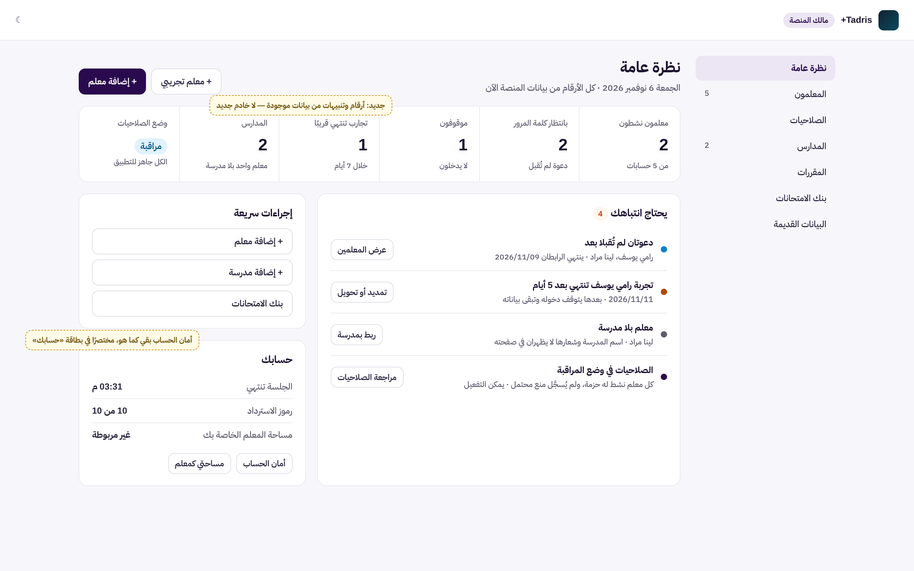
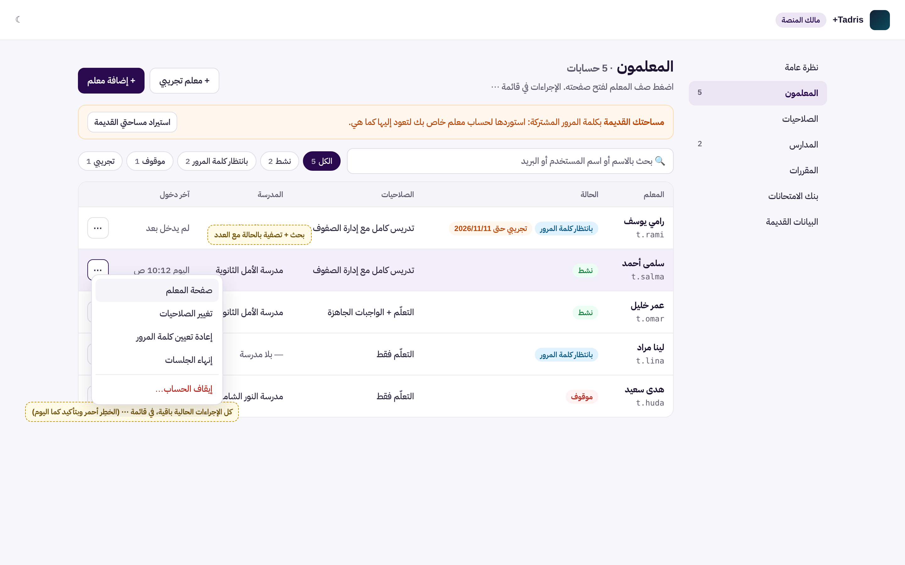
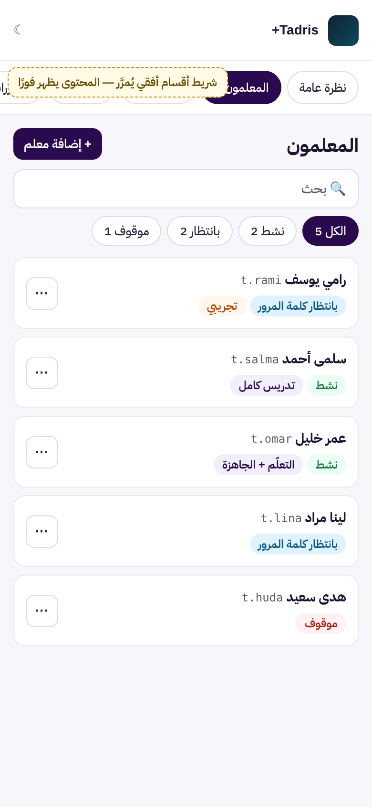

# UX-O1: لوحة المالك، النظرة العامة وجدول المعلمين وشريط الهاتف

> **حالة الوثيقة:** وافق المالك على التصميم («أوافق على تصميم UX-O1 ابدأ التنفيذ»)، ونُفِّذ في الفرع نفسه (§7).
> طلب المالك: «قم بتحليل صفحة المالك هل تحتاج الى تنسيق اكثر احترافية»، ثم «نعم ابدأ بتصميم UX-O1».

| البند | القيمة |
|---|---|
| المرحلة | UX-O1، الأولى من ثلاث مراحل عرض للوحة المالك (O1، O2، O3) |
| النوع | **عرض فقط:** لا تغيير في الخادم ولا في الصلاحيات ولا في الأمان |
| Baseline | `origin/main` = `f2c59037` (دمج #558). المرحلة لا تعتمد على #559 غير المدموج: ملفات مختلفة (`src/owner/` لا `api/`) |
| الفرع | `claude/blissful-shannon-9rv461-ux-o1-owner-overview` |
| الصور التوضيحية | `docs/assets/ux-o1/mock-overview.png`، `mock-teachers.png`، `mock-phone.png`. بيانات تجريبية للتوضيح فقط |

## 1. ما رأيناه اليوم (فحص بالواجهة الحقيقية وبيانات تجريبية)

**الطريقة:** شُغّلت الواجهة المبنية مع معالجات الخادم الحقيقية فوق تخزين تجريبي في الذاكرة، ومعها مالك حقيقي (الإعداد الأول) و5 معلمين ومدرستان و3 صفوف و4 طلاب. ثم صُوّرت كل صفحة على الحاسوب (1440) والهاتف (iPhone 13). لا أخطاء في المتصفح.

| الصفحة | الملاحظة |
|---|---|
| **نظرة عامة** | ترحيب وأمان الحساب وزرّان، ولا أرقام ولا تنبيهات. وفيها نص قديم: «مكتبة الواجبات الجاهزة تُضاف هنا في مرحلة قادمة»، وهي موجودة اليوم («بنك الامتحانات») |
| **المعلمون** | بطاقة لكل معلم فيها 4 إلى 6 أزرار. لا بحث ولا تصفية ولا عدّاد. 5 معلمين = قرابة 1300 بكسل، وتطول مع كل معلم جديد |
| **الهاتف** | القائمة الجانبية تصير 7 بنود عمودية فوق المحتوى (قرابة 350 بكسل) في **كل** صفحة، فلا يظهر المحتوى في الشاشة الأولى |

**ما يبقى لمرحلتين لاحقتين:**
- **O2:** تبويب الصلاحيات الطويل (قرابة 3800 بكسل)، وشريط مراحل وضع الصلاحيات.
- **O3:** بنك الامتحانات كجدول، وقوائم الاختيار المنسّقة، ومسار التنقّل، وقائمة الحساب في الأعلى.

## 2. التصميم

### 2.1 «نظرة عامة» (`OwnerHome` في `src/owner/OwnerApp.tsx`)

1. **رأس الصفحة:** «نظرة عامة» والتاريخ، وزرّا «إضافة معلم» و«معلم تجريبي»، يفتحان المعالج الحالي نفسه.
2. **شريط الأرقام** (مكوّن `KpiStrip` الموجود):

   | الرقم | مصدره |
   |---|---|
   | معلمون نشطون (من مجموع الحسابات) | قائمة المعلمين `GET /api/owner-teachers` (`status`) |
   | بانتظار كلمة المرور | القائمة نفسها (`status: invited`) |
   | موقوفون | القائمة نفسها (`status: suspended`) |
   | تجارب تنتهي قريبًا | القائمة نفسها: `trial.endingSoon` كما يحسبه الخادم اليوم (نافذة التنبيه نفسها التي تستعملها صفحة المعلمين)، و`trial.ended` |
   | المدارس (وعدد المعلمين بلا مدرسة) | `GET /api/owner-schools`، و`schoolId` في القائمة |
   | وضع الصلاحيات (وجاهزية التطبيق) | `GET /api/owner-access` و`GET /api/owner-access/readiness` |

3. **«يحتاج انتباهك»:** قائمة قصيرة مرتّبة، **تظهر فقط ما ينطبق**، ولكل بند زر ينقل إلى مكانه:
   - دعوات لم تُقبل بعد، أو انتهت مهلتها؛
   - تجارب تنتهي قريبًا (`endingSoon` من الخادم)، أو انتهت؛
   - معلمون بلا حزمة صلاحيات، إذ يُمنعون عند التطبيق (من `readiness`)؛
   - معلمون بلا مدرسة؛
   - صفوف قديمة بلا مالك (`GET /api/owner-legacy-classes`)؛
   - وضع المراقبة مع جاهزية كاملة: «يمكن التفعيل».

   **إن لم ينطبق شيء:** «لا شيء يحتاج انتباهك الآن» (مكوّن `EmptyState`).
4. **«إجراءات سريعة»:** إضافة معلم، إضافة مدرسة، بنك الامتحانات.
5. **«حسابك»:** أمان الحساب كما هو اليوم بكل أزراره ووظائفه (الجلسة، رموز الاسترداد، كلمة المرور، تطبيق المصادقة، الخروج، مساحة المعلم الخاصة بك). يُعرض مختصرًا في بطاقة جانبية، وكل إجراء يفتح ما يفتحه اليوم.
6. **يُحذف** النص القديم عن «مكتبة الواجبات الجاهزة».

**التحميل والأخطاء:**
- الأرقام تُطلب بالتوازي.
- إن تعذّر مصدر واحد، تظهر «—» في رقمه مع «تعذّر التحميل»، ويبقى الباقي.
- الجلسة المنتهية (401) تعيد إلى الدخول كما اليوم.

### 2.2 «المعلمون» (`src/owner/OwnerTeachers.tsx`)

1. **الرأس:** «المعلمون · N حسابات»، و«إضافة معلم» (رئيسي) و«معلم تجريبي».
2. **تنبيه «مساحتك القديمة»:** كما هو، بسطر واحد مختصر.
3. **أدوات القائمة:**
   - **بحث فوري** بالاسم أو اسم المستخدم أو البريد؛
   - **رقائق تصفية بالحالة مع العدد:** الكل، نشط، بانتظار كلمة المرور، موقوف، تجريبي، منتهٍ.
   - البحث والتصفية في المتصفح على القائمة المحمّلة أصلًا، فلا طلبات جديدة.
4. **جدول** (مكوّن `DataTable` الموجود، `<table>` حقيقي بعناوين أعمدة):
   - **الأعمدة:** المعلم (الاسم واسم المستخدم)، الحالة (شارات)، الصلاحيات، المدرسة، آخر دخول، قائمة الإجراءات.
   - **اسم المعلم رابط** إلى صفحته.
   - **قائمة الإجراءات «⋯»** (مكوّن `ActionMenu` الموجود) فيها **كل الإجراءات الحالية بالشروط نفسها:** صفحة المعلم، تغيير الصلاحيات، رابط دعوة جديد، إعادة تعيين كلمة المرور، إنهاء الجلسات، تمديد التجربة، التحويل إلى حساب دائم، إيقاف الحساب، إعادة التفعيل.
   - **الإجراء الخطِر** أحمر، وبالتأكيد نفسه الذي يطلبه اليوم.
5. **قائمة فارغة بعد التصفية:** «لا معلم يطابق البحث» مع زر «مسح التصفية».
6. **ما لا يتغير:** طلبات الخادم، ونصوص التأكيد، والمعالج، ورابط الدعوة الذي يظهر بعد الإنشاء أو إعادة الدعوة.

### 2.3 الهاتف (أقل من 860 بكسل)

1. **القائمة الجانبية تصير شريط أقسام أفقيًا** تحت الرأس. يُمرَّر بالإصبع، والقسم الحالي ظاهر ومعلَّم (`aria-current`). وهو `<nav>` نفسه بالاسم نفسه.
2. **الجدول يصير صفوفًا مضغوطة:** الاسم واسم المستخدم، والشارات تحتهما، وقائمة «⋯».
3. **أرقام النظرة العامة** في شبكة من عمودين.

### 2.4 الوصول والاتجاه

- **الاتجاه:** RTL كامل.
- **الجدول:** عناوين أعمدة حقيقية.
- **قائمة الإجراءات:** تُفتح وتُغلق بلوحة المفاتيح (`ActionMenu` يدعمها اليوم).
- **الرقائق:** أزرار بحالة `aria-pressed`.
- **الحالة:** لا تُعرف باللون وحده، فالنص دائمًا في الشارة.
- **الوضع الداكن:** يعمل برموز التصميم نفسها، دون ألوان ثابتة جديدة.

## 3. ما لا يتغير

- **الخادم:** لا ملف في `api/`، ولا طلب جديد، ولا تغيير في أي رد.
- **الصلاحيات والأمان:** التحقق الحديث (step-up)، والتأكيدات، وكل رفض من الخادم كما هو.
- **صفحة المعلم وتبويباتها والأقسام الأخرى:** دون تغيير في هذه المرحلة.

## 4. الأداء

- **صفحة «نظرة عامة»:** خمسة طلبات قراءة موجودة أصلًا، بالتوازي. تُحمَّل مرة عند فتح الصفحة.
- **البحث والتصفية:** في المتصفح على قائمة محمّلة. لا كلفة على الخادم مع نمو عدد المعلمين.
- **حجم الحزمة:** الإضافة صغيرة (مكوّنات موجودة)، وتُقاس بحارس الحزمة (bundle guard).

## 5. الاختبارات

**اختبارات جديدة** (Vitest + Testing Library، ببيانات تجريبية):
- **الأرقام:** كل رقم يُحسب من بيانات معروفة، مثل «2 نشطون من 5».
- **«يحتاج انتباهك»:**
  - يظهر كل بند فقط حين ينطبق؛
  - الحالة الفارغة تظهر «لا شيء يحتاج انتباهك»؛
  - مصدر متعذّر يظهر «—» ولا يُسقط الصفحة.
- **جدول المعلمين:**
  - البحث والتصفية والعدّاد يعملون؛
  - كل إجراء في «⋯» يرسل الطلب نفسه الذي يرسله اليوم؛
  - إجراء الإيقاف يطلب التأكيد.
- **الهاتف:** القسم الحالي معلَّم في الشريط الأفقي.

**الاختبارات الموجودة:**
- اختبارات لوحة المالك التي تبحث عن أزرار البطاقات (`OwnerTeachers.p2a2b`، `OwnerTeachers.p3a`، `OwnerConsole.p4a`، وغيرها) **تُكيَّف لتفتح «⋯» أولًا**.
- كل تأكيد على **السلوك** يبقى: الطلب المرسل، ونصوص التأكيد، والنتيجة.
- **لا يُحذف أي تأكيد،** وكل تعديل يُذكر في الـ PR.

**الفحص البصري:** صور قبل وبعد على الحاسوب والهاتف، فاتح وداكن، تُرفق في الـ PR.

## 6. خارج النطاق

- **O2:** تبويب الصلاحيات (أقسام قابلة للطي، وشريط حفظ ثابت)، وشريط مراحل وضع الصلاحيات.
- **O3:** بنك الامتحانات كجدول، وقوائم الاختيار المنسّقة، ومسار التنقّل، وقائمة الحساب في الشريط العلوي.
- **عدد الصفوف والطلاب في النظرة العامة:** يحتاج طلبًا جديدًا من الخادم يجمعها. يُقترح منفصلًا إن أردتَه.

## 7. التنفيذ (بعد الموافقة)

### 7.1 الملفات

| الملف | التغيير |
|---|---|
| `src/owner/ownerOverview.ts` (جديد) | الحساب النقي للأرقام وبنود «يحتاج انتباهك» من مصادر موجودة. والمصدر المتعذّر `null` لا صفر |
| `src/owner/OwnerOverview.tsx` (جديد) | خمسة طلبات قراءة بالتوازي، وشريط الأرقام (`KpiStrip`)، و«يحتاج انتباهك»، والحالة الفارغة |
| `src/owner/OwnerApp.tsx` | «نظرة عامة» الجديدة، وبطاقة «حسابك وأمانه» بكل أزرارها كما كانت. وزرّا الإضافة يفتحان المعالج في «المعلمون». وشريط الهاتف يبقي القسم الحالي ظاهرًا |
| `src/owner/OwnerTeachers.tsx` | جدول وبحث ورقائق تصفية بالعدد، وقائمة «⋯» فيها كل الإجراءات، ولوحة الإجراء صفًّا تحت المعلم. وعمود المدرسة من `GET /api/owner-schools` |
| `src/owner/owner.css` | التنسيقات برموز التصميم فقط، والهاتف |
| `src/owner/OwnerOverview.uxo1.test.tsx` (جديد) | 12 اختبارًا |
| `src/owner/teacherTable.testkit.ts` (جديد) | مساعدات اختبار للجدول. لا يستوردها التطبيق |
| اختبارات لوحة المالك الموجودة (9 ملفات) | تغيير **المحدِّدات فقط**: الجدول بدل القائمة، وفتح «⋯» قبل الإجراء. **لا تأكيد سلوك حُذف** (§7.3) |

### 7.2 فروق عن الصور التوضيحية

- **عنوان الصفحة** بقي «أهلًا، <الاسم>»، وتحته «نظرة عامة على المنصة · التاريخ». السبب أن اختبارات كثيرة تعتمد هذا العنوان علامةً على دخول المالك. والقائمة الجانبية تسمّي القسم «نظرة عامة» كما كانت.
- **«إجراءات سريعة»:** «إضافة مدرسة» و«الصلاحيات» و«بنك الامتحانات». وزرّا «إضافة معلم» و«معلم تجريبي» في رأس الصفحة، فلا يتكرر زر.
- **لوحة التجربة** (تمديد أو تحويل إلى دائم): كانت تظهر دائمًا تحت كل معلم تجريبي. صارت تُفتح من «⋯» باسم «التجربة: تمديد أو تحويل». والحالة نفسها ظاهرة دائمًا في الشارة («انتهت التجربة»، «ينتهي خلال يومين») وفي تنبيه أعلى القائمة.

### 7.3 الإثبات

- **اختبارات جديدة:** 12 من 12. وتغطي:
  - الأرقام من بيانات معروفة؛
  - كل بند في «يحتاج انتباهك» وترتيبه، والحالة الفارغة؛
  - المصدر المتعذّر يُظهر «—» و«تعذّر التحميل»؛
  - 401 من أي مصدر يعيد إلى الدخول؛
  - الطلبات قراءة فقط؛
  - زر الإضافة يفتح المعالج؛
  - البحث بالاسم واسم المستخدم والبريد، والتصفية مع `aria-pressed`، و«مسح التصفية» دون طلب جديد.
- **اختبارات لوحة المالك الموجودة:** 30 ملفًا، 177 اختبارًا، كلها تمرّ.
  - في 9 ملفات تغيّرت المحدِّدات فقط، وبقي كل تأكيد على الطلب المرسل ونصوص التأكيد والنتيجة.
  - تعديلان يستحقان الذكر:
    - «موقوف» بعد الإيقاف صار يُبحث عنه داخل صف المعلم، لأن رقيقة تصفية «موقوف» صارت موجودة أيضًا. وهذا أدقّ لا أرخى.
    - نصوص شرح التجربة تُفحص بعد فتح لوحتها (§7.2).
- **الفحص البصري** بالواجهة المبنية الحقيقية ومعالجات الخادم الحقيقية وبيانات تجريبية: حاسوب وهاتف وداكن، ولا أخطاء في المتصفح. الصور: `docs/assets/ux-o1/after-overview.png`، و`after-teachers-menu.png`، و`after-phone-teachers.png`.
- **عيب وُجد بالفحص البصري وأُصلح:**
  - على الهاتف كان عرض الصفحة 687 بكسل بدل 390، لأن عمود الشبكة `1fr` يتسع لعرض شريط الأقسام غير الملتفّ.
  - صار `minmax(0, 1fr)`، فالشريط يُمرَّر داخل نفسه والصفحة بعرض الشاشة.
- **Lint:** صفر أخطاء و140 تحذيرًا كما في الأساس. وأُزيل تحذيران ظهرا من الكود الجديد قبل الالتزام.
