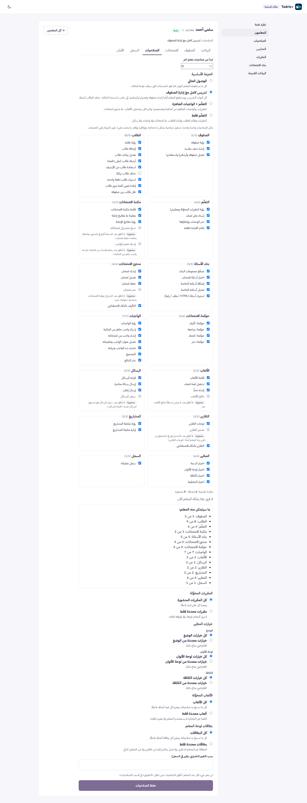
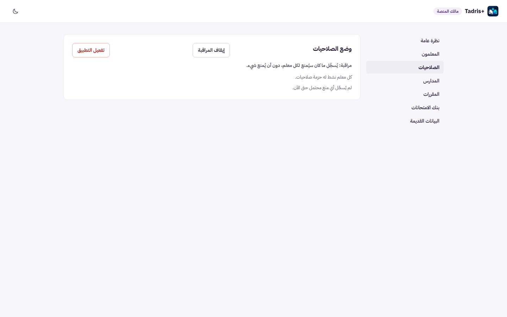
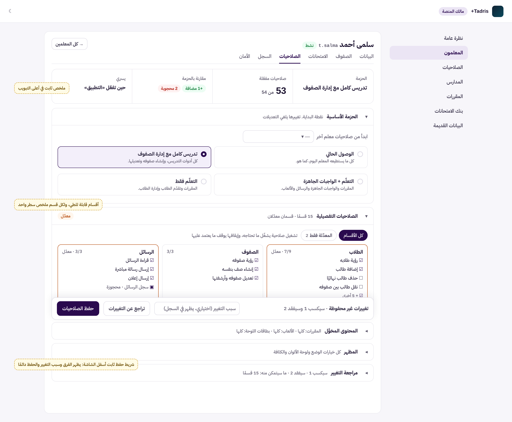
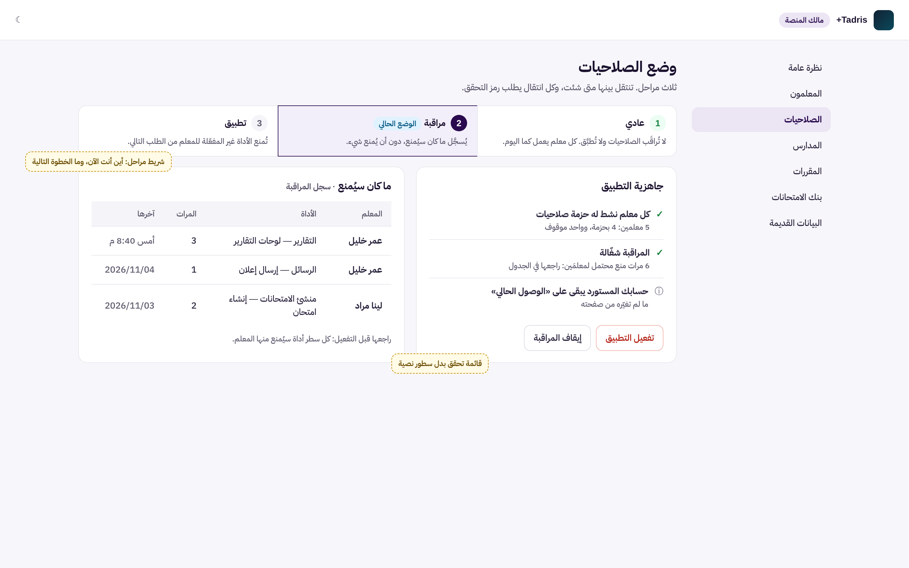
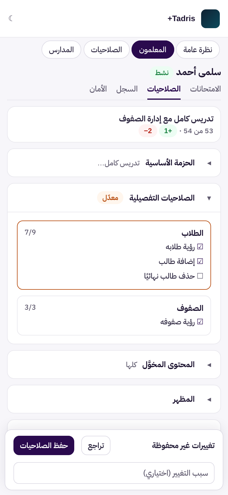

# UX-O2: لوحة المالك، تبويب الصلاحيات وشريط مراحل وضع الصلاحيات

> **حالة الوثيقة:** وافق المالك على التصميم («أوافق على تصميم UX-O2 ابدأ التنفيذ»)، ونُفِّذ في الفرع نفسه (§7).
> طلب المالك: «نعم ابدأ بتصميم UX-O2». هذه المرحلة الثانية من الثلاث التي حددها `docs/enterprise-ux-owner-console-o1.md` (§1 و§6).

| البند | القيمة |
|---|---|
| المرحلة | UX-O2، الثانية من ثلاث مراحل عرض للوحة المالك (O1 مدموجة في #560، وO3 لاحقة) |
| النوع | **عرض فقط:** لا تغيير في الخادم ولا في قواعد الصلاحيات ولا في الأمان |
| Baseline | `origin/main` = `563aa105` (دمج #560). المرحلة لا تعتمد على #559 غير المدموج (ملفاته في `api/`، وهذه في `src/owner/`) |
| الفرع | `claude/blissful-shannon-9rv461-ux-o2-owner-access` |
| الصور | قبل: `docs/assets/ux-o2/before-access-tab.png`، `before-access-mode.png`. بعد (توضيحية): `mock-access-tab.png`، `mock-access-mode.png`، `mock-phone-access.png`. بيانات تجريبية للتوضيح فقط |

## 1. ما رأيناه اليوم (قياس بالواجهة الحقيقية وبيانات تجريبية)

**الطريقة:** هي نفسها في UX-O1: الواجهة المبنية مع معالجات الخادم الحقيقية فوق تخزين تجريبي في الذاكرة، ومعها مالك حقيقي و5 معلمين في وضع «مراقبة». القياس بـ Playwright.

### 1.1 تبويب «الصلاحيات» في صفحة المعلم (`AccessEditor` في `src/owner/OwnerTeacherDetails.tsx`)

| القياس | الحاسوب (1440×900) | الهاتف (iPhone 13) |
|---|---|---|
| طول المحرّر | **3440 بكسل** (قرابة 4 شاشات) | **4669 بكسل** (قرابة 7 شاشات) |
| موضع زر «حفظ الصلاحيات» | 3660 بكسل من أعلى الصفحة | 4976 بكسل |
| المحتوى | 19 مجموعة (`fieldset`) و60 مربع اختيار | نفسه |

**المشكلات:**
1. **زر الحفظ في آخر الصفحة.** من يغيّر صلاحية في الأعلى لا يرى أن عنده تغييرًا غير محفوظ، ولا يرى الزر، إلا إذا نزل قرابة 4 شاشات.
2. **لا ملخص.** لا يظهر في أعلى التبويب أي رقم: كم صلاحية مفعّلة، وكم إضافة وكم حجب مقارنة بالحزمة. المقارنة و«ما سيتمكن منه المعلم» موجودتان، لكن في منتصف الصفحة.
3. **كل شيء مفتوح دائمًا.** الحزم والأقسام الـ15 والمقررات والمظهر والألعاب والبطاقات تظهر كلها دفعة واحدة، حتى لمن يريد تغيير الحزمة فقط.
4. **الانتقال إلى تبويب آخر يضيّع التغييرات دون تنبيه**، لأن `Tabs` تعرض التبويب المختار وحده.
5. **لا رجوع سهل.** للعودة إلى ما كان قبل التعديل يجب إعادة تحميل الصفحة.

### 1.2 قسم «الصلاحيات» في القائمة الجانبية (`OwnerAccessMode` في `src/owner/OwnerAccessMode.tsx`)

**المشكلات:**
1. **الوضع جملة نصية فقط.** الصفحة لا تبيّن أن هناك ثلاث مراحل (عادي ← مراقبة ← تطبيق)، ولا أين أنت منها، ولا ما الخطوة التالية.
2. **الجاهزية سطور نصية**، لا قائمة تحقق.
3. **سجل المراقبة قائمة متداخلة طويلة.** لا يمكن مسحها بالعين حين يكثر المعلمون.

## 2. التصميم

### 2.1 تبويب «الصلاحيات» (`AccessEditor`)

**أ) ملخص في أعلى التبويب** (مكوّن `KpiStrip` الموجود). كل أرقامه تُحسب من المسودة الحالية في الصفحة، فتتحدث مع كل نقرة:

| الخانة | المصدر |
|---|---|
| الحزمة | الحزمة المختارة (`picked.label`) |
| صلاحيات مفعّلة «N من M» | المختارة من غير المحجوزة ÷ كل غير المحجوزة وغير الخاصة بالمالك (القاعدة نفسها التي تعدّ بها الأقسام اليوم) |
| مقارنة بالحزمة | `grantsAndDenies` الموجودة: «+N مضافة» و«N محجوبة» |
| يسري | نص `modeNote` الموجود مختصرًا: «حين تفعّل التطبيق»، أو «من الطلب التالي»، أو «الحساب موقوف» |

**ب) خمسة أقسام قابلة للطي.** لكل قسم رأس هو زر (`aria-expanded` و`aria-controls`)، وبجانبه ملخص من سطر واحد، وشارة «معدّل» إن اختلف القسم عن المحفوظ:

| القسم | ما فيه (كما هو اليوم) | ملخصه | مفتوح في البداية؟ |
|---|---|---|---|
| **الحزمة الأساسية** | «ابدأ من صلاحيات معلم آخر» والحزم | اسم الحزمة | **نعم** |
| **الصلاحيات التفصيلية** | الأقسام الـ15 بمربعاتها، والمحجوزة كما في P10-K، ومرشّح «كل الأقسام / المعدّلة فقط» | «15 قسمًا · N معدّلة» | لا |
| **المحتوى المخوَّل** | المقررات والألعاب وبطاقات اللوحة | «المقررات: كلها أو N · الألعاب: … · البطاقات: …» | لا |
| **المظهر** | `AppearanceChoice` | «كل الخيارات» أو «مقيّد في N» | لا |
| **مراجعة التغيير** | `DiffView` («سيكسبها المعلم» و«سيفقدها المعلم»)، و«ما سيتمكن منه المعلم» | «سيكسب N · سيفقد N» | لا، ويُفتح وحده أول مرة يتغيّر فيها شيء |

**قواعد الأقسام:**
- **المحتوى يبقى في الصفحة وإن طُوي** (بالسمة `hidden`)، فلا تضيع مسودة ولا تتغير المعرّفات. الطيّ عرض فقط: كل ما يُرسل إلى الخادم يُحسب كما اليوم.
- **حالات تُفتح فيها الأقسام اللازمة وحدها:**
  - النسخة الحالية غير صالحة (`headBroken`)، أو لا حزمة للمعلم: يبقى قسم «الحزمة الأساسية» مفتوحًا، ومعه التنبيه الأحمر الحالي فوق الأقسام كما هو.
  - بعد «ابدأ من صلاحيات معلم آخر»: يُفتح قسما «الصلاحيات التفصيلية» و«مراجعة التغيير».
- **مرشّح «المعدّلة فقط»** يُظهر الأقسام التي يختلف فيها اختيار المسودة عن المحفوظ. عرض فقط: لا يغيّر الاختيار.
- **لا تغيير في قواعد الاعتماد.** تشغيل صلاحية يشغّل ما تحتاجه، وإيقافها يوقف ما يعتمد عليها (`withCapability` و`withoutCapability`).

**ج) شريط حفظ ثابت أسفل الشاشة** (`position: sticky; bottom: 0` داخل التبويب). يظهر دائمًا في تبويب الصلاحيات:
- **بلا تغيير:** «لا تغييرات غير محفوظة»، وزر «حفظ الصلاحيات» معطّل كما اليوم (`unchanged`).
- **مع تغيير:** «تغييرات غير محفوظة · سيكسب N وسيفقد N»، وحقل «سبب التغيير (اختياري، يظهر في السجل)» ينتقل إلى الشريط، وزران:
  - **«تراجع عن التغييرات»** (جديد، في الواجهة فقط): يعيد المسودة إلى ما فُتحت عليه الصفحة، أي النسخة المحفوظة. لا يرسل شيئًا إلى الخادم.
  - **«حفظ الصلاحيات»:** الاسم نفسه والطلب نفسه (`ownerAccessApi.assign` مع `baseRevisionId`)، ورمز التحقق نفسه، ورفض النسخة القديمة (409) نفسه.
- **سطر `modeNote`** يبقى تحت الأقسام كما هو اليوم.

**د) تنبيه قبل ضياع التغييرات.** إن كان في المسودة تغيير غير محفوظ وضغط المالك تبويبًا آخر أو «→ كل المعلمين»:
- يظهر تأكيد داخل الصفحة (مكوّن `eb-owner-confirm` الموجود)، لا نافذة المتصفح: «لديك تغييرات غير محفوظة في الصلاحيات.» ومعه «البقاء» و«تجاهل التغييرات».
- لا شيء يُحفظ تلقائيًا.
- إعادة تحميل المتصفح أو إغلاقه خارج النطاق، فلا `beforeunload`.

### 2.2 قسم «الصلاحيات» (`OwnerAccessMode`)

**أ) شريط المراحل:** «عادي ← مراقبة ← تطبيق»، بمكوّن `Stepper` الموجود (`aria-current="step"`، والمكتملة تُقال بالكلمات لا باللون وحده).
- تحت كل مرحلة جملتها الحالية من `MODE_TEXT`، والمرحلة الحالية تحمل شارة «الوضع الحالي».
- **الوضع `invalid`:** لا يُعرض الشريط. يظهر التنبيه الأحمر الحالي («إعداد الوضع على الخادم غير صالح…») كما هو.

**ب) «جاهزية التطبيق» قائمة تحقق** (`role="region"` والاسم نفسه):
- **✓ أو ✗ «كل معلم نشط له حزمة صلاحيات».** عند ✗ تظهر الأسماء، ومعها زر «المعلمون» ينقل إلى القسم.
- **سجل المراقبة:** «لم يُسجَّل أي منع محتمل حتى الآن»، أو «N مرة منع محتمل لـ M معلم».
- **ⓘ** جملة «حسابك المستورد يبقى على «الوصول الحالي»» من نص التأكيد الحالي.

**ج) «ما كان سيُمنع» جدول** (مكوّن `DataTable` الموجود) بأعمدة: المعلم، الأداة، المرات، آخرها. المصدر هو `wouldDeny` نفسه، ولا يُطلب شيء جديد من الخادم.

**د) الأزرار والتأكيد وخطوة التحقق كما هي حرفيًا.** دليل التشغيل `docs/operations-access-enforcement.md` يقتبسها، ويثبّتها اختبار `api/tests/operations-runbook-p9b3.test.js` والطفرة `P9B3-M8`:
- «تشغيل المراقبة»، «إيقاف المراقبة»، «تفعيل التطبيق»، «تأكيد: تفعيل التطبيق»، «إيقاف التطبيق (العودة إلى المراقبة)».
- نص التأكيد بحروفه.
- «جاهزية التطبيق» و«ما كان سيُمنع».

الذي يتغير هو مكان الأزرار فقط: تحت قائمة التحقق بدل رأس البطاقة. «تفعيل التطبيق» يبقى معطّلًا حتى الجاهزية الكاملة، ومعه جملته الحالية.

### 2.3 الهاتف (أقل من 860 بكسل)

**تبويب الصلاحيات:**
- الملخص بطاقة واحدة مضغوطة.
- الأقسام تملأ العرض، وبطاقات الصلاحيات التفصيلية عمود واحد.
- شريط الحفظ مثبّت أسفل الشاشة، وحقل السبب في سطر ثانٍ، ويُحسب حساب الحافة الآمنة (`env(safe-area-inset-bottom)`).

**قسم الصلاحيات:**
- المراحل الثلاث تُعرض عمودية.
- جدول «ما كان سيُمنع» يصير صفوفًا مضغوطة (قاعدة UX-O1 نفسها في جدول المعلمين).

**الشرط:** لا تمرير أفقي للصفحة. يُقاس عرض الصفحة كما في UX-O1 §7.

### 2.4 الوصول والاتجاه

- رؤوس الأقسام أزرار حقيقية (`button` مع `aria-expanded` و`aria-controls`)، تُفتح بـ Enter وSpace، والتركيز ظاهر.
- شريط الحفظ منطقة باسم «حفظ الصلاحيات» (`role="region"`)، والتغيير فيه يُعلن بـ `aria-live="polite"` (انظر §7.2).
- الأرقام داخل النص العربي في `bdi`، وكل الألوان من الرموز الموجودة، فالوضع الداكن وRTL مغطّيان.
- الحركة تحترم `prefers-reduced-motion`.

## 3. ما لا يتغير

- **الخادم:** لا مسار جديد ولا صلاحية جديدة ولا بيانات مخزنة. كل حفظ يمرّ بالطلب نفسه، والخادم يقرر كما اليوم: رمز التحقق، و409 للنسخة القديمة، والسجل والتدقيق (P10-L).
- **ما يُرسل عند الحفظ يطابق اليوم بايتًا بايتًا** لأي مسودة: الحزمة، و`grants` و`denies`، والمقررات والبطاقات والألعاب والمظهر، والسبب.
- **قواعد الصلاحيات:** الاعتماد، والمحجوزة (P10-K)، والحزم المستبدلة (P5-B4)، والنسخ من معلم آخر (P4-B2).
- **التبويبات الأخرى** في صفحة المعلم.
- **تبديل الوضع** بخطوة التحقق نفسها، وقيد الجاهزية نفسه على الخادم.
- **تبديل الوضع من observe إلى enforce يبقى إجراء المالك وحده من اللوحة** (AGENTS.md §10). هذه المرحلة لا تغيّر الوضع ولا صلاحيات أي معلم.

## 4. الأداء

- **لا طلبات جديدة.** الأقسام المطوية تبقى في الصفحة، فلا تحميل عند الفتح.
- الأرقام والملخصات تُحسب من المسودة الموجودة (`useMemo`). العدد صغير (قرابة 60 صلاحية)، فلا كلفة تُذكر.
- لا مكتبة جديدة. الحزمة تمرّ بحارس الحجم كما اليوم.

## 5. الاختبارات

**اختبارات جديدة** (`src/owner/OwnerAccessEditor.uxo2.test.tsx` و`src/owner/OwnerAccessMode.uxo2.test.tsx`، تقريبًا 14 إلى 18 اختبارًا):

1. **الملخص:** أرقامه صحيحة عند الفتح، وتتحدث بعد تشغيل صلاحية وإيقاف أخرى، والمحجوزة لا تُعدّ.
2. **الطيّ:**
   - «الحزمة الأساسية» مفتوح وحده في البداية؛
   - فتح قسم وطيّه يبقي المسودة؛
   - `aria-expanded` صحيح؛
   - مع `headBroken` يبقى قسم الحزمة مفتوحًا والتنبيه ظاهرًا؛
   - بعد «ابدأ من صلاحيات معلم آخر» يُفتح القسمان.
3. **«المعدّلة فقط»** يُظهر الأقسام المعدّلة وحدها.
4. **شريط الحفظ:**
   - «لا تغييرات غير محفوظة» وزر معطّل في البداية؛
   - بعد تغيير: النص والعدد والزر مفعّل؛
   - «تراجع عن التغييرات» يعيد كل شيء ولا يرسل طلبًا.
5. **التكافؤ (أهم اختبار):** لمسودات متعددة (حزمة فقط؛ تشغيل وإيقاف؛ مقررات محددة؛ بطاقات وألعاب؛ مظهر؛ نسخ من معلم)، جسم الطلب المرسل عند الحفظ مطابق لما كان يُرسل قبل المرحلة. يُتحقق منه مقابل الشجرة القديمة بتشغيله على الـ Baseline.
6. **التنبيه قبل الضياع:**
   - مع تغيير: تبويب آخر أو «كل المعلمين» يُظهر التأكيد، و«البقاء» يبقي المسودة، و«تجاهل التغييرات» ينتقل؛
   - بلا تغيير: ينتقل مباشرة.
7. **المراحل:**
   - `aria-current` على الوضع الحالي في الأوضاع الثلاثة؛
   - `invalid` لا شريط فيه والتنبيه ظاهر.
8. **الجاهزية والجدول:**
   - ✓ و✗ مع الأسماء؛
   - جدول «ما كان سيُمنع» بأعمدته؛
   - الأزرار بأسمائها الحرفية؛
   - «تفعيل التطبيق» معطّل بلا جاهزية.

**الاختبارات الحالية:**
- التي تنقر مربعات الصلاحيات أو حقول المقررات والبطاقات والألعاب والمظهر تحتاج **تعديل محدِّدات فقط**: فتح القسم قبل النقر، عبر مساعد اختبار مثل `teacherTable.testkit.ts` في UX-O1. هي ثمانية ملفات: `OwnerTeacherDetails.p4b1`، `OwnerTeachers.p3a`، `TeacherWizard.p4b2`، `OwnerCourses.p5a2`، `OwnerWidgets.p7a2`، `OwnerGames.p7b2`، `OwnerAppearance.p8a2`، `reservedCapabilities.p10k`.
- اختبارات `OwnerAccessMode.p3b` و`p3b2` قد تحتاج المثل إن تغيّر شكل «ما كان سيُمنع».
- لا يُضعف أي توقّع: كل ما يتحقق من السلوك وجسم الطلب والنصوص يبقى، وتُذكر كل ملفات التعديل في الـ PR.

**الطفرات:** ليست مطلوبة لأن المرحلة عرض فقط. سأزرع ثلاثًا مع ذلك على قواعد عرض حساسة، لأن خطأها يضلّل المالك:
- الحفظ يُرسل مع الطيّ مسودة ناقصة؛
- «تراجع» لا يعيد قسمًا؛
- التنبيه قبل الضياع لا يظهر.

**التحقق الكامل:** `npm test`، و`npm run lint` بلا تحذير جديد (140)، و`npx tsc -b`، و`npm run build` مع حارس الحجم، و`git diff --check`. تُصوَّر بعدها الواجهة الحقيقية على الحاسوب والهاتف، فاتحة وداكنة، ويُقاس الطول وعرض الصفحة.

## 6. خارج النطاق

- **O3:** بنك الامتحانات كجدول، وقوائم الاختيار المنسّقة، ومسار التنقّل، وقائمة الحساب في الأعلى.
- **تحذير المتصفح عند إغلاق الصفحة أو إعادة تحميلها** (`beforeunload`).
- **تحرير الحزم نفسها** (إنشاء حزمة جديدة)، وأي تغيير في قواعد الصلاحيات أو الحزم.
- **«السجل»** (`AccessHistory`)، وهو جدول من الأصل.

## 7. التنفيذ (بعد الموافقة)

يُكتب هنا بعد التنفيذ: الملفات، والفروق عن الصور التوضيحية، والإثبات.
