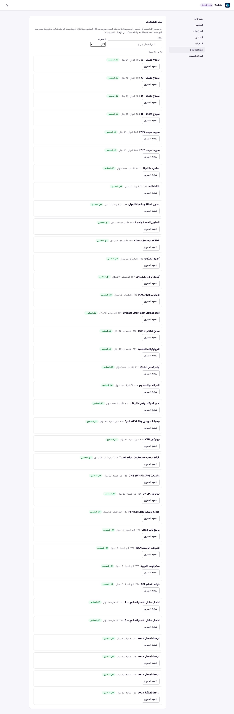
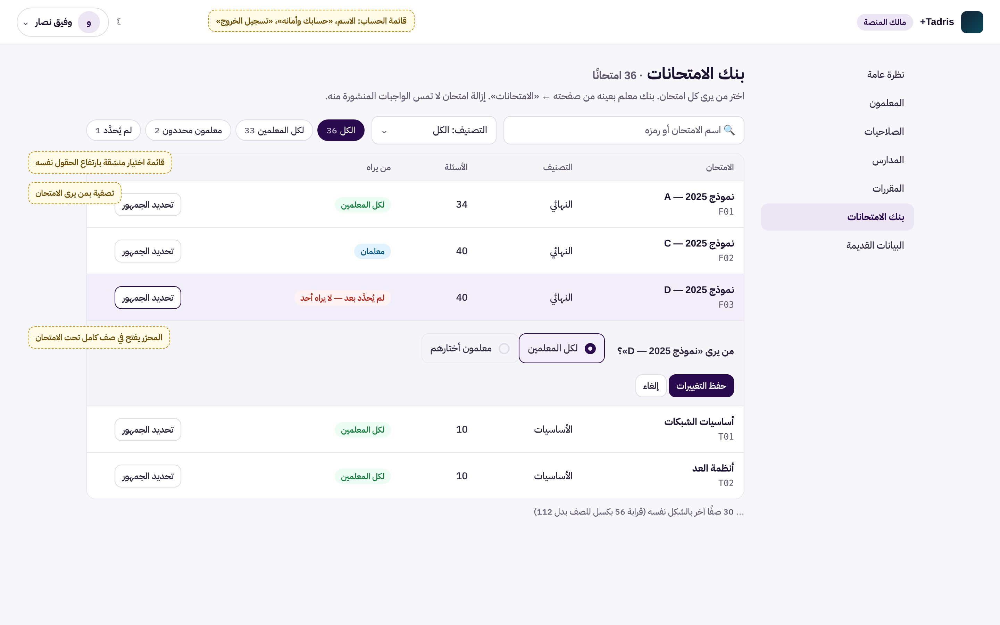
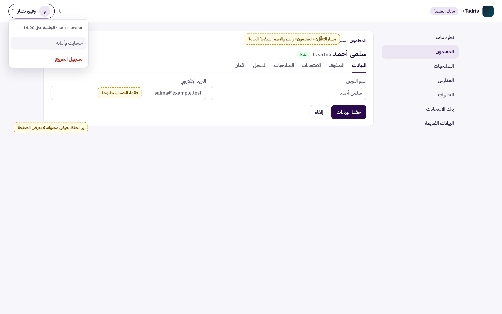

# UX-O3: لوحة المالك، جدول بنك الامتحانات وقوائم الاختيار ومسار التنقّل وقائمة الحساب

> **حالة الوثيقة:** تصميم بانتظار موافقة المالك. لا يبدأ التنفيذ قبل العبارة «أوافق على تصميم UX-O3 ابدأ التنفيذ».
> طلب المالك: «ابدأ بتصميم UX-O3». هذه المرحلة الثالثة والأخيرة من مراحل العرض التي حددها `docs/enterprise-ux-owner-console-o1.md` (§1 و§6).

| البند | القيمة |
|---|---|
| المرحلة | UX-O3، الثالثة والأخيرة من مراحل عرض لوحة المالك (O1 مدموجة في #560، وO2 في #561) |
| النوع | **عرض فقط:** لا تغيير في الخادم ولا في الصلاحيات ولا في الأمان |
| Baseline | `origin/main` = `cf5d0196` (دمج #561) |
| الفرع | `claude/blissful-shannon-9rv461-ux-o3-owner-polish` |
| الصور | قبل: `docs/assets/ux-o3/before-exams.png`، `before-select.png`، `before-wizard-buttons.png`. بعد (توضيحية): `mock-exams.png`، `mock-header-breadcrumb.png`، `mock-phone-exams.png`. بيانات تجريبية للتوضيح فقط |

## 1. ما رأيناه اليوم (قياس بالواجهة الحقيقية وبيانات تجريبية)

**الطريقة:** هي نفسها في UX-O1 وUX-O2: الواجهة المبنية مع معالجات الخادم الحقيقية فوق تخزين تجريبي في الذاكرة. القياس بـ Playwright.

| الموضع | القياس | المشكلة |
|---|---|---|
| **«بنك الامتحانات»** (`OwnerLibrary.tsx`) | **4383 بكسل** على الحاسوب و**5586** على الهاتف، لـ36 امتحانًا | بطاقة كاملة لكل امتحان (قرابة 112 بكسل) وزر تحت عنوانها. لا عمود يُقارن، ولا تصفية بمن يرى الامتحان، فلا يظهر بسهولة ما «لم يُحدَّد بعد» |
| **قوائم الاختيار** (`<select>`، 13 قائمة في لوحة المالك) | ارتفاعها **25 إلى 28 بكسل**، والحقول النصية بجانبها 48. شكلها شكل المتصفح الافتراضي، وعرضها 94 بكسل في «بنك الامتحانات» | تبدو غريبة بجانب الحقول، وخطها وحدودها تختلف من متصفح لآخر |
| **رأس الصفحة** | الشعار و«مالك المنصة» وزر الوضع الداكن فقط | الخروج والحساب في بطاقة داخل «نظرة عامة» فقط، فمن في صفحة أخرى لا يجدهما |
| **صفحة المعلم** | زر «→ كل المعلمين» فقط | لا مسار يبيّن أين أنت (المعلمون ‹ اسم المعلم) |
| **أزرار الحفظ في النماذج** (`.auth-submit`) | بعرض الصفحة كله، و«إلغاء» في سطر تحته (مثل «التالي» في معالج المعلم) | شكل صفحة الدخول داخل اللوحة: زر عريض جدًا لا يتجاور مع «إلغاء» |

## 2. التصميم

### 2.1 «بنك الامتحانات» جدولًا (`OwnerLibrary.tsx`)

1. **رأس:** «بنك الامتحانات · N امتحانًا» والجملة الإرشادية الحالية مختصرة.
2. **شريط أدوات:**
   - البحث الحالي («اسم الامتحان أو رمزه»)؛
   - قائمة «التصنيف» الحالية بالشكل الجديد (§2.2)؛
   - **جديد:** رقائق تصفية بمن يرى الامتحان، مع العدد: «الكل»، «لكل المعلمين»، «معلمون محددون»، «لم يُحدَّد». القاعدة هي `audience` و`decided` نفسهما اللذان يكتب بهما `audienceText` اليوم.
3. **جدول** بأعمدة: الامتحان (العنوان والرمز)، التصنيف، الأسئلة، من يراه (الشارة الحالية بألوانها)، وزر «تحديد الجمهور».
4. **المحرّر** (`AudienceEditor`) كما هو بحقوله وطلبه، لكنه يفتح في **صف كامل تحت الامتحان**، كما في جدول المعلمين (UX-O1).
5. **«لا امتحان يطابق البحث»** مع «مسح التصفية» عند الفراغ.
6. **الهاتف:** كل صف بطاقة مضغوطة (العنوان، التصنيف والأسئلة، الشارة، والزر في الزاوية)، بالقاعدة نفسها في جدول المعلمين.

**الأثر المتوقع:** قرابة 56 بكسل للصف بدل 112، فتصير الصفحة نصف طولها تقريبًا لـ36 امتحانًا.

### 2.2 قوائم الاختيار المنسّقة (CSS فقط)

- **كل `<select>` داخل لوحة المالك** يأخذ:
  - الارتفاع نفسه للحقول (`min-height` كحقل الإدخال)، والحدود ونصف القطر والخط نفسها؛
  - `appearance: none` مع سهم مرسوم بتدرّج CSS من رموز الألوان (`--eb-muted`)، فيتبع الوضع الداكن وRTL؛
  - مساحة للسهم في الجهة الصحيحة (`padding-inline-end`)، وحلقة تركيز ظاهرة؛
  - عرضًا أدنى معقولًا، فلا يضيق إلى 94 بكسل.
- **لا تغيير في أي ملف TSX لهذا البند:** القوائم الـ13 كما هي بخياراتها وسلوكها، والتنسيق كله في `owner.css` مقصور على `.eb-owner-page`.

### 2.3 قائمة الحساب في الرأس (`OwnerApp.tsx`)

- **زر في الرأس:** حرف الاسم الأول واسم العرض، بجانب زر الوضع الداكن. يفتح قائمة بالمكوّن المشترك `ActionMenu`، فلا نسخة جديدة منه. فيها:
  - سطر معلومات (ليس زرًا): اسم المستخدم، و«الجلسة حتى <الوقت>» من `view.session.expiresAt` الموجود؛
  - **«حسابك وأمانه»:** ينقل إلى «نظرة عامة»، حيث بطاقة الحساب بكل أزرارها كما هي؛
  - **«تسجيل الخروج»** (بلون الخطر): **الطلب نفسه** (`ownerApi.logout`) ثم الخروج محليًا، تمامًا كزر «تسجيل الخروج» الحالي في «نظرة عامة»، وهو يبقى.
- **يظهر الزر بعد الدخول فقط.** صفحتا الدخول والتأسيس بلا تغيير.
- **على الهاتف:** حرف الاسم وحده، والقائمة نفسها.

### 2.4 مسار التنقّل في صفحة المعلم (`OwnerTeacherDetails.tsx`)

- **فوق اسم المعلم:** «المعلمون ‹ <اسم المعلم>» بالمكوّن المشترك `Breadcrumb` (`aria-label="مسار الصفحة"`، والأخير `aria-current="page"`).
- **«المعلمون» رابط** يمرّ بالحارس نفسه الذي وضعته UX-O2: إن كانت في الصلاحيات تغييرات غير محفوظة يسأل أولًا.
- **زر «→ كل المعلمين» يبقى كما هو**، فالاختبارات والعادة تعتمد عليه.

### 2.5 أزرار النماذج داخل اللوحة (CSS فقط)

- **`.auth-submit` داخل `.eb-owner-console`:** بعرض محتواه لا بعرض الصفحة، ويتجاور مع «إلغاء» و«السابق» في صف واحد يلتف عند الضيق.
- **صفحة الدخول** (خارج `.eb-owner-console`) لا تتغير.
- **على الهاتف** (أقل من 640 بكسل) يعود الزر الرئيسي بعرض كامل، ليسهل لمسه.

### 2.6 الوصول والاتجاه

- الجدول جدول حقيقي (`table` و`caption` مخفي بصريًا)، والصف المفتوح يُعلن باسم الامتحان.
- رقائق التصفية أزرار `aria-pressed` داخل مجموعة مسماة «تصفية حسب من يراه»، كما في «المعلمون».
- زر الحساب اسمه «حساب <الاسم>»، والقائمة تُدار بلوحة المفاتيح كما في `ActionMenu`.
- كل الألوان من الرموز، فالوضع الداكن وRTL مغطّيان. لا تمرير أفقي للصفحة على الهاتف.

## 3. ما لا يتغير

- **الخادم:** لا مسار جديد، ولا صلاحية، ولا بيانات.
- **طلب «تحديد الجمهور»** (`ownerLibraryApi.setAudience`) وخطوة التحقق ونص الإشعار كما هي. ولا يُمسّ بنك المعلم في تبويب «الامتحانات» (`OwnerTeacherExams.tsx`)، سوى شكل قائمة «التصنيف» فيه بقاعدة §2.2.
- **الخروج:** الطلب نفسه، وزر «نظرة عامة» باقٍ.
- **قواعد الجمهور:** «لكل المعلمين»، و«لم يُحدَّد بعد — لا يراه أحد»، وما يُنشر من واجبات.
- **دليل التشغيل:** كل نص يقتبسه باقٍ.

## 4. الأداء

لا طلب جديد. التصفية تجري على القائمة المحمّلة نفسها، ولا مكتبة جديدة، والحزمة تمرّ بحارس الحجم.

## 5. الاختبارات

**اختبارات جديدة** (`src/owner/OwnerLibrary.uxo3.test.tsx` و`src/owner/OwnerChrome.uxo3.test.tsx`، تقريبًا 10 إلى 14):

1. **الجدول:** أعمدته وصفوفه؛ رقائق «من يراه» بأعدادها وتصفيتها، ومعها البحث والتصنيف معًا؛ «مسح التصفية».
2. **المحرّر في صف كامل:** يرسل الطلب نفسه حرفيًا كما قبل المرحلة (تكافؤ).
3. **قائمة الحساب:**
   - تظهر بعد الدخول وحده، وفيها اسم المستخدم ووقت انتهاء الجلسة؛
   - «حسابك وأمانه» ينقل إلى «نظرة عامة»؛
   - «تسجيل الخروج» يرسل `POST /api/owner-session/logout` مرة واحدة ثم يعود إلى صفحة الدخول.
4. **مسار التنقّل:**
   - «المعلمون ‹ الاسم» مع `aria-current`؛
   - «المعلمون» ينقل إلى القائمة؛
   - مع تغييرات غير محفوظة في الصلاحيات يسأل أولًا.
5. **قوائم الاختيار:** اختبار مصدر على `owner.css` يثبت أن القاعدة مقصورة على `.eb-owner-page`، وأن ألوانها من الرموز (القاعدة نفسها لاختبار P10-B).

**الاختبارات الحالية:**
- `OwnerLibrary.p6d.test.tsx` يقرأ «امتحانات المكتبة» قائمةً (`list` و`listitem`)، فيحتاج **تعديل محدِّدات فقط**: جدول ومجموعات صفوف باسم الامتحان، بمساعد مثل `teacherTable.testkit.ts`. لا يُضعف أي توقّع.
- **حارس `ActionMenu`** في `api/tests/ux2-shell-foundation.test.js` يثبّت قائمة الملفات التي تستورده. يُضاف إليه `src/owner/OwnerApp.tsx` كما أُضيف `OwnerTeachers.tsx` في UX-O1، أي استعمال للمكوّن المشترك لا نسخة منه.

**الطفرات:** 3 على قواعد عرض حساسة:
- رقاقة «لم يُحدَّد» تعدّ ما حُدِّد؛
- زر الخروج في القائمة لا يرسل الطلب إلى الخادم ويكتفي بالخروج المحلي؛
- مسار التنقّل يتجاوز سؤال التغييرات غير المحفوظة.

**التحقق الكامل:** `npm test`، و`npm run lint` بلا تحذير جديد (140)، و`npx tsc -b`، و`npm run build` مع حارس الحجم، و`git diff --check`. ثم صور الواجهة الحقيقية على الحاسوب والهاتف، فاتحة وداكنة، مع قياس الطول وعرض الصفحة.

## 6. خارج النطاق

- تغيير قواعد الجمهور، أو إضافة إجراء جماعي على عدة امتحانات (مثل «اجعل المحدد لكل المعلمين»). هذا تغيير سلوك يحتاج قرارك.
- تبويب «الامتحانات» في صفحة المعلم كجدول. يبقى قائمة مربعات، وتتغير قائمة التصنيف فيه فقط.
- صفحتا الدخول والتأسيس.
