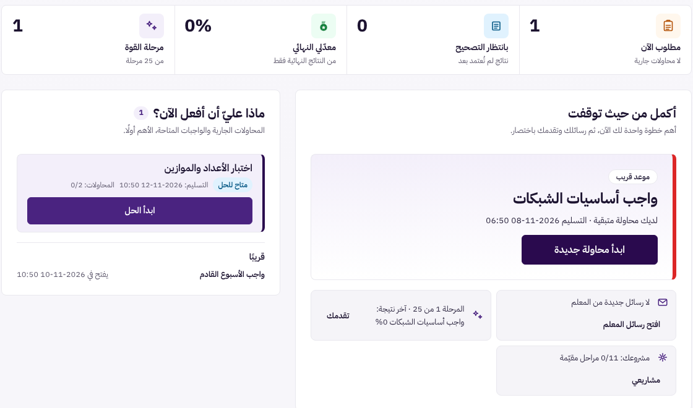
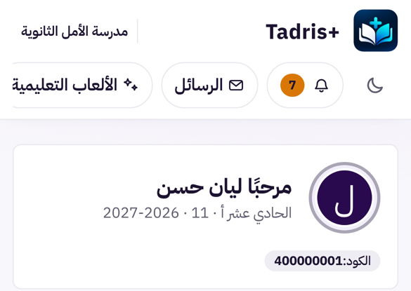
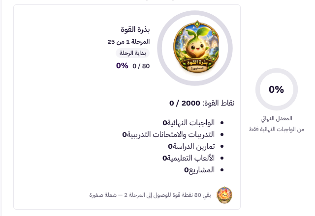
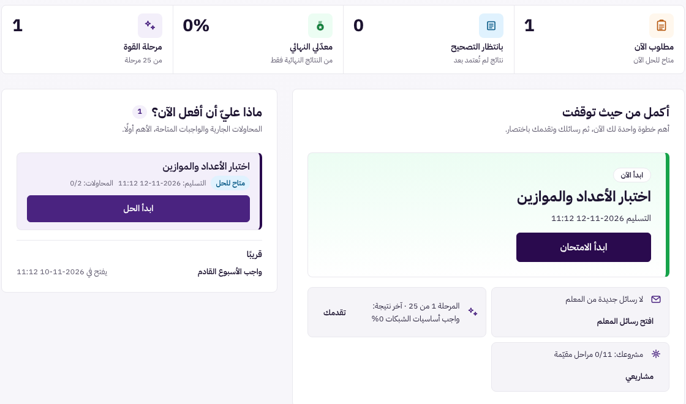
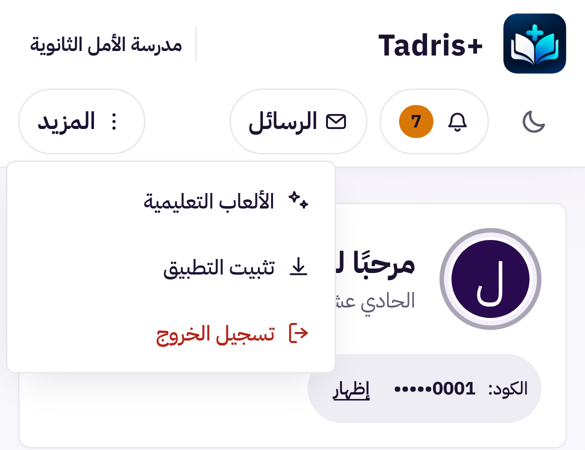
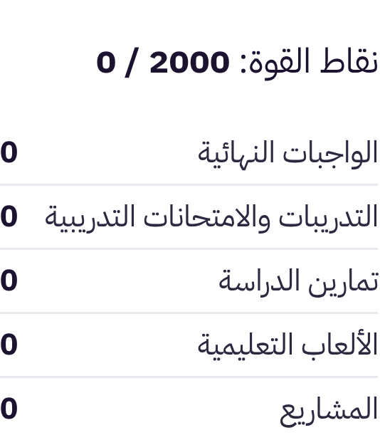

# UX-S1: بوابة الطالب، خطوة تالية واحدة متسقة، وقائمة «المزيد» على الهاتف، وتنسيق نقاط القوة، وإخفاء الكود

> **حالة الوثيقة:** وافق المالك على التصميم («أوافق على تصميم UX-S1 ابدأ التنفيذ»)، ونُفِّذ في الفرع نفسه (§7).
> طلب المالك: «قم بفحص صفحة الطالب وحللها بعمق…» ثم «ابدأ بتصميم UX-S1». هذه أولى مراحل العرض المقترحة لبوابة الطالب
> (UX-S1 إلى UX-S5)، وتعالج الأخطاء الظاهرة أولًا (البنود 1 إلى 4 في تقرير التحليل).

| البند | القيمة |
|---|---|
| المرحلة | UX-S1، الأولى من مراحل عرض بوابة الطالب |
| النوع | **عرض فقط:** لا تغيير في الخادم، ولا في التصحيح والعلامات، ولا في الصلاحيات، ولا في البيانات المحفوظة |
| Baseline | `origin/main` = `adf12d49` (دمج #566) |
| الفرع | `claude/blissful-shannon-9rv461-ux-s1-student-today` |
| الصور | قبل: `docs/assets/ux-s1/before-today.png`، `before-phone-header.png`، `before-strength-list.png`. بعد: `after-today.png`، `after-phone-menu.png`، `after-strength-list.png`. بيانات تجريبية فقط |

## 1. ما رأيناه اليوم (قياس بالواجهة الحقيقية وبيانات تجريبية)

**الطريقة:**
- الواجهة المبنية من `main`، ومعالجات الخادم الحقيقية فوق تخزين تجريبي في الذاكرة. لم تُلمس بيانات الإنتاج.
- معلمة نشرت 3 وحدات ومشروعًا و4 واجبات:
  - «واجب أساسيات الشبكات»: مفتوح، ومحاولتان، وموعده بعد 20 ساعة. سلّمت الطالبة محاولة واحدة فارغة، فنتيجتها النهائية 0%، وبقيت لها محاولة؛
  - «اختبار الأعداد والموازين»: مفتوح، و30 دقيقة، وموعده بعد 5 أيام، ولم يُبدأ؛
  - واجب منتهٍ دون تسليم؛
  - واجب يفتح بعد 3 أيام.
- القياس بـ Playwright على الحاسوب (1440) وعلى iPhone 13.

| الموضع | ما ظهر | المشكلة |
|---|---|---|
| **«أكمل من حيث توقفت»** (`StudentTodayHub`) | «واجب أساسيات الشبكات» بشريط **أحمر** «موعد قريب» وزر «ابدأ محاولة جديدة» | بطاقة الواجب نفسه في القائمة تقول **«مكتمل»**. وبجانبها «ماذا عليّ أن أفعل الآن؟» تعرض **واجبًا آخر** لم يُبدأ بعد |
| **«مطلوب الآن»** (`StudentKpiStrip`) | العدد 1، وتحته «لا محاولات جارية» | السطر الثاني ينفي الأول في ظاهره، والعدد لا يطابق ما يقترحه البطل أعلاه |
| **رأس الهاتف** (`StudentShell`) | الأزرار في شريط يُمرَّر أفقيًا بلا إشارة | «الألعاب التعليمية» مقطوعة، و**«تسجيل الخروج» و«تثبيت التطبيق» خارج الشاشة**. لا يجد الطالب الخروج إلا بالسحب أفقيًا |
| **«نقاط القوة»** (`StudentProgressSection`) | نقاط سوداء، والعدد ملتصق بالنص: «الواجبات النهائية0» | الصنف `eb-sp-strength-breakdown` **غير معرّف في أي ملف CSS** |
| **بطاقة الترحيب** (`StudentIdentityCard`) | «الكود: 400000001» بخط بارز | كود الطالب في الحسابات الجديدة هو **رقم الهوية** نفسه (`owner-classes add-student`). والصفحة تُعرض كثيرًا أمام الصف على جهاز العرض |

**سبب التضارب في الكود** (`src/student/today/todayPriority.ts`):
- القاعدة 2 («موعد قريب»، أولوية 2) تقبل أي واجب `isAttemptable`، ومنه الواجب **المكتمل** الذي بقيت له محاولة (`completed` و`canAttempt`).
- لذلك تتقدّم محاولة إضافية **اختيارية** على واجب **لم يُبدأ أصلًا**.
- أما «ماذا عليّ أن أفعل الآن؟» و«مطلوب الآن» فيعدّان `inProgress` و`available` فقط (`nowItems`).
- فهناك قاعدتان مختلفتان لسؤال واحد.

## 2. التصميم

### 2.1 خطوة تالية واحدة متسقة (`todayPriority.ts` و`StudentTodayHub.tsx`)

**القاعدة:** المحاولة الإضافية بعد نتيجة نهائية **اختيارية**، فلا تتقدّم أبدًا على عمل مطلوب لم يُبدأ، ولا تظهر بلون «موعد قريب» الأحمر.

| الأولوية | اليوم | المقترح |
|---|---|---|
| 1 | محاولة جارية | **بلا تغيير** |
| 2 | واجب يمكن حلّه وموعده خلال 48 ساعة، **ومنه المحاولة الإضافية** | واجب **لم يُسلَّم بعد** (`available`) وموعده خلال 48 ساعة |
| 3 | متابعة القراءة | **بلا تغيير** |
| 4 | مشروع قيد التقدّم | **بلا تغيير** |
| 5 | واجب يمكن حلّه بلا موعد قريب، وإلا أول وحدة | واجب **لم يُسلَّم بعد**. وإن لم يوجد: **محاولة إضافية** (نوع جديد `retry`، أقرب موعد أولًا). وإلا أول وحدة |

**تفاصيل القاعدة:**
- **المحاولة الإضافية تبقى مقترحة**، فلا يضيع على الطالب حقّه:
  - تظهر حين لا يوجد ما هو أهم؛
  - بعنوان «محاولة إضافية (اختيارية)» بلون محايد لا أحمر؛
  - وبسطر «نتيجتك النهائية N% · لديك محاولة متبقية · التسليم …». النسبة تُكتب فقط حين يكون للنتيجة إصدار معلن (`resultsVisible` ليست `false`)، بالقاعدة نفسها التي تتبعها الميداليات.
- **لا يتغير ما يُسمح به:** `canAttempt` و`availability` قراران من الخادم كما هما. التغيير **ترتيب العرض فقط**.
- **«ماذا عليّ أن أفعل الآن؟»** تبقى كما هي (`nowItems`)، وهي الآن تطابق البطل: إن اقترح البطل واجبًا، فهو أول عنصر في القائمة.

**سطر «مطلوب الآن»** (`StudentKpiStrip.tsx`):

| الحالة | السطر |
|---|---|
| محاولات جارية | «N قيد الحل» (كما اليوم) |
| لا جارية، وفي المطلوب واجبات | **«متاح للحل الآن»** |
| لا شيء | **«لا شيء مطلوب الآن»** |

لا يتغير العدد ولا مصدره.

**على بيانات المثال بعد التغيير:**
- البطل: «اختبار الأعداد والموازين» مع «ابدأ الامتحان»؛
- القائمة: الواجب نفسه أولًا؛
- «مطلوب الآن»: 1 · «متاح للحل الآن»؛
- بطاقة «واجب أساسيات الشبكات»: «مكتمل» و«النتيجة / محاولة جديدة»، كما اليوم.

### 2.2 قائمة «المزيد» في رأس الهاتف (`StudentShell.tsx` و`InstallAppEntry.tsx`)

**على الهاتف (≤ 720px):**
- تبقى ظاهرة دائمًا: زر الوضع الداكن، و«الإشعارات» بعدّادها، و«الرسائل» بعدّادها؛
- يُضاف زر **«المزيد»** (`ActionMenu` المشترك، نفسه في قائمة حساب المالك UX-O3) وفيه:
  - «الألعاب التعليمية» (حين تكون متاحة)؛
  - «تثبيت التطبيق» (حين لا يكون مثبّتًا)؛
  - **«تسجيل الخروج»** آخرًا، بلون التحذير.
- **لا تمرير أفقي:** كل ما في الرأس يتسع لعرض 360px.

**على الحاسوب:** الرأس **كما هو اليوم** بأزراره كلها، ولا قائمة.

**ما يبقى كما هو:**
- **تسجيل الخروج يبقى الطلب نفسه:** يمسح نسخ الإجابات غير المرسلة على الجهاز (`clearAllJournals`)، ثم `onLogout`، من الزر أو من القائمة.
- **التثبيت:**
  - حالته ونافذة الإرشاد تنتقلان إلى خطّاف صغير `useInstallEntry()` يستعمله الرأس مرة واحدة. السبب أن القائمة تُغلق بعد النقر، فلا يمكن أن تعيش النافذة داخلها.
  - السلوك نفسه: إن كان التطبيق مثبّتًا فلا عنصر.
  - مطالبة المتصفح الأصلية إن وُجدت، وإلا نافذة الإرشاد.

### 2.3 تنسيق «نقاط القوة» (CSS فقط، `studentportal-pro.css`)

- القائمة بلا نقاط.
- كل سطر: الاسم في البداية والعدد في النهاية بأرقام متساوية العرض (`tabular-nums`)، وفاصل رفيع بين الأسطر.
- لا تغيير في المكوّن ولا في القيم.

### 2.4 إخفاء جزء من الكود في بطاقة الترحيب (`StudentIdentityCard.tsx`)

- يُعرض الكود مخفيًا إلا آخر 4 خانات، مثل «الكود: •••••0001»، مع زر صغير **«إظهار»** (`aria-pressed`) يعرضه كاملًا ثم «إخفاء».
- كود من 4 خانات أو أقل (أكواد قديمة قصيرة) يُعرض كما هو.
- الحالة على الصفحة فقط: لا تُحفظ، وتعود مخفية عند فتح البوابة.
- **لا تغيير** في الكود نفسه، ولا في تسجيل الدخول، ولا في ما يرسله الخادم. هذا تقليل لما يظهر على الشاشة فقط، لا حماية. والحماية تبقى على الخادم كما هي.

### 2.5 الوصول والاتجاه

- كل الأزرار الجديدة لها اسم عربي واضح، وحجم لمس لا يقل عن 44px على الهاتف.
- القائمة بلوحة المفاتيح كما في `ActionMenu` (الأسهم، وEscape، وTab).
- RTL بخصائص منطقية فقط، والوضع الداكن بالمتغيرات نفسها، ولا ألوان ثابتة.

## 3. ما لا يتغير

- **الخادم كله:** `student-dashboard` وما يرسله، و`canAttempt` و`availability` و`dashboardState`.
- **التصحيح والعلامات والنتائج وإطلاقها**، والمحاولات وعددها.
- **بطاقات الواجبات** وأزرارها وفلاترها، و«ماذا عليّ أن أفعل الآن؟» بقاعدتها.
- **القواعد 1 و3 و4** في اختيار الخطوة التالية، ومنطق متابعة القراءة.
- **رأس الحاسوب**، وشريط التنقل السفلي على الهاتف، وPWA وتثبيتها.

## 4. الأداء

- لا طلبات جديدة ولا مكتبات جديدة.
- القائمة تُرسم عند فتحها فقط.
- ملف CSS للبوابة يزيد بضعة أسطر، وحارس حجم الحزمة يقيس ذلك في `npm run build`.

## 5. الاختبارات

1. **`todayPriority.ux-s1.test.ts` (جديد):**
   - واجب مكتمل بقيت له محاولة وموعده قريب، مع واجب لم يُبدأ وموعده بعيد: البطل هو **الذي لم يُبدأ**. اليوم يفشل، وهو اختبار fail-first على `adf12d49`.
   - المحاولة الإضافية وحدها: البطل `retry` بعنوان «محاولة إضافية (اختيارية)».
   - متابعة القراءة تتقدّم على المحاولة الإضافية.
   - نتيجة غير معلنة لا تُكتب نسبتها.
   - البطل يساوي أول عنصر في `nowItems` حين يكون واجبًا.
2. **`todayPriority.9a.test.ts`:** توقّعان يتغيران **بقرار هذا التصميم** لا لإخفاء خلل، ويُذكران صراحة في الـ PR:
   - «a remaining attempt after a final result IS offered»: يبقى العرض، لكن النوع `retry` بدل `assignment`؛
   - ثابت الأولويات `TODAY_PRIORITY` يضاف إليه `retry: 5`.

   باقي الاختبارات كما هي.
3. **`StudentKpiStrip`:** الأسطر الثلاثة لـ«مطلوب الآن».
4. **`StudentShell.ux-s1.test.tsx` (جديد):**
   - زر «المزيد» يفتح الألعاب والتثبيت والخروج؛
   - الخروج من القائمة يمسح الإجابات المحفوظة ثم يخرج، كالزر؛
   - التثبيت من القائمة يفتح نافذة الإرشاد وتبقى بعد إغلاق القائمة؛
   - مثبّت: لا عنصر تثبيت؛
   - لا ألعاب: لا عنصر ألعاب.
5. **`StudentIdentityCard`:** مخفي افتراضيًا (آخر 4 خانات)، و«إظهار» يعرضه كاملًا، والكود القصير كما هو.
6. **CSS:** اختبار يثبّت وجود قاعدة `.eb-sp-strength-breakdown`. واختبارات الألوان الحالية تمرّ بلا استثناء.
7. **قائمة مستوردي `ActionMenu`** (`ux2-shell-foundation.test.js`): يُضاف `StudentShell.tsx`.
8. **الطفرات** (`scripts/mutate-uxs1.mjs`، كل واحدة تُستعاد بايت ببايت):
   - إعادة المحاولة الإضافية إلى القاعدة 2؛
   - حذف شرط «لم يُسلَّم» من القاعدة 5؛
   - كتابة النسبة لنتيجة غير معلنة؛
   - الخروج من القائمة دون مسح الإجابات؛
   - عرض الكود كاملًا افتراضيًا؛
   - إسقاط عنصر الخروج من القائمة.
9. **صور قبل وبعد:** الحاسوب والهاتف والداكن بالبيانات التجريبية نفسها، وقياس: لا تمرير أفقي في رأس الهاتف عند 360 و390.
10. **التحقق الكامل:** `npm test`، و`npm run lint` (خط الأساس 140 تحذيرًا)، و`npx tsc -b`، و`npm run build`، و`git diff --check`. ثم CI على الـ commit النهائي.

## 6. خارج النطاق (مراحل لاحقة مقترحة)

- **UX-S2:** عروض مستقلة بروابط بدل الصفحة الواحدة، وتبسيط «اليوم»، ونقل بطاقة التثبيت الكبيرة.
- **UX-S3:** قائمة الواجبات مجمّعة حسب الموعد، وصفحة نتيجة بسياق.
- **UX-S4:** تبسيط التقدّم والمشاريع، وإزالة الرموز الداخلية من النص.
- **UX-S5:** حل الامتحان على الهاتف، والوضع الداكن التلقائي، والإشعارات.
- **تغيير الكود نفسه** بعيدًا عن رقم الهوية: قرار هوية مستقل، لا يمسّه هذا العرض.

## 7. التنفيذ (بعد الموافقة)

### 7.1 الملفات

| الملف | التغيير |
|---|---|
| `src/student/today/todayPriority.ts` | `isUnstarted` و`isRetry`. القاعدة 2 للواجب الذي لم يُسلَّم فقط، والقاعدة 5: الواجب الذي لم يُسلَّم ثم `retry` ثم أول وحدة. `retryCandidate` بالنسبة المعلنة فقط |
| `src/student/today/StudentTodayHub.tsx`، `today.css` | عنوان «محاولة إضافية (اختيارية)» ونمط `is-retry` المحايد |
| `src/student/portalPresentation.ts` | `kpiNowHint` و`maskCode` (دوال عرض بلا React) |
| `src/student/StudentKpiStrip.tsx` | سطر «مطلوب الآن» من `kpiNowHint` |
| `src/student/StudentIdentityCard.tsx` | الكود مخفيًا مع «إظهار» / «إخفاء» (`aria-pressed`) |
| `src/pwa/useInstallEntry.tsx` (جديد)، `InstallAppEntry.tsx` | سلوك التثبيت ونافذته في خطّاف، والمكوّن القديم يستعمله بلا تغيير في سلوكه |
| `src/shell/StudentShell.tsx`، `src/student/student-portal-v2.css` | المجموعة العريضة للحاسوب، وقائمة «المزيد» للهاتف، ونافذة التثبيت مرة واحدة في الرأس، والخروج دالة واحدة للمكانين. لا تمرير أفقي على الهاتف |
| `src/studentportal-pro.css` | قاعدة `.eb-sp-strength-breakdown`، وزر الكود (44px للهاتف، و32px من 768px داخل الكتلة الموجودة) |
| اختبارات جديدة | `todayPriority.ux-s1.test.ts` (7)، `StudentShell.ux-s1.test.tsx` (6)، `studentPortal.ux-s1.test.tsx` (6) |
| اختبارات قائمة | `todayPriority.9a.test.ts`: التوقّعان المذكوران في §5.2. `ux2-shell-foundation.test.js`: `StudentShell.tsx` في قائمة مستوردي `ActionMenu`. `exam21e3.units.test.tsx`: عزل اسم `Tadris+` يُفحص في `useInstallEntry.tsx` حيث انتقلت النافذة، والفحص نفسه لم يتغير |
| `scripts/mutate-uxs1.mjs` (جديد) | 6 طفرات |

### 7.2 فروق عن التصميم

- **دالتا العرض** `kpiNowHint` و`maskCode` في `portalPresentation.ts` لا في ملفات المكوّنات، كي لا يزيد تحذير `only-export-components`. فبقي خط أساس الفحص 140 تحذيرًا.
- **ترتيب القائمة في اختبار «أول عنصر»:** الخادم يرتّب الواجبات بالموعد (`student-dashboard`)، فبيانات الاختبار بهذا الترتيب.

### 7.3 الإثبات

- **Fail-first** (`f615358e`، الكود كما في `adf12d49`): 7 من 7 تفشل في `todayPriority.ux-s1.test.ts`. مثال: البطل `assignment` للمحاولة الإضافية بدل الواجب الذي لم يُبدأ.
- **بعد التنفيذ:** 7 من 7، و19 اختبارًا جديدًا كلها ناجحة.
- **الطفرات:** 6 من 6 قُتلت، وكل ملف استُعيد بايت ببايت.
- **الصور بعد التنفيذ** بالبيانات التجريبية نفسها:
  - البطل «اختبار الأعداد والموازين» مع «ابدأ الامتحان»، وهو أول عنصر في «ماذا عليّ أن أفعل الآن؟»؛
  - «مطلوب الآن: 1 · متاح للحل الآن»؛
  - رأس الهاتف عند 360 و390: لا تمرير أفقي، وأربعة أزرار بارتفاع 44px؛
  - رأس الحاسوب بلا تغيير.

