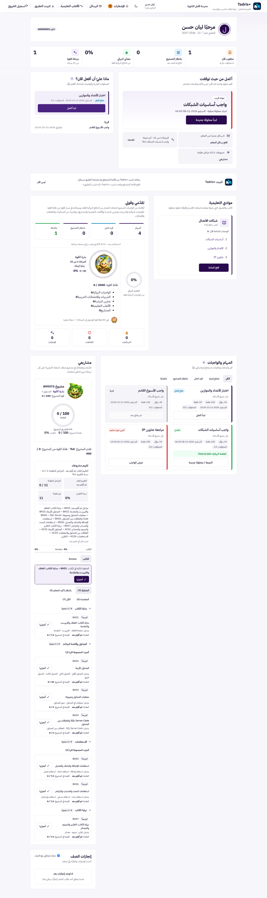
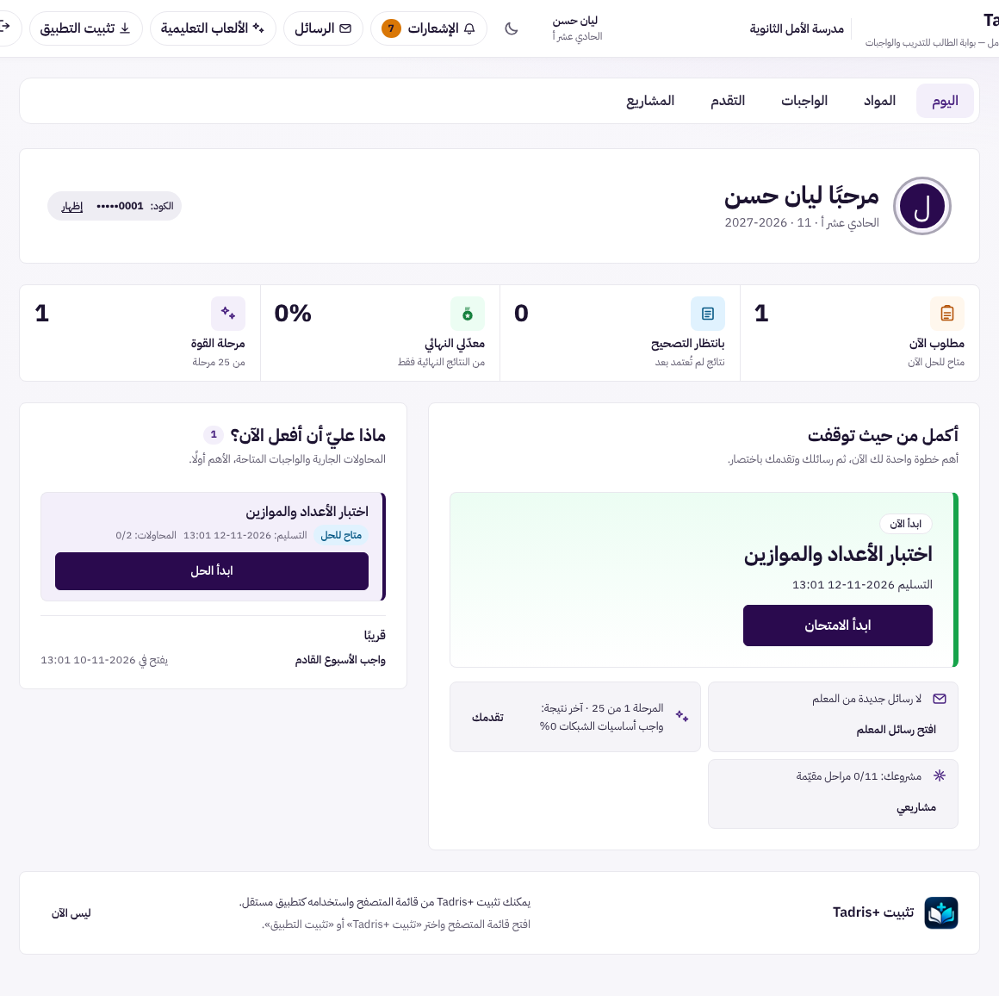
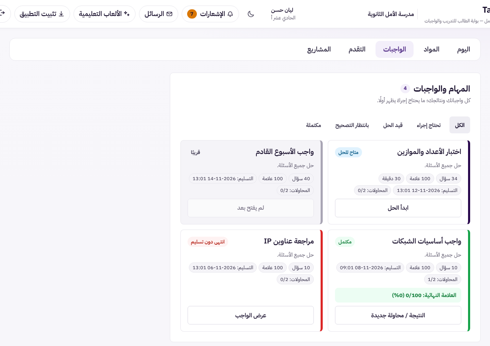
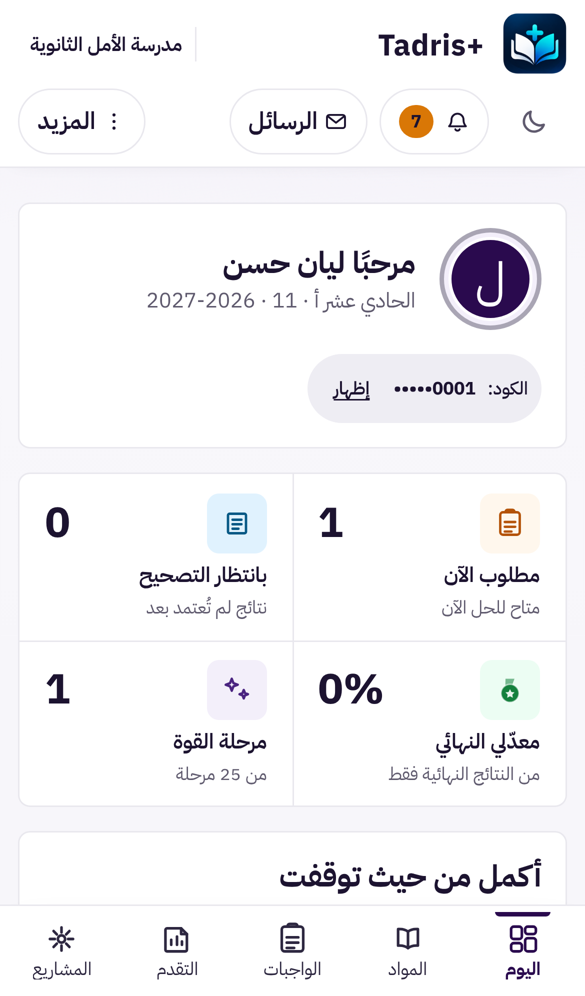
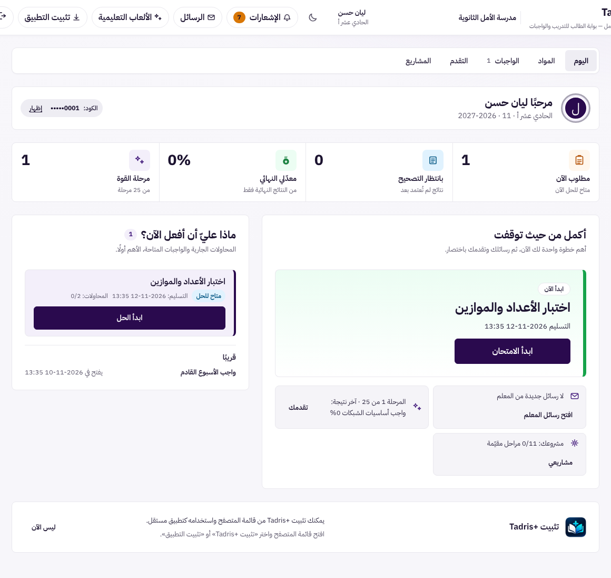
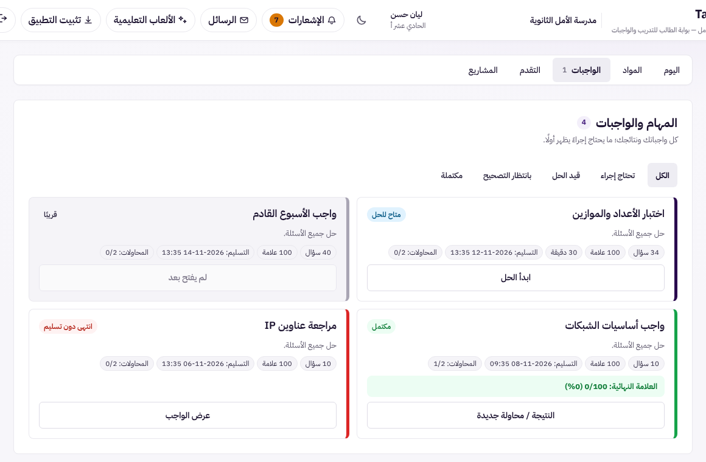
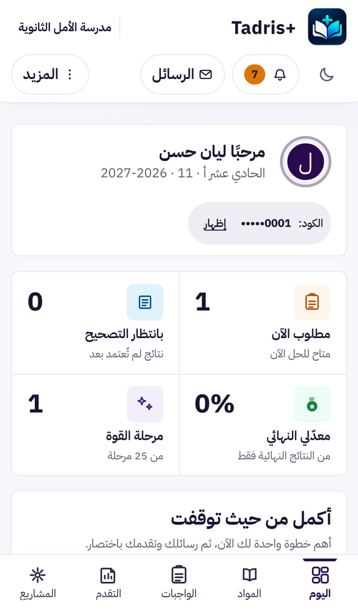
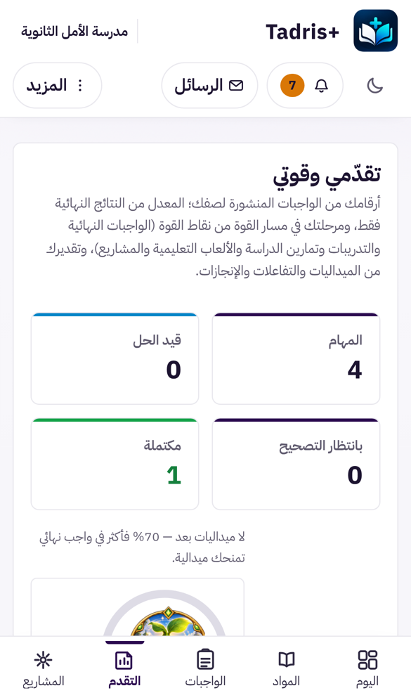

# UX-S2: بوابة الطالب في خمسة عروض لكلٍّ منها رابط، بدل صفحة واحدة طويلة

> **حالة الوثيقة:** وافق المالك على التصميم («أوافق على تصميم UX-S2 ابدأ التنفيذ»)، ونُفِّذ في الفرع نفسه (§7).
> طلب المالك: «ابدأ بتصميم UX-S2». هذه المرحلة الثانية من مراحل عرض بوابة الطالب (UX-S1 مدموجة في #567)، وتعالج البندين 5 و6 في تقرير التحليل:
> - صفحة واحدة لكل شيء؛
> - «اليوم» مزدحم.

| البند | القيمة |
|---|---|
| المرحلة | UX-S2، الثانية من مراحل عرض بوابة الطالب |
| النوع | **عرض فقط:** لا تغيير في الخادم، ولا في التصحيح، ولا في الصلاحيات، ولا في البيانات |
| Baseline | `origin/main` = `9397273f` (دمج #567) |
| الفرع | `claude/blissful-shannon-9rv461-ux-s2-student-views` |
| الصور | قبل: `docs/assets/ux-s2/before-desk-full.png`. توضيحية: `mock-desk-today.png`، `mock-desk-tasks.png`، `mock-phone-today.png`. بعد: `after-desk-today.png`، `after-desk-tasks.png`، `after-phone-today.png`، `after-phone-progress.png`، `after-dark-today.png`. بيانات تجريبية فقط |

## 1. ما رأيناه اليوم (قياس بالواجهة الحقيقية وبيانات تجريبية)

**الطريقة:** هي نفسها في UX-S1:
- الواجهة المبنية من `main` فوق معالجات الخادم الحقيقية وتخزين تجريبي؛
- طالبة في صف فيه 3 وحدات ومشروع و4 واجبات؛
- الطول المقيس هو طول الصفحة حين تُعرض أقسام كل عرض وحدها، والباقي مخفي.

| | الصفحة اليوم | «اليوم» وحده | «المواد» | «الواجبات» | «التقدم» | «المشاريع» |
|---|---|---|---|---|---|---|
| **الحاسوب** (1440) | **4821** | 1074 | 900 | 900 | 985 | 2764 |
| **الهاتف** (390) | **7350** | 1814 | 683 | 1329 | 1487 | 2891 |

**المشكلات:**
- **كل شيء في صفحة واحدة:** على الهاتف نحو 9 شاشات، ويجب المرور بالمشاريع (نحو 2700 بكسل) للوصول إلى «إنجازات الصف».
- **التنقل الحالي لا يغيّر العنوان:** أزرار الشريط السفلي على الهاتف تمرّر الصفحة فقط (`StudentMobileNav`، `scrollToStudentSection`). فلا يوجد رابط لـ«واجباتي»، ولا يعيد زر الرجوع إلى العرض السابق.
- **لا تنقّل على الحاسوب:** الشريط السفلي للهاتف فقط، فلا يرى الحاسوب أي طريق إلى الأقسام إلا التمرير.
- **التخطيط بعمودين بأطوال غير متساوية:** يترك فراغات كبيرة. مثلًا عمود «المشاريع» وحده نحو 2600 بكسل بجانب الواجبات.

## 2. التصميم

### 2.1 خمسة عروض

| العرض | الرابط | ما فيه | من أين يأتي |
|---|---|---|---|
| **اليوم** (الافتراضي) | `#/s/today` | الترحيب، والمؤشرات الأربعة، و«أكمل من حيث توقفت»، و«ماذا عليّ أن أفعل الآن؟»، ثم بطاقة تثبيت التطبيق وبطاقة إشعارات الرسائل في آخره | الأقسام نفسها |
| **المواد** | `#/s/learning` | «موادي التعليمية» | `StudentLearningMaterials` |
| **الواجبات** | `#/s/tasks` | «المهام والواجبات» بفلاترها وبطاقاتها | القسم نفسه |
| **التقدم** | `#/s/progress` | «تقدّمي وقوتي»، ثم «إنجازات الصف» | `StudentProgressSection`، `AchievementFeed` |
| **المشاريع** | `#/s/projects` | «مشاريعي» | `StudentProjectPanel` |

**قواعد العرض:**
- **كل عرض بعرض الصفحة كاملًا** (عمود واحد)، إلا «اليوم» على الحاسوب: يبقى «أكمل من حيث توقفت» و«ماذا عليّ أن أفعل الآن؟» جنبًا إلى جنب كما اليوم.
- **«المشاريع» يظهر في التنقل فقط حين يكون للطالب مشروع.** يُعرف ذلك من قراءة اللوحة نفسها، لأنها لا ترسم شيئًا حين لا يوجد مشروع. هكذا يعمل الشريط السفلي اليوم أيضًا (`missing`). ورابط `#/s/projects` بلا مشروع يفتح «اليوم».

### 2.2 الأقسام كلها تبقى محمّلة

**لا تغيير في القراءات:**
- العروض غير المختارة تبقى مركّبة ومخفية (`hidden`)، كما في أقسام محرّر الوصول في UX-O2.
- لذلك لا قراءة جديدة ولا قراءة مكرّرة عند التنقل بين العروض.
- تبقى القراءات كما هي: قراءة اللوحة `student-dashboard` وتحديثها التلقائي كل 15 ثانية، وقراءة المواد، وقراءة المشاريع، والإنجازات.

**وتبقى حالة كل عرض:** الفلتر المختار في الواجبات، والمرحلة المفتوحة في المشاريع، كلها تبقى عند العودة إلى العرض.

### 2.3 التنقل

**على الحاسوب والجهاز اللوحي (≥ 768px):**
- شريط أفقي تحت رأس الصفحة بالعروض الخمسة، بنمط `SubNav` المشترك (أفقيًا).
- عناصره `<nav aria-label="أقسام بوابة الطالب">` وأزرار بها `aria-current="page"` للعرض الحالي، ومع «الواجبات» عدد ما يحتاج إجراءً.

**على الهاتف:**
- الشريط السفلي الحالي نفسه (`StudentMobileNav`)، بالأيقونات والأسماء نفسها.
- لكنه **يغيّر العرض** بدل التمرير. حذف مراقب التمرير (`IntersectionObserver`) لأنه لم يعد لازمًا.

**الرابط وزر الرجوع:**
- تغيير العرض يكتب `#/s/<عرض>` في العنوان، فيكون لكل عرض رابط.
- زر الرجوع في المتصفح والهاتف يعود إلى العرض السابق.
- فتح البوابة بلا رابط، أو برابط غير معروف، يفتح «اليوم».

**التركيز والتمرير:**
- عند تغيير العرض ينتقل التمرير إلى الأعلى، بلا حركة حين يطلب الجهاز تقليل الحركة.
- ويُوضع التركيز على عنوان العرض (`h2`)، كما يفعل التنقل الحالي، كي يعلم قارئ الشاشة أين صار.

**حدود الروابط الجديدة:**
- تبدأ بـ `#/s/` كي لا تتداخل مع `#/owner` و`#/invite/` و`#/handoff/`.
- لا تعيد تحميل الصفحة، لأن `main.tsx` يعيد التحميل فقط عند الانتقال بين تلك الأسطح.
- صفحة المعلم لا تقرأ هذه الروابط.

### 2.4 كل الأزرار التي كانت «تمرّر» تفتح العرض الصحيح

| من | اليوم | بعد UX-S2 |
|---|---|---|
| مؤشر «مطلوب الآن» | يمرّر إلى «ماذا عليّ أن أفعل الآن؟» | «اليوم» ثم القسم نفسه |
| مؤشر «بانتظار التصحيح» | يمرّر إلى «المهام والواجبات» | عرض «الواجبات» |
| مؤشرا «معدّلي» و«مرحلة القوة» | يمرّران إلى «تقدّمي» | عرض «التقدم» |
| زر «تقدمك» في «اليوم» | يمرّر | عرض «التقدم» |
| زر «المهام والواجبات» في حالة «لا شيء عاجل» | يمرّر | عرض «الواجبات» |
| زر «مشاريعي» وخطوة مشروع في «أكمل من حيث توقفت» | يمرّر أو يفتح المشروع | عرض «المشاريع» ثم المشروع نفسه (Phase 12D) |
| إشعار واجب لم يُفتح بعد | يمرّر إلى بطاقته | عرض «الواجبات» ثم البطاقة، بالتركيز عليها |
| إشعار «تفاعل المعلم» أو «ملاحظة» على إنجاز | يمرّر إلى المنشور | عرض «التقدم» ثم المنشور |
| إشعار مادة جديدة، أو فتح واجب | يفتح القارئ أو صفحة الامتحان | **بلا تغيير** |

**عند العودة من الامتحان أو القارئ أو الرسائل أو الألعاب:** يعود الطالب إلى **العرض الذي خرج منه**.

### 2.5 «اليوم» أبسط

- **الترحيب أخف:** صورة الطالب أصغر، والاسم والصف في سطر، والكود (المخفي منذ UX-S1) بجانبهما. على الهاتف يصغر من نحو 164 إلى نحو 96 بكسل. ولا يظهر الترحيب في العروض الأخرى، فلكل عرض عنوانه.
- **ترتيب «اليوم»:**
  1. الترحيب؛
  2. المؤشرات؛
  3. «أكمل من حيث توقفت» و«ماذا عليّ أن أفعل الآن؟»؛
  4. بطاقة التثبيت وبطاقة إشعارات الرسائل **في آخر «اليوم»** بدل وسطه. تبقى بقواعدها نفسها (الإخفاء 7 أيام، ولا شيء حين يكون التطبيق مثبّتًا).

**الطول المتوقع:**
- الهاتف: نحو 1700 بكسل بدل 7350، أي نحو شاشتين؛
- الحاسوب: نحو شاشة واحدة.

### 2.6 الوصول والاتجاه

- **أحجام اللمس:** شريط الحاسوب بأزرار ارتفاعها 40px، والشريط السفلي للهاتف كما هو، 44px على الأقل.
- **لوحة المفاتيح:**
  - Tab يمرّ على عناصر الشريط بترتيبها؛
  - Enter أو Space يفتح العرض؛
  - العرض المخفي `hidden`، فلا تصل إليه لوحة المفاتيح ولا قارئ الشاشة.
- **الاتجاه والألوان:** RTL بخصائص منطقية فقط، والوضع الداكن بالمتغيرات نفسها، والعرض الحالي معلَّم بالنص والوزن لا باللون وحده.

## 3. ما لا يتغير

- **الخادم كله وكل القراءات وتوقيتها.**
- **التصحيح، والنتائج، والمحاولات.**
- **محتوى كل قسم وسلوكه:**
  - بطاقات الواجبات وفلاترها؛
  - قسم التقدم ومسار القوة؛
  - المشاريع وزر «أنجزتها»؛
  - الإنجازات والتفاعل.
- **الصفحات التي تأخذ الشاشة كاملة** كما هي، بلا رابط جديد: الامتحان، والقارئ، والرسائل، والألعاب، ونافذة الأيقونة.
- **رأس الصفحة وقائمة «المزيد»** (UX-S1)، **والإشعارات**.
- **PWA والتثبيت.**

## 4. الأداء

- لا قراءة جديدة: كل الأقسام مركّبة كما اليوم، وإخفاؤها لا يستدعي شيئًا.
- إزالة مراقب التمرير من الشريط السفلي تقلل العمل على الهاتف.
- حجم الحزمة يزيد بضع مئات من البايتات (منطق العرض والشريط)، وحارس الحزمة يقيس ذلك.

## 5. الاختبارات

1. **منطق العرض (جديد، دوال بلا React):**
   - قراءة الرابط إلى عرض: معروف، وغير معروف يصير «اليوم»، و«المشاريع» بلا مشروع يصير «اليوم»؛
   - كتابة الرابط عند التغيير.
2. **البوابة (جديد):**
   - «اليوم» افتراضيًا، والأقسام الأخرى مخفية لكنها مركّبة: قراءة المواد والمشاريع تحدث مرة واحدة كما اليوم؛
   - تغيير العرض من الشريط يغيّر الرابط ويضع التركيز على العنوان؛
   - زر الرجوع يعيد العرض السابق؛
   - الرابط المباشر `#/s/tasks` يفتح «الواجبات».
3. **كل زر في جدول §2.4** يفتح العرض الصحيح، ويصل إلى الهدف بالتركيز عليه.
4. **العودة** من الامتحان أو القارئ أو الرسائل أو الألعاب إلى العرض نفسه.
5. **«المشاريع»:** لا يظهر في التنقل بلا مشروع، ويظهر حين تعيد قراءة اللوحة مشروعًا.
6. **الهاتف:** الشريط السفلي يغيّر العرض و`aria-current` يتبعه، ولا مراقب تمرير.
7. **الاختبارات القائمة التي تعرض البوابة** (31 ملفًا تقريبًا):
   - ما يبحث فيها عن عنصر في عرض آخر يفتح ذلك العرض أولًا. هذا تغيير بقرار هذا التصميم لا لإخفاء خلل، ويُذكر كل ملف في الـ PR.
   - لا يُحذف اختبار ولا يُخفَّف فحص.
8. **بوابة الصور (UX-R19b):**
   - مشهد `student-portal` يصير «اليوم»، ويُعلن ذلك بسببه؛
   - مشاهد جديدة للعروض الأربعة الأخرى، كي تبقى مراقبة. تُضاف إلى أداة الالتقاط، بالبناءين.
9. **الطفرات** (`scripts/mutate-uxs2.mjs`):
   - العرض غير المختار يُفكّ تركيبه بدل إخفائه، فتتكرر القراءة؛
   - الرابط لا يُكتب؛
   - زر الرجوع لا يعيد العرض؛
   - إشعار الواجب يمرّر دون فتح «الواجبات»؛
   - «المشاريع» يظهر بلا مشروع؛
   - التركيز لا ينتقل إلى العنوان.
10. **صور قبل وبعد** لكل عرض على الحاسوب والهاتف والوضع الداكن، و**قياس الأطوال**.
11. **التحقق الكامل:** الاختبارات، وفحص الكود (خط الأساس 140)، والأنواع، والبناء، و`git diff --check`. ثم CI على الـ commit النهائي.

## 6. خارج النطاق (مراحل لاحقة)

- **UX-S3:** قائمة الواجبات مجمّعة حسب الموعد، وصفحة نتيجة بسياق.
- **UX-S4:** تبسيط التقدّم والمشاريع، وإزالة الرموز الداخلية من النص.
- **UX-S5:** حل الامتحان على الهاتف، والوضع الداكن التلقائي، والإشعارات.
- **رابط لصفحات الشاشة الكاملة** (الامتحان والقارئ): يحتاج قرارًا منفصلًا لأنه يمسّ حالة المحاولة.
- **إصلاح بيانات المشهد التجريبي** في أداة الصور (الملاحظة في #567): ليس لها أثر على الطالب.

## 7. التنفيذ (بعد الموافقة)

### 7.1 الملفات

| الملف | التغيير |
|---|---|
| `src/student/portalViews.ts` (جديد) | العروض الخمسة وروابطها (`#/s/<عرض>`)، و`viewFromHash` (رابط غير معروف، أو «المشاريع» بلا مشروع، يفتح «اليوم»)، وعنوان كل عرض |
| `src/StudentPortal.tsx` | حالة العرض، و`goView()` (يكتب الرابط في السجل، وينقل التمرير إلى الأعلى، ويضع التركيز على العنوان)، و`popstate` لزر الرجوع. الأقسام في خمسة أوعية `data-view` مخفية بـ `hidden` ومركّبة كلها. شريط الحاسوب (`SubNav`). المؤشرات واختصارات «اليوم» وإشعار الواجب المجدول وإشعار التفاعل وتعمّق المشروع تفتح العرض الصحيح |
| `src/shell/StudentMobileNav.tsx` | يفتح العرض، و`aria-current="page"` للعرض الحالي، وحُذف مراقب التمرير |
| `src/projects/StudentProjectPanel.tsx` | `onAvailableChange`: اللوحة تُخبر بعد قراءتها هل للطالب مشروع |
| `src/student/StudentIdentityCard.tsx`، `src/student/student-portal-v2.css` | صورة 44px. العروض أعمدة بـ `:not([hidden])`، و«اليوم» يبقى بعمودين على الشاشات العريضة، وقواعد بطاقة التثبيت وقائمة «الآن» تتبع «اليوم». شريط الحاسوب من 768px. بطاقة الترحيب في سطر من 768px، وتنكسر على الهاتف |
| `src/test-setup/studentViewReset.ts` (جديد)، `vite.config.ts` | كل اختبار يبدأ على «اليوم»: يُزال رابط عرض الطالب فقط بين الاختبارات، على غرار `devicePrefsReset.ts` (P8-B2b) |
| `src/student/portalViews.testkit.ts` (جديد) | `openStudentView()`: الاختبار يصل إلى القسم كما يصل الطالب، من شريط العروض |
| `scripts/capture-visual-baseline-ux-r.mjs` | مشاهد `student-learning` و`student-tasks` و`student-progress`. لا مشهد لـ«المشاريع»، لأن طالب أداة الصور بلا مشروع |
| `docs/ux-r/visual-changes.json` | التغييرات البصرية المقصودة مُعلنة بسببها (§7.3) |
| `scripts/mutate-uxs2.mjs` (جديد) | 6 طفرات |

### 7.2 الاختبارات

**اختبارات جديدة:**
- `portalViews.ux-s2.test.ts` (7): الروابط، والرجوع إلى «اليوم»، وحدود `#/s/`، وعقد الـ CSS؛
- في `StudentPortal.mobileNav.12c.test.tsx`: فتح كل عرض بالرابط والتركيز وأعلى الصفحة، وزر الرجوع، والرابط المباشر، والعودة من الرسائل إلى العرض نفسه؛
- `notificationCenter.6d`: يتحقق أيضًا من أن العرض الصحيح هو الظاهر.

**الاختبارات القائمة التي تبحث في عرض آخر** تفتحه أولًا بـ `openStudentView`، ولم يُحذف منها أي فحص. وهي عشرة ملفات:
- `authority`، `b2b`، `grading`، `strengthAuthority`، `training`؛
- `phase8b`، `phase8d`؛
- `learningMaterials`، `todayHub.9a`، `ux7a`.

**توقعات تغيّرت بقرار هذا التصميم** (التمرير صار فتح عرض)، وكلها مذكورة في الـ PR:
- ترتيب الأقسام في `ux7a`: الأقسام نفسها بترتيبها، مجمّعة في العروض الخمسة؛
- مكان المواد في `learningMaterials`: صار العرض كله؛
- المؤشرات في `v2.21e`، واختصارات «اليوم» في `todayHub.9a`؛
- شريط الهاتف: أُعيدت كتابة `StudentMobileNav.12c` لسلوكه الجديد مع إبقاء عقد الـ CSS كما هو، و`StudentPortal.mobileNav.12c`؛
- تعمّق المشروع في `projectDrill.12d`: التمرير والحركة بلا تغيير، والجديد أن عرض «المشاريع» يُفتح أولًا.

### 7.3 الإثبات

- **الحالة:** تصميم، وليس إصلاح خلل، فلا اختبار يفشل قبل التغيير بالمعنى الحرفي. اختبارات العرض الجديدة تفشل على `main`، لأن الروابط والعروض غير موجودة هناك.
- **الطفرات:** 6 من 6 قُتلت، وكل ملف استُعيد بايت ببايت.
- **المعاينة الحية** (بيانات تجريبية، بعد الإصلاح):

  | | اليوم | المواد | الواجبات | التقدم | المشاريع |
  |---|---|---|---|---|---|
  | الحاسوب | 1096 | 900 | 900 | 1297 | 2002 |
  | الهاتف 390 | 1794 | 683 | 1329 | 1487 | 2891 |

  - على الهاتف كانت الصفحة 7350 بكسل، و4821 على الحاسوب؛
  - لا تمرير أفقي عند 360 و390 و1440، ولا أخطاء في الصفحة؛
  - زر الرجوع يعيد العرض السابق.
- **بوابة الصور (UX-R19b) محليًا، مقارنةً ببناء `main`، على الحاسوب والهاتف والجهاز اللوحي:**
  - 231 صورة؛
  - التغيير في 4 صفحات فقط: `student-portal` و`student-learning` و`student-tasks` و`student-progress`؛
  - لا تغيير في أي صفحة أخرى: الامتحان والألعاب والرسائل وصفحات المعلم؛
  - التغييرات الأربعة مُعلنة بسببها في `docs/ux-r/visual-changes.json` (`viewport: all`)، والملف صالح بلا أخطاء. لم يتغير أي حدّ ولا أي فحص.
- **ما أصلحته المعاينة قبل الإثبات:**
  - بطاقة الترحيب كانت تكسر الاسم والسنة على الهاتف؛
  - قواعد الشاشة العريضة لبطاقة التثبيت وقائمة «الآن» كانت مكتوبة لأبناء الصفحة المباشرين. الإصلاح في `73ea5827`.

