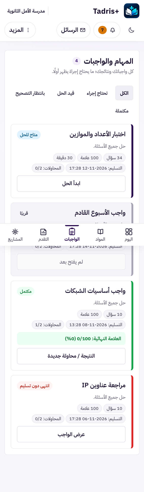
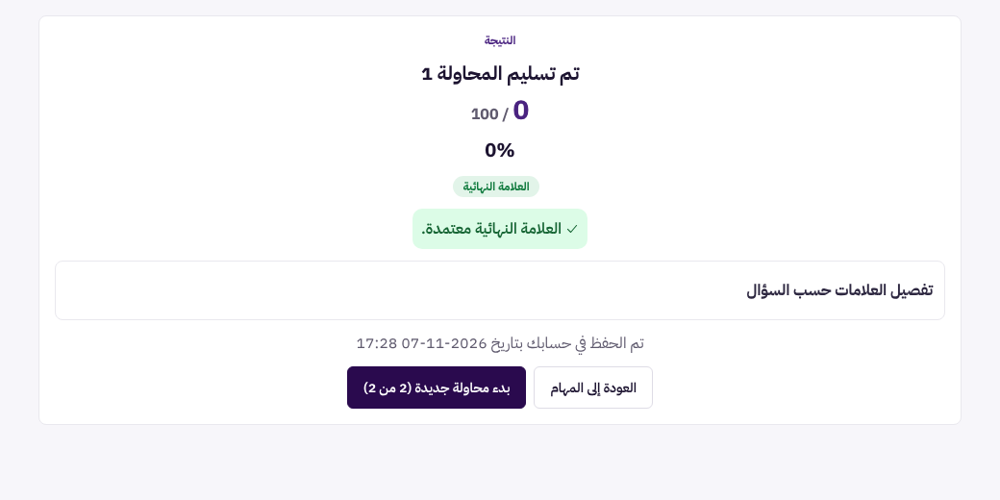
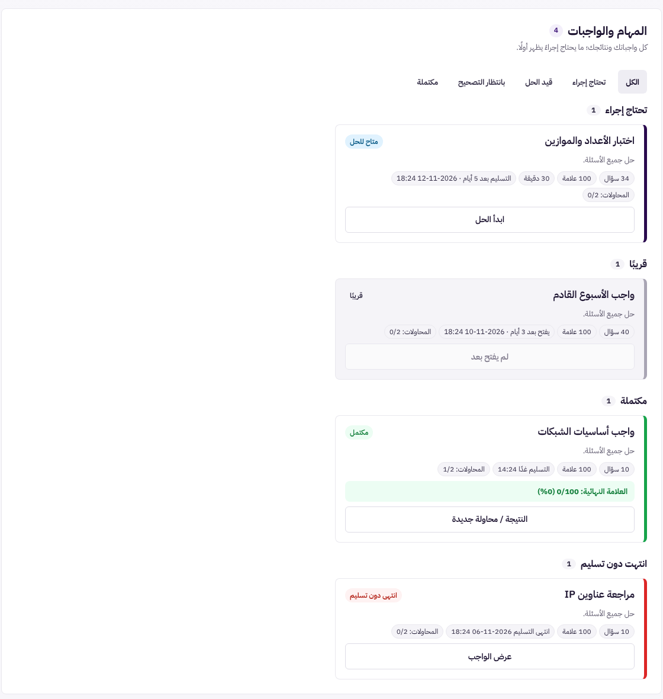
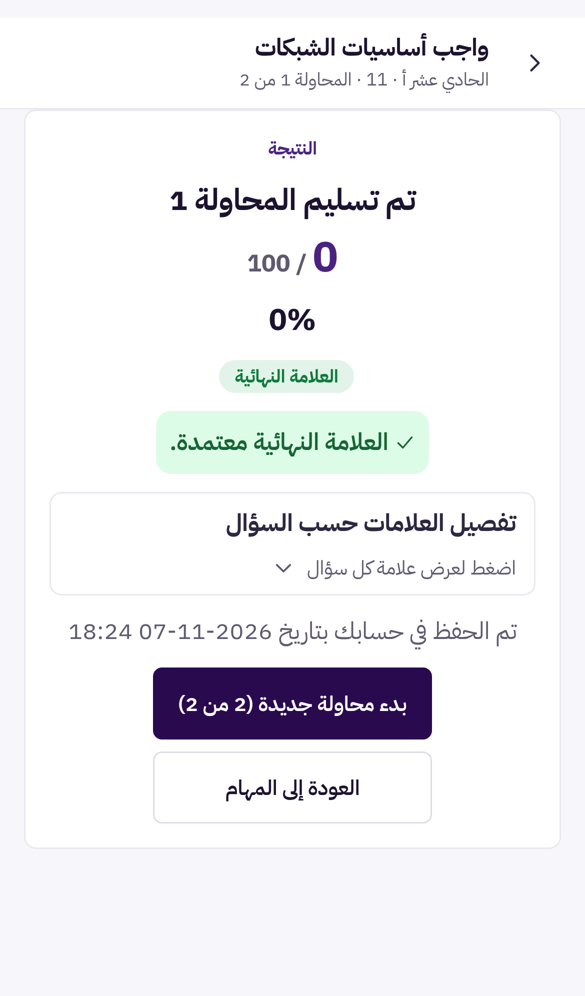

# UX-S3: «الواجبات» مجمّعة بالحالة مع مواعيد مفهومة، وصفحة نتيجة تعرف أي واجب هي

> **حالة الوثيقة:** وافق المالك على التصميم («اوافق ابدا»، ثم بالعبارة الكاملة «أوافق على تصميم UX-S3 ابدأ التنفيذ»)، ونُفِّذ في الفرع نفسه (§7).
> طلب المالك: «ابدا» بعد اقتراح UX-S3. هذه المرحلة الثالثة من مراحل عرض بوابة الطالب (UX-S1 في #567، وUX-S2 في #568)، وتعالج البندين 9 و13 في تقرير التحليل.

| البند | القيمة |
|---|---|
| المرحلة | UX-S3 |
| النوع | **عرض فقط:** لا تغيير في الخادم، ولا في التصحيح، ولا في المحاولات، ولا في إطلاق النتائج |
| Baseline | `origin/main` = `12ffaa11` (بعد #568 و#569 و#570) |
| الفرع | `claude/blissful-shannon-9rv461-ux-s3-tasks-results` |
| الصور | قبل: `docs/assets/ux-s3/before-phone-tasks.png`، `before-desk-result.png`. بعد: `after-desk-tasks.png`، `after-phone-tasks.png`، `after-phone-result.png`. بيانات تجريبية فقط |

## 1. ما رأيناه اليوم (المعاينة الحية، بيانات تجريبية)

### 1.1 «الواجبات» (`StudentPortal.tsx` + `StudentAssignmentCard.tsx`)

**الحالة الحالية:**
- قائمة واحدة مرتّبة بالحالة (`sortTaskFirst`)، لكن **بلا عناوين**. الواجب المتاح والقادم والمكتمل والمنتهي تتتالى بطاقاتٍ متشابهة، ولا يفصلها إلا لون الحافة والشارة.
- **الموعد تاريخ رقمي فقط** («التسليم: 2026-11-12 17:28»). الطالب يحسب بنفسه هل بقي يوم أم أسبوع، وهل فاته الموعد.
- على الهاتف كل بطاقة نحو 320 بكسل. بأربع واجبات صار العرض 1321 بكسل، وفي صف حقيقي فيه 20 واجبًا يصير قائمة طويلة لا يُعرف فيها أين يبدأ «ما عليّ».

### 1.2 صفحة النتيجة (`StudentExamPage.tsx`، فرع `!started && result`)

**المحتوى الحالي:**
- «النتيجة»؛
- «تم تسليم المحاولة 1»؛
- العلامة، وشارة «العلامة النهائية»؛
- «تفصيل العلامات حسب السؤال»؛
- تاريخ الحفظ، وزرّا «العودة إلى المهام» و«بدء محاولة جديدة».

**المشكلات:**
- **لا يظهر اسم الواجب في أي مكان**، ولا الصف، ولا كم محاولة مسموحة. من يفتح نتيجتين متتاليتين لا يميّز بينهما.
- **لا شريط علوي:** شاشة الحل نفسها لها شريط فيه الاسم والصف والمحاولة وزر الرجوع (`ExamTopBar`)، وصفحة النتيجة بلا شيء من ذلك.
- **«تفصيل العلامات حسب السؤال» مطويّ** (`
`) بلا أي إشارة إلى أنه يُفتح. يبدو صندوقًا فارغًا.

## 2. التصميم

### 2.1 «الواجبات» مجمّعة بالحالة (فلتر «الكل» فقط)

حين يكون الفلتر «الكل»، تُعرض البطاقات في **مجموعات بعناوين وعدد**، بالترتيب نفسه الذي يرتّب به `sortTaskFirst` اليوم:

| المجموعة | تضم (`dashboardState` من الخادم) | ترتيبها الداخلي |
|---|---|---|
| **تحتاج إجراء** | `inProgress` ثم `available` | أقرب موعد أولًا |
| **بانتظار التصحيح** | `awaitingReview` | ترتيب الخادم |
| **قريبًا** | `scheduled` | أقرب موعد فتح أولًا |
| **مكتملة** | `completed` | ترتيب الخادم |
| **انتهت دون تسليم** | `closedUnsubmitted` | ترتيب الخادم |

**تفاصيل العرض:**
- **المجموعة الفارغة لا تظهر.**
- **العناوين:** كل عنوان `h3` بعدده («تحتاج إجراء · 2»)، والقائمة تحته `ul` كما اليوم. لا طيّ في هذه المرحلة.
- **الفلاتر الأخرى** («تحتاج إجراء» و«قيد الحل» وغيرها) تعرض قائمة واحدة كما اليوم: هي أصلًا مجموعة واحدة.
- **التصنيف من حقل الخادم نفسه** (`stateOf`)، فلا قاعدة جديدة ولا حساب جديد.

### 2.2 موعد مفهوم على كل بطاقة

يبقى التاريخ الرقمي، ويُضاف أمامه وصف قريب:

| الحالة (محسوبة من `effectiveDueAt` أو `dueAt`، بتوقيت الجهاز) | السطر |
|---|---|
| اليوم | «التسليم اليوم 17:28» |
| غدًا | «التسليم غدًا 17:28» |
| خلال 2 إلى 6 أيام | «التسليم بعد 3 أيام · 2026-11-12 17:28» |
| أبعد من ذلك | «التسليم: 2026-11-20 17:28»، كما اليوم |
| فات الموعد | «انتهى التسليم 2026-11-06 17:28» |
| لا موعد | «بدون موعد»، كما اليوم |

**قواعد السطر:**
- **واجب يحتاج إجراءً وموعده خلال 48 ساعة** يُعلَّم بلون التحذير وأيقونة الساعة، وليس باللون وحده: النص نفسه يقول «اليوم» أو «غدًا».
- **الواجب القادم** (`scheduled`) يقول «يفتح في …» بالقاعدة نفسها، بدل «التسليم».
- **نافذة التسليم المتأخر** («تسليم متأخر حتى …») كما هي.

### 2.3 صفحة النتيجة تعرف أي واجب هي (`StudentExamPage.tsx`)

**الشريط العلوي:**
- **`ExamTopBar` نفسه** أعلى صفحة النتيجة، كما في شاشة الحل: اسم الواجب، و«الصف · المحاولة 1 من 2»، وزر الرجوع.
- **زر الرجوع في الشريط** هو `onBack` نفسه الذي يستعمله زر «العودة إلى المهام»، ويعود إلى العرض الذي خرج منه الطالب (UX-S2).

**ما يبقى بلا تغيير:**
- العنوان «تم تسليم المحاولة 1» وكل ما تحته: العلامة، والشارات، والملاحظات، وحجب النتيجة غير المعلنة؛
- الزرّان، وحالة «لا توجد محاولة إضافية».

**«تفصيل العلامات حسب السؤال»:**
- يُضاف سهم ونص صغير «اضغط لعرض علامة كل سؤال»، ويتغيّر إلى «اضغط للإخفاء» حين يُفتح.
- ويبقى مطويًّا افتراضيًا (قرار D4).
- المحتوى كما هو: علامات وملاحظات المعلم فقط، بلا إجابات صحيحة.

### 2.4 الوصول والاتجاه

- **العناوين والقوائم:** عناوين المجموعات `h3` تحت `h2` «المهام والواجبات»، وقوائمها `ul` بأسماء مقروءة.
- **«التسليم اليوم» و«غدًا»:** تقرأهما قارئات الشاشة نصًّا. والتاريخ الكامل يبقى ظاهرًا في السطر أو في `title`.
- **السهم في «تفصيل العلامات»** زخرفي (`aria-hidden`)، والزر هو `summary` نفسه كما اليوم.
- **عام:** RTL بخصائص منطقية، والوضع الداكن بالمتغيرات نفسها، وأهداف اللمس 44px على الأقل.

## 3. ما لا يتغير

- **الخادم وكل القراءات:** `student-dashboard` و`student-assignment` و`student-submission`.
- **حالات الواجب** (`dashboardState`) وتصنيفها، و`canAttempt`، والمحاولات، والمواعيد نفسها.
- **إطلاق النتائج وحجبها**، والعلامة المؤقتة والنهائية، وتفصيل العلامات (D4)، ولا كشف لأي مفتاح.
- **زرّا صفحة النتيجة وأسماؤهما**، والفلاتر الخمسة وأسماؤها، وبطاقات «اليوم» و«ماذا عليّ أن أفعل الآن؟».
- **عروض UX-S2 وروابطها.**

## 4. الأداء

- لا قراءة جديدة.
- التجميع والوصف القريب حساب على قائمة موجودة في الذاكرة، ودوال بلا React قابلة للاختبار.
- `ExamTopBar` مكوّن موجود أصلًا في حزمة صفحة الامتحان.

## 5. الاختبارات

1. **دوال جديدة بلا React:**
   - `groupTasks`: المجموعات الخمس وترتيبها، وحذف الفارغة؛
   - `dueText`: اليوم، وغدًا، وبعد N أيام، والأبعد، وفات الموعد، وبلا موعد، و«يفتح في» للقادم، وحدود منتصف الليل بتوقيت الجهاز.
2. **البوابة:**
   - عناوين المجموعات وأعدادها تحت «الكل»؛
   - الفلاتر الأخرى بلا عناوين؛
   - الواجب القريب معلَّم.
3. **صفحة النتيجة:**
   - اسم الواجب والصف و«المحاولة n من m» في الشريط؛
   - زر الرجوع في الشريط يعود كالزر الآخر؛
   - النتيجة غير المعلنة تبقى محجوبة؛
   - التفصيل مطويّ ونص الإشارة يتبدّل.
4. **الاختبارات القائمة:** أي اختبار يعتمد على ترتيب البطاقات المسطّح أو نص التاريخ القديم يُحدَّث بقرار هذا التصميم، ويُذكر في الـ PR. لا يُحذف فحص.
5. **فحوص المتصفح وبوابة الصور:**
   - `student-tasks` و`student-exam` ومشاهد النتيجة تتغير، وتُعلن بسببها؛
   - فحوص Chromium (P9-B1 وL.8 والمشاريع) تبقى خضراء.
6. **الطفرات** (`scripts/mutate-uxs3.mjs`):
   - مجموعة في غير مكانها، مثلًا «مكتملة» قبل «تحتاج إجراء»؛
   - إظهار مجموعة فارغة؛
   - «غدًا» لموعد اليوم؛
   - فات الموعد يُعرض موعدًا قادمًا؛
   - الشريط بلا اسم الواجب؛
   - زر الرجوع في الشريط لا يرجع.
7. **صور قبل وبعد**، و**التحقق الكامل** بالاختبارات وفحص الكود والأنواع والبناء، ثم **CI على الـ commit النهائي**.

## 6. خارج النطاق

- **UX-S4:** تبسيط «التقدم» و«المشاريع».
- **UX-S5:** حل الامتحان على الهاتف، والوضع الداكن التلقائي، والإشعارات.
- **إظهار الإجابة الصحيحة في صفحة النتيجة:** قرار D4 يمنعه، ولا يمسّه هذا العرض.
- **بحث في الواجبات، أو طيّ المجموعات:** يُنظر فيهما إن كثرت الواجبات فعلًا.

## 7. التنفيذ (بعد الموافقة)

### 7.1 الملفات

| الملف | التغيير |
|---|---|
| `src/student/portalPresentation.ts` | `TASK_GROUPS` و`groupTasks` و`dueText`: دوال بلا React فوق `dashboardState` والتواريخ من الخادم |
| `src/StudentPortal.tsx` | «الكل» مجموعات (`role="group"` وعنوان `h3` بعدده)، والفلاتر الأخرى قائمة واحدة. تمرّر البوابة ساعتها (`now`) إلى البطاقات |
| `src/student/StudentAssignmentCard.tsx` | سطر الموعد الجديد (`data-testid="card-due"`، والتاريخ الكامل في `title`)، و`is-soon` بأيقونة `IconHistory` |
| `src/StudentExamPage.tsx`، `src/student/exam/ExamTopBar.tsx` | الشريط في صفحة النتيجة. العنوان نص لا `h1`، وزر الرجوع «رجوع» بـ `onBack` نفسه |
| `src/student/exam/ResultBreakdown.tsx`، `src/studentexam-pro.css` | نص الإشارة والسهم، مع بقاء التفصيل مطويًّا |
| `src/student/student-portal-v2.css` | عناوين المجموعات وأعدادها، و`is-soon` و`is-past` |
| `src/student/tasks.ux-s3.test.tsx` (جديد) | 9 اختبارات |
| `scripts/mutate-uxs3.mjs` (جديد) | 6 طفرات |

### 7.2 فروق عن التصميم واختبارات تغيّرت

- **ترتيب المجموعات:** جدول §2.1 وضع «قريبًا» قبل «بانتظار التصحيح»، والنص نفسه يقول «بالترتيب نفسه الذي يرتّب به `sortTaskFirst`»، وهو يقدّم «بانتظار التصحيح». **اتُّبع النص** وصُحّح الجدول، فبقي اختبار الترتيب في `ux7a` كما هو.
- **`ux7a`:**
  - البطاقة القادمة تقول الآن متى تُفتح؛ وفي البيانات التجريبية «موعد الفتح غير محدد بعد».
  - فحص التاريخ الرقمي ISO انتقل إلى بطاقة لها موعد تسليم: «انتهى التسليم 2026-05-01 …».
- **`StudentExamPage.breakdown.d4`:** عنوان الملخص يُقرأ من عنصره، ونص الإشارة يُفحص وحده.
- **خمسة اختبارات ترسم البطاقة مباشرة** تمرّر الآن `now={Date.now()}`، لأن البطاقة صارت تأخذ ساعة البوابة بدل قراءة الوقت داخل الرسم (قاعدة purity).

### 7.3 الإثبات

- **الحالة:** تصميم، وليس إصلاح خلل، فلا اختبار يفشل قبل التغيير بالمعنى الحرفي. الاختبارات الجديدة تفشل على `main` لأن الدوال والشريط غير موجودة هناك.
- **الطفرات:** 6 من 6 قُتلت، وكل ملف استُعيد بايت ببايت.
- **فحوص المتصفح محليًا** (Chromium حقيقي)، كلها ناجحة:
  - P9-B1 وL.8؛
  - المشاريع التسعة: P3 وP4 وP6 وP7 وP8 وP10 وG1 وG3 وG4b.
- **بوابة الصور (UX-R19b) محليًا**، مقارنةً ببناء `main` على الحاسوب والهاتف والجهاز اللوحي:
  - التغيير في `student-tasks` وحده؛
  - لا تغيير في الامتحان ولا في «اليوم» ولا في صفحات المعلم. صفحة النتيجة ليس لها مشهد في أداة الصور؛
  - التغيير مُعلن بسببه في `docs/ux-r/visual-changes.json` (`viewport: all`)، والملف صالح بلا أخطاء.
- **المعاينة الحية** (بيانات تجريبية):
  - المجموعات بترتيبها: «تحتاج إجراء 1» ثم «قريبًا 1» ثم «مكتملة 1» ثم «انتهت دون تسليم 1»؛
  - المواعيد: «التسليم بعد 5 أيام · …»، و«يفتح بعد 3 أيام · …»، و«التسليم غدًا 14:24»، و«انتهى التسليم …»؛
  - صفحة النتيجة: «واجب أساسيات الشبكات · الحادي عشر أ · 11 · المحاولة 1 من 2»؛
  - التفصيل: «اضغط لعرض علامة كل سؤال».

