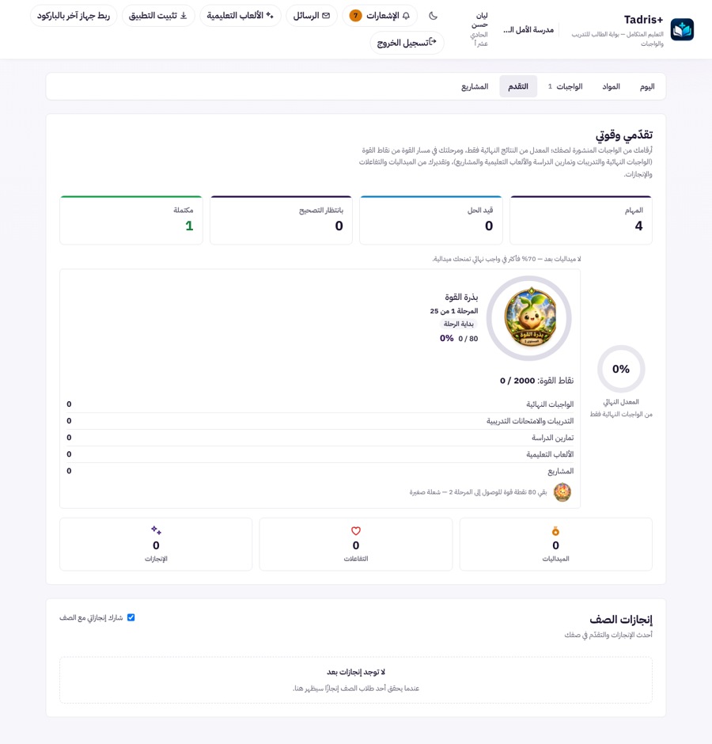
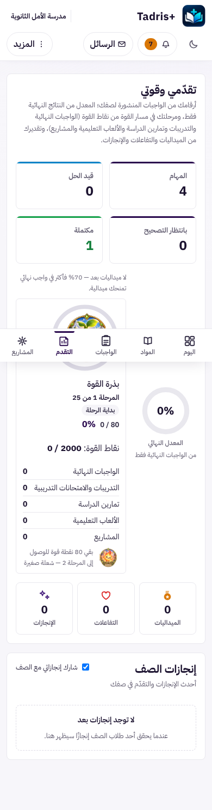
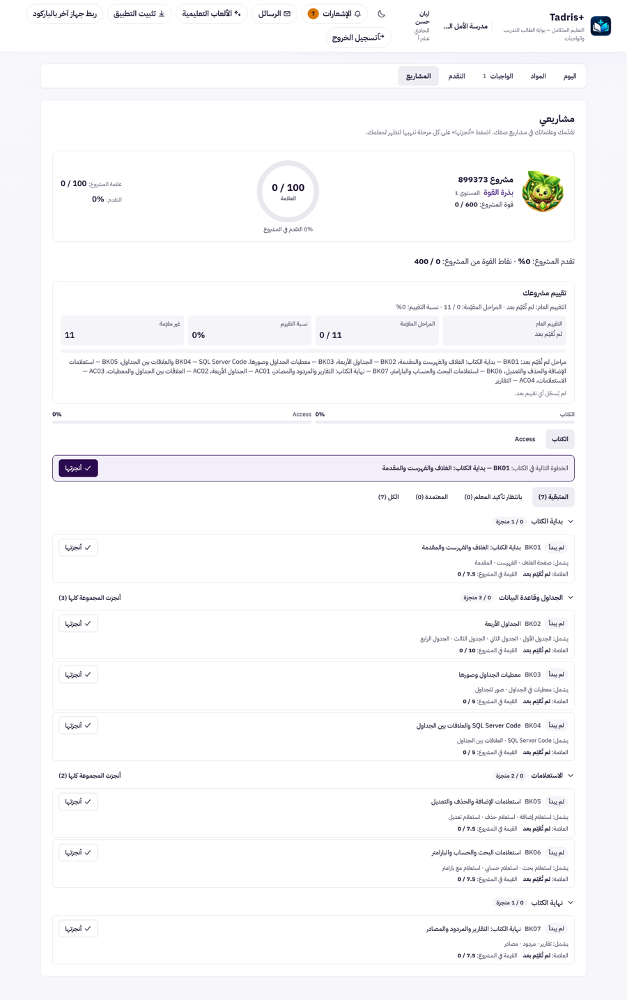

# UX-S4: «التقدم» و«المشاريع» أبسط: رقم رئيسي واحد، وخطوة تالية واضحة، بلا تكرار

> **حالة الوثيقة:** تصميم بانتظار موافقة المالك. لا يبدأ التنفيذ قبل العبارة «أوافق على تصميم UX-S4 ابدأ التنفيذ».
> طلب المالك: «ننفذ تصميم UX-S4» بعد دمج #582 و#583. هذه المرحلة الرابعة من مراحل عرض بوابة الطالب (UX-S1 في #567، وUX-S2 في #568، وUX-S3 في #572).

| البند | القيمة |
|---|---|
| المرحلة | UX-S4 |
| النوع | **عرض فقط:** لا تغيير في الخادم، ولا في حساب نقاط القوة، ولا في علامات المشاريع أو تقييمها، ولا في «أنجزتها» |
| Baseline | `origin/main` = `74e0df2f` (بعد #583) |
| الفرع | `claude/blissful-shannon-9rv461-ux-s4-progress-projects` |
| الصور | قبل: `docs/assets/ux-s4/before-desk-progress.png`، `before-phone-progress.png`، `before-desk-projects.png`. بيانات تجريبية فقط |

## 1. ما رأيناه اليوم (المعاينة المحلية، بيانات تجريبية)

الطالب التجريبي في بداية الفصل: 4 واجبات، واحد مكتمل، ومشروع واحد (899373) بمسارين و11 مرحلة لم يُقيَّم منها شيء.

### 1.1 «التقدم» (`src/student/StudentProgressSection.tsx`)

| # | المشكلة | الأثر |
|---|---|---|
| P1 | **فقرة تعريف من 3 أسطر** تشرح مصادر النقاط والمعدل والتقدير دفعة واحدة | أول ما يقرؤه الطالب شرح تقني، لا حالته |
| P2 | **أربع بطاقات عدّ المهام** (المهام، قيد الحل، بانتظار التصحيح، مكتملة) | تكرار: «اليوم» يعرض «مطلوب الآن» و«بانتظار التصحيح»، و«الواجبات» (UX-S3) يعرض كل مجموعة بعددها. هي عن الواجبات لا عن التقدم |
| P3 | **رقمان للقوة بلا تسمية واضحة:** «0 / 80» و«نقاط القوة: 0 / 2000» | الطالب لا يعرف أيهما يهمّه الآن |
| P4 | **خمسة صفوف أصفار** لمصادر النقاط (الواجبات النهائية، التدريبات، تمارين الدراسة، الألعاب، المشاريع) | في بداية الفصل خمسة أصفار لا تقول ماذا يفعل |
| P5 | **ثلاث بطاقات تقدير بالصفر** (الميداليات، التفاعلات، الإنجازات) | نفس المشكلة |
| P6 | **على الهاتف** المعدل النهائي حلقة صغيرة بجانب بطاقة مسار القوة، والبطاقة مضغوطة في عمود ضيق | النصوص تلتف، والصورة صغيرة |
| P7 | **لا خطوة تالية:** لا شيء في العرض يقول كيف ترتفع النقاط | الطالب يرى الأرقام ولا يعرف ماذا يفعل |

### 1.2 «المشاريع» (`src/projects/StudentProjectPanel.tsx`، `ProjectRankHero.tsx`، `ProjectEvaluationCard.tsx`)

| # | المشكلة | الأثر |
|---|---|---|
| J1 | **التقدم والعلامة يظهران 3 مرات:** في الدائرة («0 / 100 العلامة»، «0% التقدم في المشروع»)، وفي القائمة بجانبها («علامة المشروع 0 / 100»، «التقدم 0%»)، ثم في سطر «تقدم المشروع: 0%» | ازدحام بلا معلومة جديدة |
| J2 | **«قوة» بمعنيين متقاربين:** «قوة المشروع: 0 / 600» (رتبتك داخل المشروع) و«نقاط القوة من المشروع: 0 / 400» (ما يضيفه المشروع لقوتك العامة) | يبدوان رقمين متناقضين للشيء نفسه |
| J3 | **بطاقة التقييم:** أربع خانات، ثم فقرة طويلة تسرد كل المراحل غير المقيّمة برموزها («BK01 — …، BK02 — …، … AC04 — …») | تكرار لما تقوله كل بطاقة مرحلة («لم تُقيّم بعد»)، ونص طويل على الهاتف |
| J4 | **شريطا تقدم للمسارين، ثم أزرار المسارين** تحتهما | عنصران لنفس الاختيار |
| J5 | **الرموز الداخلية في النص:** «الخطوة التالية في الكتاب: **BK01** — بداية الكتاب…»، وكل بطاقة تبدأ بالرمز | الرمز يتقدّم على اسم المرحلة الذي يفهمه الطالب |
| J6 | **سطر العلامة في كل مرحلة:** «العلامة: لم تُقيّم بعد · القيمة في المشروع: 0 / 7.5» | «0 / 7.5» قبل التقييم يُقرأ كأنه علامة صفر |
| J7 | **الطول:** العرض 2042 بكسل على الحاسوب و2879 على الهاتف، والخطوة التالية تأتي بعد الرأس والتقييم والمسارات | «أنجزتها» للخطوة التالية تحت الطيّة على الهاتف (نحو 1270 بكسل من الأعلى) |

**ملاحظة على العنوان «مشروع 899373»:** هذا اسم المشروع الرسمي من سجل المشاريع في الخادم (`api/src/lib/project-tracker/registry.js`)، وليس رمزًا داخليًا يُخفى. تغيير الأسماء قرار محتوى خارج هذه المرحلة.

## 2. التصميم

القاعدة: **كل رقم يظهر مرة واحدة باسم واضح، وكل عرض يبدأ بحالة الطالب وينتهي بخطوته التالية.** كل القيم كما يرسلها الخادم، ولا يُحسب شيء جديد في الواجهة.

### 2.1 «التقدم»

**الترتيب الجديد من الأعلى:**

1. **العنوان وسطر واحد:** «تقدّمي وقوتي» — «مرحلتك في مسار القوة، ومعدّلك من النتائج النهائية، وتقديرك.» (يحل محل الفقرة، P1).
2. **بطاقة رئيسية واحدة لمسار القوة** (P3، P6):
   - صورة المرحلة داخل الحلقة كما هي اليوم، واسمها، و«المرحلة 1 من 25».
   - رقم واحد بارز بتسمية صريحة: **«إلى المرحلة التالية: بقي 80 نقطة»** (النص نفسه موجود اليوم في `remainingText` من `stagePresentationFromStrength`، المبني على قيم الخادم).
   - سطر ثانوي: «مجموع نقاطك: 0 من 2000».
   - على الهاتف: الحلقة فوق النص في عمود واحد بعرض البطاقة كاملًا.
3. **بطاقتان صغيرتان متجاورتان:**
   - «معدّلي النهائي» (الحلقة الحالية، «من النتائج النهائية فقط»)؛
   - «الميداليات» (العدد حسب النوع، أو «70% فأكثر في واجب نهائي تمنحك ميدالية»).
4. **«من أين جاءت نقاطك؟»** قائمة قابلة للطيّ (`
`) (P4):
   - تُفتح تلقائيًا إن كان للطالب نقاط، وتعرض **المصادر غير الصفرية أولًا**؛
   - إن كان المجموع صفرًا تبقى مطوية، ويظهر بدلها سطر الخطوة التالية (البند 6).
5. **التقدير** (P5): إن كانت التفاعلات والإنجازات صفرًا معًا يظهر سطر واحد «لا تفاعلات ولا إنجازات بعد». وإلا تظهر البطاقات الثلاث كما اليوم.
6. **الخطوة التالية** (P7): زر واحد «افتح الواجبات» إن كان عند الطالب واجب مطلوب الآن (نفس عدد «مطلوب الآن» في «اليوم»)، وإلا «تابع القراءة في المواد». يفتح العرض المطلوب بنفس رابط UX-S2.
7. **تُحذف بطاقات عدّ المهام الأربع** (P2). الأرقام نفسها تبقى في «اليوم» و«الواجبات».
8. «إنجازات الصف» تحت العرض كما هي، بلا تغيير.

### 2.2 «المشاريع» (عرض المشروع الواحد)

1. **رأس المشروع** (J1، J2):
   - الصورة والعنوان والرتبة كما اليوم؛
   - دائرة العلامة والتقدم كما اليوم؛
   - **تُحذف القائمة المكررة** «علامة المشروع / التقدم» بجانب الدائرة في عرض الطالب فقط (المعلم في `ProjectStudentDetail` يبقى كما هو)؛
   - تسميتان صريحتان بدل «قوة»:
     - «رتبتك في المشروع: بذرة القوة · 0 من 600»؛
     - «يضيف إلى قوتك العامة: 0 من 400» (يحل محل سطر «تقدم المشروع: 0% · نقاط القوة من المشروع»، فيُحذف تكرار التقدم).
2. **الخطوة التالية أولًا** (J7): بطاقة «الخطوة التالية» مع «أنجزتها» تنتقل إلى ما بعد الرأس مباشرة، قبل التقييم والمسارات، فتظهر على الشاشة الأولى في الهاتف.
3. **التقييم في سطر واحد** (J3): «قيّم المعلم 0 من 11 مرحلة» و«معدّل التقييم: —» (أو النسبة إن وُجدت). **تُحذف قائمة المراحل غير المقيّمة**؛ كل بطاقة مرحلة تقولها بنفسها. في عرض المعلم تبقى البطاقة كاملة.
4. **المسارات في عنصر واحد** (J4): زر لكل مسار يحمل اسمه ونسبته («الكتاب · 0%»، «Access · 0%»)، وتُحذف الأشرطة المنفصلة. بمسار واحد يبقى شريط واحد بلا أزرار.
5. **الاسم قبل الرمز** (J5):
   - «الخطوة التالية في الكتاب: بداية الكتاب: الغلاف والفهرست والمقدمة» بلا رمز؛
   - في بطاقة المرحلة يأتي الاسم أولًا، والرمز بعده بخط صغير باهت (يبقى للمعلم والطالب حين يتحدثان عن مرحلة بعينها)؛
   - أسماء الأزرار للقارئ الصوتي («أنجزت …») تبقى بالرمز والاسم.
6. **سطر العلامة** (J6):
   - قبل التقييم: «قيمتها في المشروع: 7.5» (بلا «0 /»)؛
   - بعد التقييم: «العلامة: X · تضيف Y من 7.5» من قيم الخادم كما هي.
7. فلاتر المراحل («المتبقية» …) والطيّ و«أنجزت المجموعة كلها» و«تراجع» **بلا تغيير**.

### 2.3 بطاقات المشاريع (أكثر من مشروع)

نفس التسميتين الصريحتين («رتبتك في المشروع»، «يضيف إلى قوتك العامة»). لا تغيير آخر.

### 2.4 الوصول والاتجاه

- كل قائمة مطوية `
/
` حقيقية، تعمل بلوحة المفاتيح ويقرؤها القارئ الصوتي.
- لا يتغير أي `role="progressbar"` أو قيمه.
- أهداف اللمس 44 بكسل على الأقل (أزرار المسارات والخطوة التالية).
- الأرقام داخل `dir="ltr"` كما اليوم؛ النص عربي RTL.

## 3. ما لا يتغير

- **الخادم:** لا مسار جديد، ولا حقل جديد، ولا تغيير في `student-strength.js` أو في أداء المشاريع أو التقييم.
- **الحساب:** 25 مرحلة × 80 نقطة، و400 حدّ مساهمة المشروع، و600 حدّ رتبة المشروع: كلها كما يرسلها الخادم.
- **«أنجزتها» و«تراجع» وتأكيد المعلم:** نفس الطلب، ونفس الرسائل، ونفس القراءة للقراءة فقط في الصف المؤرشف.
- **عرض المعلم** للطالب (`ProjectStudentDetail`) وبطاقة التقييم الكاملة فيه.
- «اليوم» و«المواد» و«الواجبات».

## 4. الأداء

لا قراءة جديدة. يُحذف عنصران من الشجرة (بطاقات عدّ المهام، قائمة المراحل غير المقيّمة)، ويُتوقع أن يقصر عرض «المشاريع» على الهاتف بنحو 400 بكسل قبل قائمة المراحل. حزمة الواجهة لا تزيد إلا ببضعة أسطر (حارس الحجم يتحقق).

## 5. الاختبارات

- **اختبار جديد** `src/student/progress.ux-s4.test.tsx`:
  - لا بطاقات عدّ مهام في «التقدم»؛
  - «إلى المرحلة التالية: بقي N نقطة» و«مجموع نقاطك» من قيم الخادم؛
  - «من أين جاءت نقاطك؟» مطوية عند الصفر ومفتوحة مع النقاط، والمصادر غير الصفرية أولًا؛
  - سطر «لا تفاعلات ولا إنجازات بعد» عند الصفر، والبطاقات الثلاث عند وجود قيم؛
  - الخطوة التالية تفتح «الواجبات» أو «المواد».
- **اختبار جديد** `src/projects/studentProject.ux-s4.test.tsx`:
  - العلامة والتقدم مرة واحدة في رأس المشروع (الطالب)، والقائمة باقية في عرض المعلم؛
  - التسميتان «رتبتك في المشروع» و«يضيف إلى قوتك العامة»؛
  - الخطوة التالية قبل التقييم في ترتيب الشجرة، وبلا رمز؛
  - التقييم سطر واحد بلا قائمة المراحل غير المقيّمة (الطالب فقط)؛
  - أزرار المسارات تحمل النسبة، ولا أشرطة منفصلة؛
  - «قيمتها في المشروع: 7.5» قبل التقييم، و«العلامة … تضيف …» بعده.
- **اختبارات قائمة تتغير:** كل اختبار يقرأ النصوص المحذوفة أو المعاد تسميتها يُحدَّث ليقرأ النص الجديد، ويُذكر كل واحد منها في §7 مع السبب. لا يُخفَّف أي اختبار.
- **فحوص المتصفح الحقيقي:** سكربتات المشاريع التسعة وL.8 و P9-B1 كما هي؛ أي تغيير في محدِّداتها يُذكر.
- **البوابة البصرية UX-R19b:** «التقدم» و«المشاريع» يتغيّران عمدًا، ويُعلَنان في `docs/ux-r/visual-changes.json`.
- **الطفرات** (`scripts/mutate-uxs4.mjs`): إعادة بطاقات العدّ، عكس شرط الطيّ، إعادة قائمة غير المقيّمة للطالب، إعادة الرمز في الخطوة التالية، «0 /» قبل التقييم، الخطوة التالية بعد التقييم. المتوقع: كلها KILLED.
- **التحقق الكامل:** `npm test`، `npm run lint` (140)، `npx tsc -b`، `npm run build`، `git diff --check`.

## 6. خارج النطاق

- تغيير أسماء المشاريع أو رموز المراحل في السجل (قرار محتوى).
- أي تغيير في كيفية كسب نقاط القوة أو حدودها (قرار المالك، ليس عرضًا).
- **UX-S5:** حل الامتحان على الهاتف، والوضع الداكن التلقائي، والإشعارات.

## 7. أسئلة للمالك قبل التنفيذ

1. **بطاقات عدّ المهام الأربع في «التقدم»:** التوصية حذفها لأنها مكررة في «اليوم» و«الواجبات». إن أردت إبقاءها، تبقى سطرًا واحدًا صغيرًا بدل أربع بطاقات.
2. **رموز المراحل (BK01، AC01):** التوصية إظهار الاسم أولًا والرمز صغيرًا بعده. إن كان الطلاب لا يستعملون الرموز إطلاقًا، يمكن إخفاؤها من العرض كليًا (تبقى للقارئ الصوتي وللمعلم).
